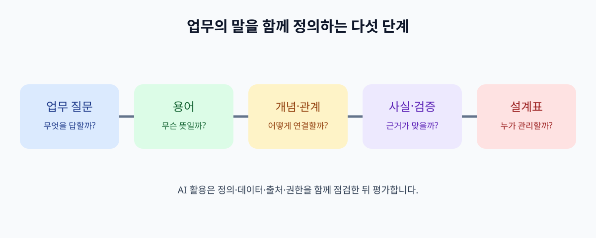

# 들어가며: AI에게 우리 회사의 말을 가르친다는 것

고객이 “반품이 언제 끝나나요?”라고 묻습니다. 상담팀은 *반품*을 고객이 상품을 돌려보내는 전체 과정으로 부릅니다. 물류팀은 창고에 상품이 도착한 상태만 *반품 완료*라고 기록합니다. 회계팀은 환불이 끝나야 일이 끝났다고 말합니다. 세 팀의 기록을 모은 AI에게 “이 반품은 끝났나요?”라고 질문하면 무엇을 답해야 할까요?

이 책은 그 질문에서 시작합니다. AI에 문서를 더 많이 넣기 전에, 회사 안에서 사용하는 말의 뜻과 관계를 먼저 정해야 합니다. 이를 위한 도구 가운데 하나가 **온톨로지**입니다. 온톨로지는 업무에서 중요한 대상의 종류, 그 사이의 관계, 사용할 때 지켜야 할 뜻을 명시한 모델입니다. [W3C의 OWL 입문서](https://www.w3.org/TR/owl-primer/)는 이를 클래스(대상의 종류), 속성(관계), 개별 대상 등을 이용해 표현합니다.

*그림: 이 책의 학습 경로를 저자가 제작한 개념도입니다. 특정 제품 화면이나 표준 도식은 아닙니다.*

## 이 책이 답하려는 질문

| 독자의 질문 | 책에서 찾을 답 |
| --- | --- |
| 부서마다 같은 말을 다르게 쓰면 어떻게 하나요? | 용어의 뜻과 사용 범위를 함께 기록합니다. |
| 고객과 주문은 어떻게 연결하나요? | 대상의 종류와 관계의 방향을 정합니다. |
| 서로 다른 시스템의 주문이 같은 주문인지 어떻게 알 수 있나요? | 식별자와 동일성 판단 근거를 분리합니다. |
| 데이터가 잘못 연결되었는지 어떻게 확인하나요? | 검증 조건과 사람의 사실 확인을 나눕니다. |
| AI가 이 지도를 사용하면 답이 정확해지나요? | 검색·추론·출처·권한을 각각 평가합니다. |

표의 질문은 순서대로 이어집니다. 용어부터 흐릿하면 같은 주문을 찾아도 서로 다른 상태를 비교하게 됩니다. 관계를 그렸더라도 원본의 상태가 오래되었다면 AI의 답은 틀릴 수 있습니다. 온톨로지는 좋은 질문과 검증을 가능하게 하는 설계도이지, 실제 데이터의 진실성을 자동으로 보증하는 장치는 아닙니다.

## 한 가지 사례를 끝까지 사용합니다

이 책의 예시 회사 **다온상점**은 가상의 온라인 판매 회사입니다. 고객 `C-204`, 주문 `O-391`, 배송 `S-88`, 반품 요청 `R-17`은 모두 설명용 가상 식별자입니다. 독자는 이 네 대상의 뜻을 구분하는 데서 시작해, `고객이 주문을 생성했다`, `주문에 배송이 연결된다`, `반품 요청이 주문의 일부 상품을 가리킨다`와 같은 관계를 설계합니다.

마지막 실습에서는 한 장의 설계표를 만듭니다. 개발 도구를 설치할 필요는 없습니다. 종이, 문서, 스프레드시트 가운데 익숙한 것을 선택하면 됩니다. 이후 실제 시스템에 옮길 때는 데이터 담당자와 보안 담당자의 검토가 필요합니다.

## 이 책에서 용어를 쓰는 방식

| 용어 | 이 책의 쉬운 뜻 | 독자가 먼저 할 일 |
| --- | --- | --- |
| 용어집 | 말의 뜻을 적은 목록 | “완료”가 무엇을 뜻하는지 확인 |
| 분류표 | 종류를 위아래로 묶은 구조 | 배송 지연의 하위 종류 구분 |
| 온톨로지 | 종류·관계·뜻을 명시한 모델 | 주문과 배송의 관계 정의 |
| 지식 그래프 | 구체적인 대상과 사실을 연결한 데이터 | 실제 주문 `O-391`의 배송 연결 |
| 검증 규칙 | 정한 조건과 데이터가 맞는지 점검하는 기준 | 주문번호 누락 여부 확인 |

이들은 서로 바꿔 부를 이름이 아닙니다. 하나의 회사는 용어집을 정리한 뒤 온톨로지를 만들고, 그 모델을 이용해 지식 그래프를 구축할 수 있습니다. 필요하다면 [SKOS](https://www.w3.org/TR/skos-reference/) 같은 표준으로 용어 체계를 표현하고, [SHACL](https://www.w3.org/TR/shacl/)로 그래프의 정해진 조건을 검사합니다. 독자는 처음부터 모든 표준을 구현할 필요가 없습니다. 먼저 업무에서 모호한 말을 찾아 뜻을 합의해야 합니다.

## 읽는 방법과 기대할 수 있는 결과

1~5장은 무엇을 모델링할지 정합니다. 6~10장은 이름, 식별자, 사실의 연결, 추론, 검증을 다룹니다. 11~15장은 출처와 시간, 검색, AI 에이전트, 운영 책임으로 이어집니다. 16장은 앞에서 만든 메모를 한 장의 설계표로 합칩니다.

각 장에서 “따라 해 보기”를 하나씩 수행해 보세요. 실제 회사 자료를 쓰기 어렵다면 책의 다온상점 사례를 그대로 사용해도 됩니다. 조직에서 쓸 모델은 실제 업무 담당자의 확인을 받아야 합니다. 특히 개인정보 접근 권한과 환불 승인 정책은 용어의 관계만으로 결정할 수 없습니다.

이 책을 다 읽은 뒤 목표는 “온톨로지를 안다”고 말하는 것이 아닙니다. 동료에게 **무엇을 같은 대상으로 볼지, 어떤 관계가 어떤 근거에서 나왔는지, 틀린 데이터를 어떻게 발견할지** 설명할 수 있는 상태입니다.

## 출처와 기준일

이 원고의 기준일은 **2026년 11월 4일**입니다. 기본 개념은 W3C 권고안을 우선합니다. [RDF 1.2](https://www.w3.org/TR/rdf12-concepts/)는 이 날짜에 후보 권고안 스냅샷이고, [SHACL 1.2 Core](https://www.w3.org/TR/shacl-core/)는 작업 초안입니다. 책의 기본 실습은 확정된 RDF 1.1과 SHACL 권고안의 개념을 사용합니다. 상세 확인 기록은 [출처 장부](../docs/SOURCE_LEDGER.md)에 남깁니다.

- [W3C OWL 2 입문서](https://www.w3.org/TR/owl-primer/)
- [W3C RDF 1.1 개념](https://www.w3.org/TR/rdf11-concepts/)
- [W3C SKOS](https://www.w3.org/TR/skos-reference/)
- [W3C SHACL](https://www.w3.org/TR/shacl/)
