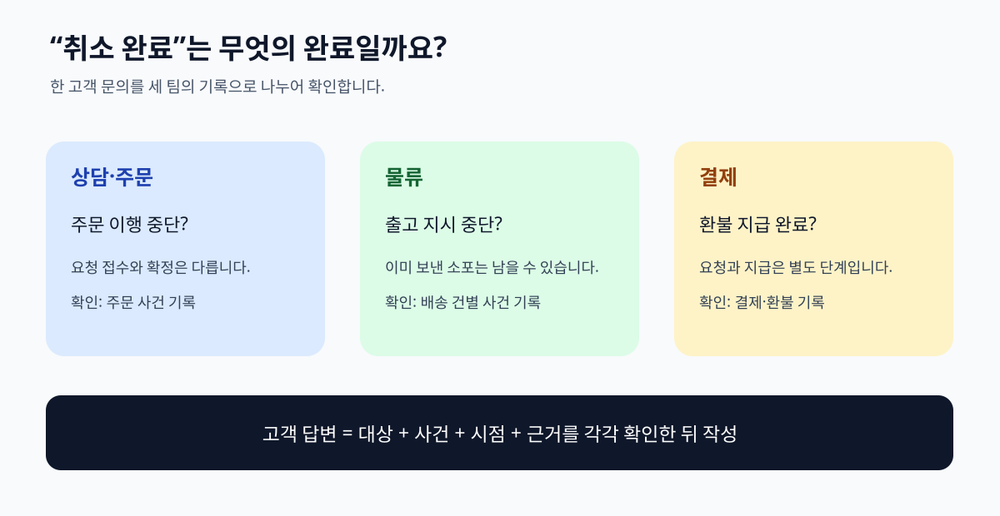

# 01. 같은 말을 다르게 쓰는 조직

> **이 장의 한 문장:** 온톨로지 작업은 멋진 그림을 그리는 일이 아니라, 서로 다른 팀이 같은 대상을 같은 뜻으로 다루도록 업무의 약속을 명시하는 일입니다.

가상의 쇼핑몰 ‘다온상점’ 고객센터에 고객 `C-204`가 “주문 `O-391`이 취소됐는데 택배가 왔어요”라는 문의를 남겼습니다. 상담 화면에는 **취소 완료**, 물류 화면에는 배송 건 `S-88`의 **출고 완료**, 결제 화면에는 **환불 대기**가 표시됩니다. 상담사는 취소가 무엇을 뜻하는지 먼저 확인해야 합니다. 주문을 더 처리하지 말라는 뜻일까요, 창고 작업을 멈췄다는 뜻일까요, 고객에게 돈이 돌아갔다는 뜻일까요? 세 화면의 단어는 모두 비슷하지만 다루는 대상과 사건이 다릅니다.

이런 혼란은 시스템이 나빠서만 생기지 않습니다. 서로 다른 팀이 자기 업무에 맞는 약어와 상태를 만든 뒤, 그 뜻을 문서로 합의하지 않았기 때문입니다. 사람이 전화로 묻고 답할 때는 맥락으로 메울 수 있지만, 여러 시스템을 읽는 AI에게는 그 틈이 그대로 판단 오류가 됩니다. AI가 ‘취소 완료’라는 한 문장만 보고 환불까지 끝났다고 답하면 고객에게 잘못된 약속을 하게 됩니다. 이 책의 예시 회사·고객·주문번호는 모두 설명을 위한 가상 사례입니다.

*그림 1-1. 상담·물류·결제의 서로 다른 ‘취소’ 의미를 분리한 자체 제작 개념도입니다.*

## 1.1 같은 단어가 같은 사실은 아닙니다

문제를 발견하려면 화면의 글자보다 그 글자가 가리키는 **대상, 사건, 시점**을 봐야 합니다. “주문 취소”는 요청일 수도 있고, 확정된 상태일 수도 있습니다. “배송 완료”는 택배사의 전달 스캔일 수도 있고 고객의 수령 확인일 수도 있습니다. 둘을 같은 뜻으로 합치면 조회 결과가 틀어집니다.

| 화면에 보이는 말 | 실제로 물어야 할 질문 | 가능한 의미 |
| --- | --- | --- |
| 취소 완료 | 무엇이 취소됐습니까? | 주문 이행 중단, 출고 지시 취소, 결제 승인 취소 |
| 배송 완료 | 누가 어떤 행위를 확인했습니까? | 택배사 배송 처리, 고객 수령 확인 |
| 환불 완료 | 어떤 돈의 이동을 뜻합니까? | 환불 요청 접수, 지급 지시, 고객 계좌 반영 |
| 반품 접수 | 물건이 어디 있습니까? | 고객 신청, 수거 예약, 창고 입고 |

표의 오른쪽 칸은 정답 목록이 아닙니다. 각 조직이 실제 화면과 운영 규칙을 조사해 채워야 할 질문 목록입니다. 같은 용어라도 서비스에 따라 단계가 다르고, 한 화면 안에서도 날짜에 따라 정의가 바뀔 수 있습니다. 따라서 첫 작업은 “우리 회사에서 이 말은 무엇을 뜻하는가”를 담당자와 함께 기록하는 것입니다.

용어의 차이를 적는 것만으로 끝나지 않습니다. 예를 들어 ‘주문’과 ‘배송’을 한 항목처럼 취급하면 한 주문에 여러 묶음 배송이 생기는 경우를 설명할 수 없습니다. 반대로 택배사가 반송한 소포와 고객이 신청한 반품을 하나의 ‘반품’으로 묶으면 신청 주체와 처리 책임이 사라집니다. 앞으로 이 책은 이 대상을 분리하고, 그들 사이의 관계를 한 장씩 더해 갑니다.

## 1.2 무엇이 잘못될 수 있습니까?

| 업무 질문 | 용어를 섞었을 때 답 | 구분해서 확인한 답 |
| --- | --- | --- |
| 고객은 환불을 받았습니까? | “취소 완료이므로 받았습니다” | 주문 취소 기록과 결제 환불 완료 기록을 각각 확인 |
| 물건은 다시 배송될 수 있습니까? | “배송 완료이므로 끝났습니다” | 배송 건별 현재 상태와 재배송 지시 유무 확인 |
| 반품 처리 기간은 언제부터 셉니까? | “반품 접수일입니다” | 신청일·수거일·입고일 중 정책의 기준일 확인 |

두 번째 열의 문장은 실제 상담 답변으로 사용하면 안 됩니다. 세 번째 열처럼 **확인해야 할 근거**를 드러내야 합니다. AI를 쓴다면 질문을 곧바로 답변으로 바꾸기 전에 관련 기록을 찾아야 합니다. 다만 기록이 있어도 그것이 최신인지, 고객에게 공개해도 되는지는 별도로 검토해야 합니다. 온톨로지는 대상을 설명하는 약속이며, 권한 정책이나 사실 확인 절차를 대신하지 않습니다.

## 1.3 온톨로지가 해결하려는 부분

이 책에서 온톨로지는 **업무 영역에 등장하는 대상의 종류와 관계, 그리고 그 말의 뜻을 명시한 모델**입니다. ‘주문’이 무엇인지, ‘배송 건’은 주문과 어떤 관계인지, ‘환불’은 주문 취소와 같은 사건인지 다른 사건인지를 합의해 적습니다. 컴퓨터가 읽을 수 있게 표현할 수도 있지만, 종이 표에서 시작해도 좋습니다. 2장에서는 표·분류표·데이터베이스와의 차이를 더 정확히 살펴봅니다.

W3C의 [OWL 2 입문서](https://www.w3.org/TR/owl-primer/)는 이런 모델을 클래스, 속성, 개별 대상과 데이터 값으로 설명합니다. 여기서 우리는 아직 문법을 외우지 않습니다. **고객 문의 한 건에 대해 어떤 대상을 구분해야 하는가**를 먼저 익힙니다. 뒤의 장에서 같은 약속을 더 명확하게 표현하는 방법을 배웁니다.

그렇다고 모든 팀의 용어를 한꺼번에 하나로 통일할 필요는 없습니다. 물류팀의 ‘출고 취소’와 결제팀의 ‘승인 취소’는 실제로 다른 일을 뜻할 수 있습니다. 올바른 모델은 두 단어를 억지로 합치지 않고, 각각의 정의와 연결 관계를 보여 줍니다. “주문 취소 요청이 접수되면 출고 취소를 요청할 수 있다”는 업무 절차와 “출고 취소가 실제 완료됐다”는 사실도 구별해야 합니다.

## 1.4 따라 해 보기: 세 화면의 말 모으기

업무에서 자주 받는 문의 하나를 고르세요. 가상 사례에서는 “취소한 주문의 택배가 도착했습니다”를 씁니다. 상담·물류·결제 화면 또는 담당자가 쓰는 단어를 세 개씩 모은 뒤, 아래와 같은 **용어 충돌 카드**를 만듭니다. 개인정보나 실제 주문번호는 넣지 마세요.

| 항목 | 적을 내용 | 가상 사례 |
| --- | --- | --- |
| 화면의 표현 | 직원이 실제로 보는 문구 | 취소 완료 |
| 이 말의 대상 | 무엇의 상태인가 | 주문 이행 |
| 담당 팀 | 뜻을 확인할 주체 | 주문 운영팀 |
| 발생 시점 | 언제부터 참인가 | 취소 확정 시각 |
| 다른 말과의 차이 | 헷갈리는 표현 | 환불 완료와 다름 |
| 확인 근거 | 어떤 기록으로 검증하는가 | 주문 이벤트 기록 |

카드는 한 줄씩 따로 만들어야 합니다. ‘취소 완료’와 ‘환불 완료’를 같은 줄에 넣으면 차이를 찾기 어렵습니다. 각 표현을 쓴 담당자에게 “이 문구만으로 고객에게 어떤 말을 할 수 있나요?”라고 물어 보세요. 답이 갈리면 오류가 아니라 좋은 발견입니다. 그 차이를 모델의 입력으로 남기면 됩니다. 아직 누가 옳은지 결정하지 못했다면 **미합의**로 표시하고, 한 사람이 임의로 뜻을 확정하지 않습니다.

완성된 카드는 업무 회의에서 바로 쓸 수 있습니다. 회의의 목표는 사전처럼 멋진 정의를 쓰는 일이 아닙니다. **한 문의에 대해 세 팀이 어떤 기록을 확인해야 동일한 답을 할 수 있는지** 정하는 것입니다. 정의가 바뀌면 언제부터 바뀌는지도 적어 두세요. 이전 주문에 새 정의를 그대로 적용하면 과거 상담 기록을 잘못 해석할 수 있습니다.

## 1.5 흔한 실패와 수정

가장 흔한 실패는 화면의 상태 값을 그대로 ‘세상의 사실’로 취급하는 것입니다. 한 시스템은 취소 요청을 받자마자 `완료`라고 표시하고, 다른 시스템은 실제 처리 뒤에 같은 단어를 표시할 수 있습니다. 이때는 상태 이름 옆에 **무엇의 완료인지**와 **완료를 기록한 주체**를 붙이세요. “주문 이행 중단 완료”와 “결제 환불 완료”는 별도의 사실입니다.

두 번째 실패는 모든 예외를 처음부터 정리하려는 것입니다. 고객지원에는 부분 취소, 묶음 배송, 교환, 선물 주문처럼 경우의 수가 많습니다. 첫 모델은 대표 질문 하나를 정확히 답하는 데 필요한 대상을 잡고, 그 질문을 깨뜨리는 예외부터 추가하세요. 범위를 제한해야 담당자가 정의를 검토할 수 있습니다.

세 번째 실패는 ‘서로 다른 말’을 무조건 동의어로 만드는 것입니다. 반품 신청과 반품 승인은 이어질 수 있어도 같은 사건이 아닙니다. 직원에게 “두 표현이 같은 시각에 참이 되는가?” “하나만 참일 수 있는가?”라고 물으면 구분이 쉬워집니다. 하나만 참일 수 있다면 별도 상태나 사건으로 남겨야 합니다.

## 1.6 이번 장 점검표

- [ ] 한 고객 문의를 고르고 관련 팀을 확인했습니까?
- [ ] 같은 단어가 가리키는 대상과 사건을 구분했습니까?
- [ ] 완료·접수·요청의 시점을 따로 적었습니까?
- [ ] 화면의 표시와 실제 처리 기록을 구별했습니까?
- [ ] 미합의 뜻을 임의로 통일하지 않고 담당자를 표시했습니까?

**장 요약.** 온톨로지가 필요한 첫 징후는 용어의 양이 아니라 **같은 질문에 다른 뜻으로 답하는 상황**입니다. 서로 다른 말을 억지로 합치기보다, 각 말이 가리키는 대상·행동·시점·근거를 먼저 적습니다. 이 작은 용어 충돌 카드가 다음 장에서 만들 모델의 출발점입니다.

### 공식 출처

- [W3C OWL 2 Web Ontology Language Primer](https://www.w3.org/TR/owl-primer/) — 클래스·속성·개별 대상을 표현하는 온톨로지의 기본 요소를 확인했습니다.
- [W3C RDF Schema 1.1](https://www.w3.org/TR/rdf-schema/) — 개념의 종류와 관계를 표현하는 어휘의 역할을 확인했습니다.
