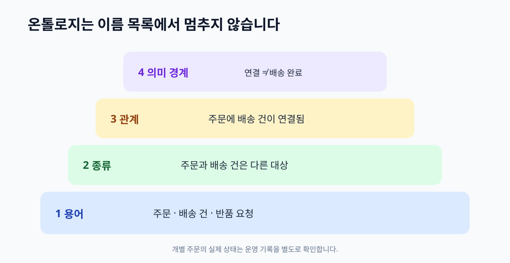

# 02. 온톨로지는 무엇인가

> **이 장의 한 문장:** 온톨로지는 한 업무 영역에서 무엇을 어떤 종류의 대상으로 보고, 그 대상들이 어떻게 연결되는지 명시한 공유 모델입니다.

1장에서 만든 용어 충돌 카드를 회의실 벽에 붙였다고 해 봅시다. ‘주문’, ‘배송 건’, ‘환불’, ‘반품 신청’이라는 카드가 나란히 있습니다. 상담팀은 주문 취소가 환불 완료를 뜻한다고 생각했고, 결제팀은 환불이 별도 처리라고 말합니다. 이때 필요한 것은 카드를 더 늘리는 일이 아니라 **카드 사이의 관계를 합의하는 일**입니다. 주문에는 배송 건이 연결되고, 주문 취소 뒤에 환불이 생길 수 있지만 반드시 동시에 끝나는 것은 아닙니다. 그 약속을 사람이 읽고 시스템도 활용할 수 있게 만들면 온톨로지의 중심부가 됩니다.

*그림 2-1. 용어·대상 종류·관계·의미 규칙을 차례로 더한 자체 제작 개념도입니다.*

## 2.1 먼저 한 문장으로 이해하기

**온톨로지(ontology)**는 특정 업무 영역에 등장하는 대상의 종류, 그들 사이의 관계, 해석 규칙을 명시한 모델입니다. 예를 들어 ‘배송 건은 주문과 연결된다’, ‘반품 신청은 고객이 요청한 처리 건이다’, ‘환불은 결제와 관련된 별도 사건이다’처럼 뜻을 적습니다. W3C의 [OWL 2 입문서](https://www.w3.org/TR/owl-primer/)는 온톨로지를 클래스, 속성, 개별 대상, 데이터 값으로 설명합니다. 이 책은 그 표준을 이해할 발판으로 업무 그림과 표부터 시작합니다.

온톨로지를 ‘모든 것을 알고 있는 지식’으로 생각하면 실망하기 쉽습니다. 모델은 무엇을 뜻하는지 알려 줄 뿐, 주문 `O-391`이 오늘 정말 배송되었는지는 배송 기록이 말해 줍니다. 주문의 ‘배송 건’ 관계를 정의해도 실제 데이터에 잘못된 번호가 들어오면 결과는 틀립니다. 온톨로지는 현실을 자동으로 관찰하지 않고, 사용자가 볼 권한까지 결정하지도 않습니다.

| 구성 요소 | 쉬운 풀이 | 가상 고객지원 예 |
| --- | --- | --- |
| 대상 종류(클래스) | 같은 기준으로 묶이는 것 | 주문, 배송 건, 환불 건 |
| 관계(속성) | 대상과 대상을 잇는 의미 | 주문에는 배송 건이 연결됨 |
| 개별 대상 | 실제로 구분할 한 건 | 주문 `O-391`, 배송 `S-88` |
| 데이터 값 | 대상에 붙는 날짜·금액 등 | 주문일, 환불 금액 |
| 의미 규칙 | 관계를 읽고 이해하는 약속 | ‘배송 건이 연결됨’이 ‘배송 완료’를 뜻하지 않음 |

한 개별 대상은 여러 설명을 가질 수 있습니다. 주문 `O-391`에는 주문일도 있고 두 배송 건이 연결될 수도 있습니다. 중요한 것은 표의 각 칸에 예시를 넣을 때 **종류와 실제 기록**을 구별하는 것입니다. ‘주문’은 종류이고 `O-391`은 그 종류에 속한 개별 대상입니다. “주문에는 배송이 있다”는 모델의 일반 설명이며 “O-391에는 S-88이 연결된다”는 특정 사실입니다.

## 2.2 비슷한 도구와 어떻게 다릅니까?

| 형태 | 주로 담는 것 | 장점 | 이 책의 질문에서 부족한 점 |
| --- | --- | --- | --- |
| 용어집 | 말과 정의 | 새 직원이 표현을 배움 | 대상 간 관계를 찾기 어려움 |
| 분류표 | 상위·하위 범주 | 문의 유형을 정리하기 좋음 | 주문과 배송처럼 다른 종류 사이의 관계가 약함 |
| 데이터베이스 설계 | 저장 구조·필드·키 | 운영 데이터의 기록과 조회에 유리 | 필드 이름만으로 업무 의미가 명확하지 않을 수 있음 |
| 온톨로지 | 종류·관계·의미 규칙 | 여러 자료의 뜻을 맞추고 해석에 도움 | 실제 데이터를 수집·보정하는 작업은 별도로 필요 |
| 지식 그래프 | 연결된 사실과 질의 가능한 구조 | 개별 주문과 배송의 연결을 탐색 | 어떤 관계가 무엇을 뜻하는지 모델과 운영 규칙이 필요 |

이 표는 경쟁 제품 비교가 아닙니다. 실제 현장에서는 함께 씁니다. 용어집의 정의를 온톨로지의 설명으로 삼고, 데이터베이스의 주문·배송 기록을 지식 그래프의 사실로 연결할 수 있습니다. 분류표도 온톨로지의 일부가 될 수 있습니다. W3C의 [SKOS](https://www.w3.org/TR/skos-reference/)는 용어와 개념 체계를 공유하는 가벼운 방법을 제공하고, [OWL](https://www.w3.org/TR/owl-primer/)은 더 풍부한 관계와 의미를 표현합니다. 6장에서 두 접근의 쓰임을 다시 비교합니다.

“엑셀 표를 쓰면 온톨로지가 아닌가요?”라는 질문도 자주 나옵니다. 표 형식이 결정 기준은 아닙니다. 표에 ‘주문’, ‘배송 건’이라는 이름만 있으면 용어 목록에 가깝습니다. 각 대상의 뜻, 구분 기준, 관계의 방향, 예외를 적고 팀이 함께 사용한다면 작은 온톨로지 설계의 출발점입니다. 컴퓨터가 자동으로 해석하고 교환하려면 나중에 RDF·OWL 같은 표현을 선택할 수 있습니다. 당장은 뜻을 정확히 쓰는 편이 더 중요합니다.

## 2.3 다온상점의 첫 모델

가상의 다온상점은 고객 `C-204`의 주문 `O-391`과 배송 건 `S-88`을 함께 보며 다음 네 문장부터 합의합니다.

1. **주문**은 고객의 구매 요청을 식별하는 단위입니다.
2. 하나의 **주문**에는 0개 이상의 **배송 건**이 연결될 수 있습니다. 아직 출고 전이면 0개일 수 있고, 나누어 보내면 여러 개일 수 있습니다. 이것은 업무 설계의 예시이며 모든 회사에 적용되는 표준 규칙이 아닙니다.
3. **반품 신청**은 고객이 주문 상품의 반환을 요청한 기록입니다. 택배가 창고에 도착했다는 사실과 같지 않습니다.
4. **환불 건**은 돈을 돌려주는 처리 기록입니다. 주문 취소 또는 반품 처리와 관계가 있을 수 있지만, 그 관계만으로 지급 완료를 뜻하지 않습니다.

이 네 문장만으로도 고객 응대가 달라집니다. “취소됐는데 택배가 왔어요”라는 문의에는 주문 상태 하나만 읽지 않습니다. 해당 주문과 연결된 배송 건의 최신 기록, 반품 신청 유무, 환불 처리 기록을 따로 확인합니다. 고객에게 답할 때도 “취소 요청은 확인됐고, 배송과 환불은 각각 확인 중입니다”처럼 확인된 부분만 말할 수 있습니다. 물론 실제 운영에서는 회사의 정책과 권한에 따라 조회 범위가 달라집니다.

모델을 만든다는 것은 항상 경계를 고르는 일입니다. 여기서는 상품 카탈로그의 색상과 공급망 전체를 설명하지 않습니다. 고객의 취소·배송·반품 문의를 처리하는 데 필요한 대상만 먼저 다룹니다. 물류 예외가 드러나면 모델을 확장할 수 있지만, 첫 버전에서 모든 업무를 담으려 하면 검토할 사람이 없어집니다.

## 2.4 따라 해 보기: 네 칸 모델 카드

1장의 용어 충돌 카드 중 한 사례를 골라 아래 표를 채워 보세요. 대상 종류를 셋에서 다섯 개로 제한합니다. **같은 단어를 여러 의미로 썼다면 줄을 나눕니다.**

| 적을 칸 | 확인 질문 | 가상 사례의 초안 |
| --- | --- | --- |
| 대상 종류 | 무엇을 한 건으로 셉니까? | 주문, 배송 건, 환불 건 |
| 구분 기준 | 무엇이 별개의 건입니까? | 주문번호와 배송번호가 다름 |
| 관계 | 두 건은 어떻게 이어집니까? | 주문에 배송 건이 연결됨 |
| 금지할 해석 | 무엇을 자동으로 결론 내리면 안 됩니까? | 배송 건이 있다고 배송 완료는 아님 |

여기서 ‘금지할 해석’ 칸은 매우 유용합니다. 처음 배우는 사람은 화살표 하나를 보고 “주문이 취소되면 환불도 끝난다”처럼 건너뛰기 쉽습니다. 모델이 **무엇을 말하지 않는지** 기록하면 AI나 신규 직원이 관계를 과장하지 않도록 도울 수 있습니다. 이 칸은 OWL 표준의 문법 요소가 아니라 이 책에서 제안하는 업무 검토용 항목입니다.

카드를 완성한 뒤 서로 다른 팀 두 명에게 같은 질문을 해 보세요. “이 모델만 보고 주문 취소 상태에서 택배 위치를 알 수 있습니까?” 둘 다 “배송 건의 실제 상태를 조회해야 한다”고 답하면 첫 합의가 이루어진 것입니다. 답이 다르면 정의가 더 필요합니다. 모델은 문서를 만들기 위한 문서가 아니라, **동일한 질문에 같은 확인 절차로 접근하게 하는 약속**입니다.

## 2.5 흔한 실패와 수정

첫째, 온톨로지를 회사 전체의 거대한 조직도로 시작하는 경우입니다. ‘사람’, ‘상품’, ‘시간’ 같은 최상위 개념을 끝없이 토론할 수 있습니다. 대신 고객 문의 세 종류처럼 책임자와 검증 질문이 분명한 범위를 정하세요. 모델은 작은 범위에서도 유용하며, 질문이 늘면 확장하면 됩니다.

둘째, 시스템 필드를 그대로 업무 개념으로 올리는 경우입니다. `cancel_yn`이라는 필드가 어느 사건의 어떤 단계인지 모르면 이름을 옮겨도 혼란이 남습니다. 필드마다 생성 시스템, 갱신 주체, 상태 전이 조건을 확인하세요. 같은 업무 개념이 여러 필드로 나타날 수도 있고, 하나의 필드가 과거에 뜻을 바꿨을 수도 있습니다.

셋째, 관계를 업무 절차나 권한으로 오해하는 경우입니다. 주문이 환불 건과 연결되어 있어도 고객센터 상담사가 환불을 실행할 수 있다는 뜻은 아닙니다. “관련됨”은 정보의 관계이고, “실행 가능”은 별도 권한·승인 규칙입니다. 이는 뒤의 에이전트 장에서 다시 다룹니다.

## 2.6 이번 장 점검표

- [ ] 대상 종류와 개별 기록을 구분했습니까?
- [ ] 관계가 의미하는 것과 의미하지 않는 것을 적었습니까?
- [ ] 용어집·분류표·저장 구조·연결된 사실의 역할을 구분했습니까?
- [ ] 하나의 고객 문의에 필요한 범위로 첫 모델을 제한했습니까?
- [ ] 서로 다른 팀이 같은 모델을 읽고 같은 확인 질문을 할 수 있습니까?

**장 요약.** 온톨로지는 대상의 이름을 모아 놓은 목록보다 한 단계 깊습니다. 대상 종류와 개별 기록을 구분하고, 관계의 뜻과 해석 경계를 명시합니다. 실제 주문이 어떻게 처리됐는지는 별도의 데이터와 검증으로 확인해야 합니다. 다음 장에서는 모델을 그리기 전에 **어떤 질문에 답할 것인지**부터 정합니다.

### 공식 출처

- [W3C OWL 2 Web Ontology Language Primer](https://www.w3.org/TR/owl-primer/) — 클래스·속성·개별 대상과 데이터 값의 기본 구성을 확인했습니다.
- [W3C SKOS Simple Knowledge Organization System Reference](https://www.w3.org/TR/skos-reference/) — 분류·개념 체계를 온톨로지와 함께 사용할 수 있음을 확인했습니다.
- [W3C VoID Note](https://www.w3.org/TR/void/) — 데이터셋과 그 안에 쓰인 어휘의 관계를 참고했습니다. VoID는 권고안이 아닌 W3C 노트입니다.
