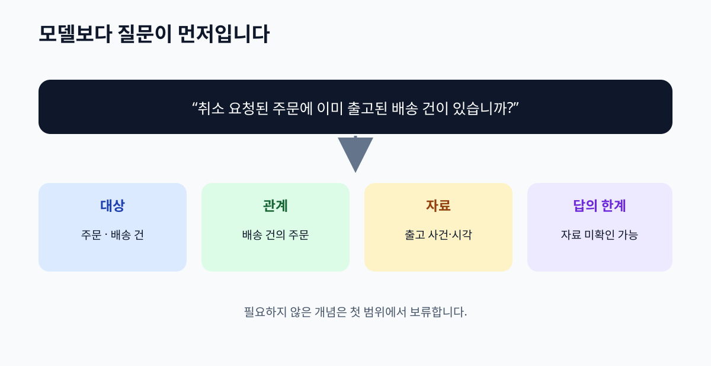

# 03. 답할 질문부터 정하기

> **이 장의 한 문장:** 좋은 온톨로지의 범위는 그림에 넣고 싶은 단어가 아니라, 실제로 답해야 할 업무 질문으로 정합니다.

다온상점 고객센터가 온톨로지 회의를 시작했습니다. 상담팀은 고객 문의 유형을 넣자고 하고, 물류팀은 창고와 택배사 전체를 넣자고 합니다. 결제팀은 카드 승인과 정산까지 필요하다고 말합니다. 각자 중요하다고 생각하는 대상을 모두 넣으면 목록은 빠르게 커지지만, “취소된 주문의 택배가 왜 도착했나요?”라는 첫 문의에는 여전히 답하기 어렵습니다. 어떤 정보가 필요한지보다 **어떤 판단을 해야 하는지**가 먼저 정해지지 않았기 때문입니다.

*그림 3-1. 업무 질문에서 필요한 대상·관계·근거를 찾아 첫 모델의 범위를 정하는 자체 제작 개념도입니다.*

## 3.1 첫 질문은 ‘무엇을 모델에 넣을까’가 아닙니다

온톨로지가 답해야 할 질문을 **역량 질문(competency question)**이라고 부릅니다. 이름이 낯설어도 뜻은 간단합니다. “이 모델과 연결된 자료가 준비되면 어떤 질문에 제대로 답할 수 있어야 하나요?”라고 묻는 것입니다. 기업 온톨로지 방법론을 제시한 Grüninger와 Fox는 업무 장면을 먼저 잡고, 온톨로지가 답해야 할 질문으로 범위를 정하도록 설명합니다. 이 장은 그 방법을 비개발자의 회의 문서로 바꿉니다. [원 연구 기관의 방법론 설명](https://eil.mie.utoronto.ca/theory/enterprise-modelling/entmethod/)

예를 들어 “고객 정보를 잘 관리한다”는 좋은 의도이지만 역량 질문으로는 넓습니다. “취소 요청이 접수된 주문에 아직 배송 중인 배송 건이 있나요?”는 대상을 찾고 결과를 확인할 수 있는 질문입니다. 답하려면 주문, 취소 요청, 배송 건, 현재 배송 상태의 뜻을 정해야 합니다. 반면 직원의 연차나 창고의 전기 사용량은 이 질문에 필요하지 않습니다. 질문이 모델의 경계를 그어 주는 것입니다.

| 질문 후보 | 이 책의 판단 | 이유와 다음 조치 |
| --- | --- | --- |
| 주문을 더 잘 처리하려면? | 너무 넓음 | 누가 어떤 상황에서 무엇을 확인할지 좁힘 |
| 취소 요청된 주문에 출고된 배송 건이 있습니까? | 첫 범위에 포함 | 주문·취소 요청·배송 건·출고 사건 필요 |
| 환불 완료라고 말할 근거가 있습니까? | 첫 범위에 포함 | 결제 환불 기록과 처리 시각 필요 |
| 어느 택배사가 가장 빠릅니까? | 다음 단계로 보류 | 성능 측정과 비교 기간을 추가로 정의해야 함 |
| 고객의 앞으로의 구매 의도는? | 현재 범위 밖 | 추측 문제이며 이 모델의 사실 조회 목표와 다름 |

‘포함’은 반드시 자동 응답을 허용한다는 뜻이 아닙니다. 모델이 질문에 필요한 대상을 설명하더라도, 데이터가 비어 있거나 권한이 없으면 “확인할 수 없음”이 정직한 결과입니다. ‘보류’도 영구 제외가 아닙니다. 나중에 담당자와 평가 기준이 생기면 별도 판을 만들어 다룰 수 있습니다.

## 3.2 질문을 검증 가능한 형태로 바꾸기

상담사가 “환불은 끝났나요?”라고 묻는다고 해 봅시다. 답을 만들기 전에 질문의 네 부분을 채웁니다. **대상**은 어떤 주문 또는 결제 건인지, **시점**은 지금인지 특정 날짜인지, **근거**는 어떤 기록인지, **허용 응답**은 모를 때 어떻게 답할 것인지입니다.

| 항목 | 확인할 내용 | 다온상점의 가상 예 |
| --- | --- | --- |
| 대상 | 어떤 건을 식별할 것인가 | 주문 `O-391`과 연결된 환불 건 |
| 시점 | 언제의 상태를 묻는가 | 오늘 14시 현재 |
| 근거 | 무엇을 읽어 판단하는가 | 결제 시스템의 지급 완료 사건 |
| 응답 | 무엇을 말할 수 있는가 | 완료 / 진행 중 / 기록 없음 / 권한 없음 |
| 책임 | 정의와 데이터의 담당자는 누구인가 | 결제 운영팀 |

‘기록 없음’과 ‘환불 안 됨’은 다릅니다. 시스템 연결이 늦어 기록을 아직 읽지 못했을 수도 있습니다. ‘권한 없음’도 별도 응답입니다. 모델을 설계할 때 이 네 가지 결과를 한 칸으로 뭉개면 상담 화면이나 AI가 모르는 것을 부정으로 바꿔 말하기 쉽습니다. 질문의 품질은 정답률만 아니라 **불확실성을 어떻게 표시하는지**에서도 드러납니다.

실제 데이터의 정확도를 확인하는 단계도 구분해야 합니다. 온톨로지 설계는 주문과 환불 건의 뜻과 연결을 정합니다. 자료 연결은 개별 주문에 환불 건이 있는지 찾습니다. 데이터 품질 점검은 누락이나 잘못된 번호를 검사합니다. 업무 검토는 고객에게 어느 상태까지 말할지 결정합니다. 네 단계가 모두 있어야 고객 답변이 됩니다.

## 3.3 포함과 제외를 함께 적기

첫 판의 범위를 종이에 한 줄로 적어 보세요. 다온상점의 초안은 “취소·배송·반품 문의에서 현재 처리 단계와 다음 확인처를 알려준다”입니다. 그 아래에는 **포함**, **제외**, **나중에**를 적습니다. 제외 항목은 실패의 표시가 아니라 모델을 검토 가능한 크기로 지키는 장치입니다.

| 범위 구분 | 가상 예 | 왜 이렇게 결정하는가 |
| --- | --- | --- |
| 포함 | 주문, 배송 건, 취소 요청, 반품 신청, 환불 건 | 첫 문의의 확인 경로에 직접 필요 |
| 제외 | 광고 캠페인, 추천 상품, 고객 성향 예측 | 첫 문의의 사실 확인에 필요하지 않음 |
| 나중에 | 택배사별 지연 분석, 부분 반품의 정산 | 사례와 정책 정의를 더 모아야 함 |

범위 결정에는 담당자의 책임도 붙입니다. ‘환불 완료’의 뜻은 결제 운영팀이, ‘배송 완료’의 뜻은 물류팀이 검토해야 합니다. 온톨로지 작성자가 혼자 모든 뜻을 추정하면 일관된 표는 만들 수 있어도 운영에서는 틀릴 수 있습니다. 정의를 확정한 사람과 날짜를 남겨야 다음 변경 때 다시 확인할 수 있습니다.

## 3.4 따라 해 보기: 역량 질문 카드 세 장

실제 업무에서 자주 묻는 질문 세 개를 고르세요. 개인 정보가 들어가지 않게 가상의 건 번호를 사용합니다. 각 질문을 아래 형식으로 적고, 답을 만드는 데 필요한 대상과 관계를 두세 개만 써 보세요.

> **질문:** 취소 요청된 주문에 이미 출고된 배송 건이 있습니까?
> **필요한 대상:** 주문, 취소 요청, 배송 건, 출고 사건
> **필요한 관계:** 취소 요청이 주문을 대상으로 함, 배송 건이 주문에 속함, 출고 사건이 배송 건에 발생함
> **답의 형태:** 있음 / 없음 / 자료 미확인
> **근거와 담당:** 주문·물류 기록, 각 팀의 상태 정의
> **범위 밖:** 배송 지연의 원인 추정

카드가 완성되면 다른 팀 담당자에게 읽어 달라고 하세요. “출고된 배송 건”을 택배사 인계 시점으로 볼지, 창고에서 상자를 닫은 시점으로 볼지 답이 갈릴 수 있습니다. 갈리면 더 좁은 표현으로 고치거나, 각각 별도 사건으로 모델에 넣어야 합니다. 질문 카드가 모호한데 그림만 정교해져도 결과는 좋아지지 않습니다.

다음으로 **반례**를 하나 적어 보세요. 부분 취소된 주문에 두 배송 건이 있고 한 건만 출고됐다면 “취소 요청된 주문에 출고 건이 있나요?”에는 예라고 답해야 합니다. 한 주문에 배송이 하나라고 가정한 모델이라면 이 반례를 설명하지 못합니다. 반례는 모델을 복잡하게 만들기 위한 장식이 아니라, 업무에서 자주 틀리는 경계를 드러내는 시험입니다.

마지막으로 카드마다 합격 조건을 적습니다. “실제 데이터가 모두 채워진 가상 사례 세 건에서 필요한 기록을 찾아 담당자가 같은 답을 설명할 수 있다”처럼 관찰 가능한 조건이면 좋습니다. 모든 답을 AI가 자동 생성해야 합격하는 것은 아닙니다. 어느 경우에 사람에게 넘겨야 하는지도 합격 조건이 될 수 있습니다.

## 3.5 흔한 실패와 수정

첫 번째 실패는 질문을 너무 추상적으로 쓰는 것입니다. “고객 경험을 향상한다”에서 무엇을 모델링할지 알 수 없습니다. 대상을 하나 정하고, 시간과 근거를 붙여 “오늘 14시 현재 이 주문의 환불 건은 지급 완료 기록이 있습니까?”로 좁힙니다.

두 번째 실패는 모델이 답할 수 있는 질문과 실제 데이터가 답할 수 있는 질문을 섞는 것입니다. 모델에 배송 건과 출고 사건의 관계가 있어도 물류 데이터가 들어오지 않으면 특정 주문의 답은 모릅니다. 질문 카드에 **모델이 설명할 구조**와 **운영 자료에서 찾아야 할 사실**을 따로 적습니다.

세 번째 실패는 좋게 보이는 긍정 사례만 시험하는 것입니다. 기록이 늦게 들어온 주문, 부분 취소, 배송 건이 둘인 주문, 환불이 실패한 주문을 함께 살펴야 합니다. 반례가 모델 밖이면 의도적으로 범위를 넓히거나 사람 검토로 넘기는 규칙을 만듭니다. “자료가 없으면 없음” 같은 지름길은 쓰지 않습니다.

## 3.6 이번 장 점검표

- [ ] 실무자가 실제로 받는 질문 세 개를 골랐습니까?
- [ ] 질문마다 대상·시점·근거·답의 형태를 적었습니까?
- [ ] 필요한 개념과 관계를 질문에서 거꾸로 찾았습니까?
- [ ] 제외·보류 범위와 정의 담당자를 기록했습니까?
- [ ] 데이터가 없을 때와 사실이 없을 때를 구분했습니까?
- [ ] 부분 취소 같은 반례로 첫 모델을 시험했습니까?

**장 요약.** 먼저 답할 질문을 정하면 모델의 크기와 검토할 사람을 정할 수 있습니다. 좋은 질문은 대상, 시점, 근거, 가능한 답과 모를 때의 처리까지 포함합니다. 다음 장에서는 이 질문에 나온 **대상의 종류와 개별 건**을 구분합니다.

### 공식·원 연구 출처

- [Enterprise Integration Laboratory의 기업 온톨로지 방법론](https://eil.mie.utoronto.ca/theory/enterprise-modelling/entmethod/) — 업무 장면과 역량 질문을 온톨로지 범위에 연결하는 원 연구 기관 설명입니다.
- [W3C Data on the Web Best Practices](https://www.w3.org/TR/dwbp/) — 구조·출처·품질 정보가 데이터 이해와 재사용에 필요함을 확인했습니다.
- [W3C OWL 2 Web Ontology Language Primer](https://www.w3.org/TR/owl-primer/) — 모델이 표현할 개념·관계의 범위를 참고했습니다.
