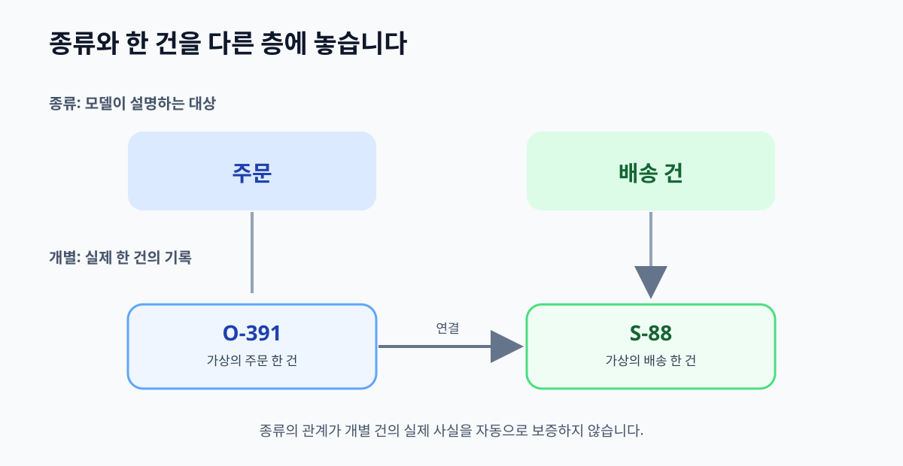

# 04. 개념·클래스·개별 대상

> **이 장의 한 문장:** 클래스는 같은 기준으로 묶는 대상의 종류이고, 개별 대상은 그 종류에 속하는 특정 한 건입니다.

다온상점은 3장의 질문을 바탕으로 첫 표를 만들었습니다. 그런데 한 직원은 ‘주문’을 한 줄로 적고, 다른 직원은 ‘주문 O-391’를 같은 칸에 적습니다. 두 표현을 섞으면 “주문은 배송 건과 연결된다”라는 일반 설명과 “O-391은 S-88과 연결된다”라는 실제 기록이 구별되지 않습니다. 모델을 읽는 사람이 무엇이 설계 규칙이고 무엇이 개별 사례인지 알 수 있도록 **종류와 한 건**을 나눠야 합니다.

*그림 4-1. 대상 종류인 클래스와 실제 주문·배송 기록의 층을 분리한 자체 제작 개념도입니다.*

## 4.1 이름표와 실제 상자를 구분하기

창고에 ‘반품 예정 상자’라고 적힌 선반이 있다고 생각해 봅시다. 선반의 이름은 상자를 분류하는 기준입니다. 그 선반에 놓인 상자 A와 B는 서로 다른 물건입니다. 온톨로지에서도 **클래스(class)**는 같은 기준으로 묶이는 대상의 종류이고, **개별 대상(individual 또는 instance)**은 특정 주문이나 배송 건 하나입니다. W3C [OWL 2 입문서](https://www.w3.org/TR/owl-primer/)도 클래스·개별 대상·속성을 모델의 기본 재료로 설명합니다.

‘개념’은 업무에서 쓰는 생각의 단위라는 넓은 말입니다. 모델을 만들 때 모든 명사를 클래스라고 할 필요는 없습니다. ‘주문’은 대상 종류가 될 수 있고, ‘취소’는 상황에 따라 **취소 요청 사건**, **취소된 상태**, **취소 사유** 중 무엇인지 먼저 정해야 합니다. 이름이 명사라는 이유만으로 같은 종류의 대상으로 만들면 화면에서 본 혼란을 모델로 그대로 옮기게 됩니다.

| 표현 | 모델에서의 자리 | 이유 |
| --- | --- | --- |
| 주문 | 클래스 후보 | 여러 개별 주문을 한 기준으로 묶음 |
| 주문 `O-391` | 개별 대상 후보 | 다른 주문과 구별되는 한 기록 |
| 배송 건 | 클래스 후보 | 실제 소포 이동의 처리 단위 |
| 배송 건 `S-88` | 개별 대상 후보 | 한 주문에 연결된 특정 처리 건 |
| ‘취소 완료’ | 아직 결정 전 | 요청·결과·상태 중 무엇인지 조사해야 함 |

`O-391`과 `S-88`은 가상 예시 번호입니다. 실제 조직에서는 번호만으로 전 세계에서 한 대상을 식별할 수 있다고 가정하지 마세요. 다른 시스템에도 같은 문자열이 있을 수 있고, 번호가 재사용될 수도 있습니다. 이 문제는 7장에서 별도로 다룹니다. 여기서는 **모델 안에서 서로 다른 한 건을 가리킨다**는 감각만 익힙니다.

## 4.2 상위·하위는 ‘항상 그렇다’는 약속입니다

다온상점은 ‘배송 건’ 아래에 ‘해외 배송 건’을 둘 수 있습니다. 해외 배송 건이라면 배송 건이라는 설명은 자연스럽지만, 배송 건이 모두 해외 배송 건인 것은 아닙니다. 이것이 **상위·하위 클래스**를 생각하는 기본 시험입니다. “A는 B의 일종인가?”라고 물을 때, 모든 A가 B여야 합니다. ‘배송 건에는 주문이 연결된다’는 문장은 종류의 포함 관계가 아니라 **두 종류 사이의 관계**입니다. 화살표를 모두 상하 분류로 그리면 뜻이 뒤틀립니다.

| 후보 연결 | ‘A는 B의 일종’ 시험 | 적절한 표현 |
| --- | --- | --- |
| 해외 배송 건 → 배송 건 | 해외 배송 건은 모두 배송 건 | 하위 클래스 후보 |
| 반품 신청 → 고객 문의 | 모든 반품 신청을 고객 문의로 볼지는 업무 정의에 달림 | 정의 확인 뒤 결정 |
| 주문 → 배송 건 | 주문은 배송 건이 아님 | 두 종류 사이 관계 |
| 고객 → 주문 | 고객은 주문이 아님 | 고객이 주문을 생성한다는 관계 |
| 부분 취소 → 취소 요청 | ‘부분 취소’가 사건인지 상태인지 먼저 확인 | 기준 확정 전 보류 |

두 번째 행처럼 현실의 범주가 모호하면 담당자와 합의해야 합니다. 온라인 반품 신청을 고객 문의 시스템에 자동 등록하는 회사라면 두 기록이 연결될 수 있습니다. 그렇다고 반품 신청과 고객 문의를 무조건 같은 대상이라고 선언할 수는 없습니다. 모델은 회사의 실제 식별 단위와 절차를 설명해야 합니다.

또 하나 중요한 점은 **하나의 개별 대상이 여러 클래스에 속할 수 있다**는 것입니다. 같은 사람은 ‘고객’이면서 ‘배송 수령인’일 수 있습니다. 이 두 역할을 별개 사람으로 복제하면 고객에게 연락할 때 문제가 생길 수 있습니다. 반대로 배송 수령인이 항상 주문 고객이라고 가정하면 선물 주문을 설명하지 못합니다. 사람의 정체성과 사람이 특정 주문에서 맡은 역할을 나눠 생각하면 더 견고한 모델이 됩니다. OWL은 클래스 소속을 기본적으로 하나만 허용하지 않습니다.

## 4.3 사건, 상태, 값의 자리를 정하기

고객지원 모델에서 많은 오류는 ‘완료’를 물건처럼 다룰 때 생깁니다. “환불 완료”는 환불 건의 현재 상태일 수 있고, 지급 시스템이 남긴 **완료 사건**일 수도 있습니다. 어떤 질문에 답할지에 따라 모델의 자리가 달라집니다. 고객에게 “언제 완료됐나요?”라고 답해야 한다면 시각과 기록 주체가 있는 사건으로 표현하는 편이 유용합니다. 현재 처리 단계만 보여 주면 된다면 상태 값으로 시작할 수 있습니다. 둘을 함께 쓰더라도 무엇이 원본 기록인지 정해야 합니다.

| 업무 표현 | 가능한 모델 형태 | 확인할 질문 |
| --- | --- | --- |
| 환불 요청 | 별도 사건 또는 처리 건 | 요청자·접수 시각을 찾아야 하나? |
| 환불 완료 | 상태 값 또는 완료 사건 | 완료 시각·근거가 필요한가? |
| 배송 중 | 배송 건의 상태 값 | 상태가 어느 시점에 유효한가? |
| 배송비 3,000원 | 금액 값 | 통화와 계산 기준은 무엇인가? |
| 반품 사유 | 분류 값 또는 기록 | 여러 사유와 자유 서술을 구분할까? |

이 표도 하나의 정답을 강요하지 않습니다. 업무 질문이 먼저이고, 모델은 그 질문을 정확히 답할 수 있게 설계합니다. 예를 들어 환불 완료 시각이 분쟁 처리에 필요하다면 단순한 `완료=true`만으로는 부족합니다. 완료 사건의 시각과 출처가 필요합니다. 반대로 첫 판에서 상세 이력까지 다룰 이유가 없다면 상태와 출처 기록을 분리해 나중에 확장할 수 있습니다.

## 4.4 따라 해 보기: 종류와 한 건 두 층 표

3장의 역량 질문 카드 하나를 꺼내세요. 왼쪽에는 일반 종류, 오른쪽에는 가상 기록을 적습니다. 실제 고객의 개인 정보를 옮기지 마세요.

| 종류 층: 무엇의 종류인가 | 개별 층: 한 건은 무엇인가 | 구별할 번호·근거 | 아직 모르는 점 |
| --- | --- | --- | --- |
| 주문 | `O-391` | 주문 시스템의 주문 ID | 부분 취소를 주문 하나로 볼까? |
| 배송 건 | `S-88`, `S-89` | 물류 시스템의 배송 ID | 두 건의 최신 시각은? |
| 취소 요청 | `X-17` | 고객센터 접수 기록 | 승인 여부는 어디서 확인? |
| 환불 건 | `F-51` | 결제 시스템의 처리 ID | 지급 완료 근거는? |

그다음 각 줄에 “하나의 개별 대상이 둘 이상의 역할을 맡을 수 있나요?”를 물어 보세요. 고객과 수령인은 한 사람일 수도, 다른 사람일 수도 있습니다. 주문과 배송은 애초에 다른 종류입니다. 같은 번호를 공유한다고 하나의 대상이 되는 것도 아닙니다. 이 검토를 통해 **종류**, **역할**, **식별자**를 섞지 않게 됩니다.

마지막으로 반례를 하나 넣습니다. 주문 `O-391`에 배송 `S-88`, `S-89`가 연결됐다고 가정해 보세요. 모델이 배송 건 하나만 담도록 만들어졌다면 바로 문제가 드러납니다. 첫 모델을 무조건 많은 경우에 맞추라는 뜻이 아닙니다. 실제 업무에서 충분히 일어나는 반례를 설명할 수 있는지 확인하라는 뜻입니다.

## 4.5 흔한 실패와 수정

첫 번째 실패는 ‘고객’을 사람 자체와 특정 거래의 역할로 동시에 쓰는 것입니다. 조직에 따라 비회원 구매자, 선물 수령인, 법인 담당자가 있습니다. 사람이나 조직이라는 대상과 **주문에서 맡은 역할**을 따로 적으면 예외를 설명하기 쉽습니다. 어느 수준까지 나눌지는 역량 질문이 결정합니다.

두 번째 실패는 단어가 비슷하다는 이유로 상하 관계를 만드는 것입니다. ‘반품 배송’은 배송의 한 종류일 수 있지만 ‘반품 신청’은 배송의 한 종류가 아닙니다. “모든 A가 B인가?”를 실제 사례 세 건에 적용해 보세요. 하나라도 설명되지 않으면 관계를 다시 정해야 합니다.

세 번째 실패는 클래스에 없는 내용을 개별 대상에 상상으로 채우는 것입니다. ‘주문에는 배송 건이 연결될 수 있다’는 설계 설명에서 특정 주문의 배송 건이 이미 있다고 결론 내릴 수 없습니다. 실제 연결 기록이 있어야 합니다. 다음 장은 종류 사이의 **관계가 정확히 무엇을 말하는지** 다룹니다.

## 4.6 이번 장 점검표

- [ ] 종류 이름과 특정 건의 기록을 다른 칸에 적었습니까?
- [ ] 상위·하위 연결에 ‘모든 A가 B인가?’ 시험을 했습니까?
- [ ] 주문·배송처럼 다른 종류를 상하 분류로 잘못 넣지 않았습니까?
- [ ] 같은 사람이 여러 역할을 맡는 경우를 검토했습니까?
- [ ] 상태·사건·값 중 어디에 둘지 업무 질문으로 결정했습니까?
- [ ] 개별 건의 존재를 모델 정의만으로 추정하지 않았습니까?

**장 요약.** 온톨로지의 첫 층은 종류와 개별 건의 구분입니다. 상위·하위는 ‘일종’ 관계이고, 주문과 배송의 연결은 다른 형태의 관계입니다. 모델에 넣은 일반 설명이 특정 주문의 사실을 자동으로 보증하지 않습니다.

### 공식 출처

- [W3C OWL 2 Web Ontology Language Primer](https://www.w3.org/TR/owl-primer/) — 클래스, 개별 대상, 클래스 계층과 여러 클래스 소속을 확인했습니다.
- [W3C RDF Schema 1.1](https://www.w3.org/TR/rdf-schema/) — 클래스 및 속성의 기본 표현을 확인했습니다.
