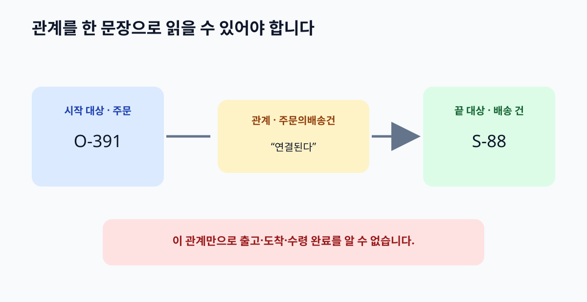

# 05. 관계와 업무 규칙

> **이 장의 한 문장:** 관계는 두 대상을 잇는 화살표가 아니라, 어느 쪽에서 어느 쪽으로 무엇이 참인지 읽을 수 있는 문장입니다.

다온상점 상담사가 주문 `O-391`을 열었습니다. 배송 건 `S-88`이 연결돼 있고, 고객 `C-204`가 반품 요청 `R-17`을 남겼습니다. 화면에 네 개의 상자가 있고 선만 그어져 있다면 무엇을 알 수 있을까요? 주문과 배송이 관련 있다는 정도는 보이지만, `S-88`이 실제로 출고됐는지, 반품 요청이 승인됐는지, 고객이 그 배송의 수령인인지 알 수 없습니다. **선마다 동사와 방향, 적용 시점**을 적어야 업무에 쓸 수 있습니다. 모든 번호와 인물은 가상 사례입니다.

*그림 5-1. 관계의 시작 대상·끝 대상·동사·해석 경계를 표시한 자체 제작 개념도입니다.*

## 5.1 선을 문장으로 읽기

4장에서 종류와 개별 건을 나눴습니다. 이제 종류 사이에 **관계(property 또는 relation)**를 더합니다. “주문 **에는 배송 건이 연결된다**”라고 읽을 수 있는 동사입니다. 개별 기록에서는 “주문 `O-391` **에는 배송 건 `S-88`이 연결된다**”처럼 적습니다. 동사가 없는 ‘관련 있음’은 너무 넓어서 어떤 기록을 찾고 무엇을 말할지 결정하기 어렵습니다.

| 관계 이름 후보 | 자연어로 읽기 | 바로 알 수 있는 것 | 아직 알 수 없는 것 |
| --- | --- | --- | --- |
| `주문의배송건` | 주문에 배송 건이 연결된다 | 어느 배송 건을 찾아야 하는가 | 출고·도착 여부 |
| `요청대상주문` | 반품 요청이 주문을 대상으로 한다 | 어떤 주문의 처리 요청인가 | 승인·수거 여부 |
| `요청한고객` | 반품 요청을 고객이 제출했다 | 요청 주체의 기록 | 고객이 소유자나 수령인인지 |
| `배송건의수령인` | 배송 건에 수령인이 지정됐다 | 누구에게 보낼 예정인가 | 실제 수령 여부 |

표의 마지막 칸을 읽는 습관이 중요합니다. 관계가 있다고 그 뒤의 업무 단계까지 완료됐다고 말하면 안 됩니다. `요청대상주문`은 고객의 신청을 주문에 연결하지만, 반품 승인이나 환불 지급을 뜻하지 않습니다. 그 사건들은 별도의 기록과 관계를 요구합니다. 또 관계를 볼 수 있다는 사실과 그 주문을 수정할 권한은 별개의 문제입니다.

## 5.2 시작과 끝을 정하기

관계를 설계할 때 **시작 대상**과 **끝 대상**을 적으면 같은 이름의 화살표를 뒤집어 읽는 실수를 줄일 수 있습니다. W3C RDF Schema와 OWL에는 시작 쪽 종류를 설명하는 `domain`, 끝 쪽 종류를 설명하는 `range` 개념이 있습니다. 예를 들어 `주문의배송건`이라는 관계의 시작을 주문, 끝을 배송 건으로 설명할 수 있습니다. 다만 이 선언은 **데이터 입력 칸을 검사해 잘못된 값을 거부하는 조건과 같지 않습니다.** RDF Schema의 domain·range는 관계를 보고 대상의 종류를 추론하는 데 쓰입니다. 입력 자료가 조건을 충족하는지 검사하는 방법은 10장의 SHACL에서 따로 다룹니다. [W3C RDF Schema](https://www.w3.org/TR/rdf-schema/)

| 설계 카드 | 다온상점의 가상 초안 | 검토 질문 |
| --- | --- | --- |
| 관계 이름 | 주문의배송건 | 읽었을 때 동사의 뜻이 분명한가? |
| 시작 종류 | 주문 | 배송 건을 가진 주체가 주문인가? |
| 끝 종류 | 배송 건 | 배송 상태 값이 아니라 개별 배송 건인가? |
| 개별 예 | `O-391` → `S-88` | 두 ID가 어느 시스템의 기록인가? |
| 말하지 않는 것 | 출고·도착·수령 완료 | 다른 사건을 잘못 암시하지 않는가? |
| 정의 책임 | 주문·물류 운영팀 공동 | 한 팀만의 약어로 남지 않는가? |

같은 의미를 반대 방향에서 읽어야 할 때도 있습니다. 상담 화면에서는 “주문에 어떤 배송 건이 있나요?”라고 묻고 물류 화면에서는 “이 배송 건이 어느 주문에 속하나요?”라고 묻습니다. 이때 두 관계를 별개 사실처럼 무작정 저장하면 값이 어긋날 수 있습니다. OWL은 두 속성이 **역관계**라는 뜻을 표현할 수 있습니다. 단, 역관계를 선언했다고 원본 시스템의 연결 오류가 자동으로 고쳐지는 것은 아닙니다. 관계를 언제 어떤 자료에서 가져왔는지 확인해야 합니다. [W3C OWL 2 입문서](https://www.w3.org/TR/owl-primer/)

## 5.3 관계와 절차를 섞지 않기

다온상점의 반품 절차를 생각해 봅시다. 고객 `C-204`가 요청 `R-17`을 제출하고, 담당자가 승인하며, 택배사가 수거하고, 창고가 입고를 확인한 뒤 환불 검토가 시작됩니다. 이 순서는 **업무 절차**입니다. `R-17`이 주문 `O-391`을 대상으로 한다는 사실은 **관계**입니다. 순서와 관계를 섞으면 “요청이 연결됨 → 승인됨 → 환불됨”처럼 존재하지 않는 자동 결론이 만들어집니다.

| 문장 | 성격 | 필요한 확인 |
| --- | --- | --- |
| `R-17`은 `O-391`을 대상으로 한다 | 대상 사이 관계 | 요청서와 주문 ID의 연결 |
| `R-17`은 11월 4일 10시에 제출됐다 | 사건의 사실 | 접수 기록과 시각 |
| 승인된 요청은 수거 예약을 할 수 있다 | 회사 정책 | 현재 정책 버전과 예외 |
| `R-17`이 승인됐다 | 개별 처리 사실 | 승인자와 승인 기록 |
| 승인된 요청을 상담사가 환불할 수 있다 | 권한 주장 | 별도 권한·승인 규칙 확인 |

여기서 `R-17`은 주문 `O-391`의 **일부 상품**에 대한 요청이라고 가정합니다. 주문과 연결하는 관계만 있으면 어느 상품을 돌려보내려는지 알 수 없습니다. 부분 반품을 답해야 한다면 주문 상품의 개별 항목을 대상 종류로 추가하고, 요청이 그 항목을 가리키는 관계를 별도로 정해야 합니다. 이처럼 역량 질문이 요구하는 세부 수준에 따라 관계가 늘어납니다.

회사 정책은 시기에 따라 바뀌며 상품 종류마다 예외가 있을 수 있습니다. 온톨로지에 **개념의 관계**와 **정책 문장**을 함께 적어도, 둘을 한 화살표로 뭉치지 마세요. 특히 “할 수 있다”는 표현은 개념적으로 가능한 일인지, 시스템 권한인지, 정책상 허용인지 분명히 해야 합니다. 권한은 현재 로그인 사용자와 상황에 따라 달라지므로 모델의 일반 관계만 보고 실행할 수 없습니다.

## 5.4 개수와 예외를 조심해서 다루기

“주문에는 배송이 하나 있다”고 쓰면 실제로는 부분 배송을 놓칠 수 있습니다. 다온상점의 가상 정책에서는 출고 전 주문은 배송 건이 없을 수 있고, 나누어 보내는 주문은 둘 이상일 수 있습니다. 따라서 첫 모델은 **주문 한 건에 배송 건이 0개 이상 연결될 수 있다**고 가정합니다. 이 숫자는 W3C 표준이 정해 준 사실이 아니라 가상 회사의 업무 규칙입니다. 실제 회사에서는 물류 정책을 확인해야 합니다.

개수 제한을 어디에 두느냐도 중요합니다. OWL에서는 개체가 알려진 자료 밖에 더 있을 수 있다는 **열린 세계** 관점이 기본입니다. “기록된 배송 건이 하나뿐”이라고 해서 다른 배송 건이 절대 없다고 단정하지 않습니다. 운영 데이터에 “배송 건 ID가 반드시 있어야 한다” 같은 입력 조건을 검사하려면 10장에서 다루는 SHACL과 자료 검증을 사용합니다. 두 도구는 서로 다른 질문에 답합니다. 하나는 모델이 말하는 의미와 가능한 결론, 다른 하나는 주어진 자료가 정한 형식을 만족하는지입니다.

| 질문 | 먼저 필요한 것 | 왜 다른가 |
| --- | --- | --- |
| 주문에 배송 건이 연결될 수 있습니까? | 업무 관계의 정의 | 종류 사이의 의미를 정함 |
| `O-391`의 배송 건은 몇 개입니까? | 실제 연결 자료와 조회 시점 | 모델만으로 건수를 알 수 없음 |
| 배송 건 번호가 비어 있습니까? | 입력 데이터 검증 규칙 | 누락을 찾아 수정해야 함 |
| 상담사가 배송을 취소할 수 있습니까? | 사용자 권한과 승인 정책 | 관계의 존재와 실행 허가가 다름 |

이 질문들을 모두 ‘온톨로지 규칙’으로 부르면 담당자 사이에 오해가 생깁니다. 관계 설계표에는 **의미**, **데이터 품질 조건**, **업무 정책**, **권한**의 칸을 나눠 두세요. 한 팀이 어느 칸을 수정했는지도 기록합니다. 그래야 고객에게 잘못 답했을 때 모델의 의미가 틀렸는지, 원본 데이터가 늦었는지, 정책이 바뀌었는지 찾을 수 있습니다.

## 5.5 따라 해 보기: 관계 계약서 두 장

3장의 질문 카드에서 필요한 관계 두 개를 고르세요. 하나는 `주문의배송건`, 다른 하나는 `요청대상주문`처럼 서로 다른 역할이면 좋습니다. 아래의 **관계 계약서**를 채워 다른 담당자가 문장으로 읽어 보게 합니다.

| 계약서 항목 | 적을 내용 |
| --- | --- |
| 관계 이름 | 대상 두 종류와 동사가 보이는 이름 |
| 시작·끝 종류 | 어느 쪽에서 어느 쪽으로 읽는가 |
| 개별 예 | 가상의 두 ID로 문장을 만들어 보기 |
| 반례 | 연결돼도 자동으로 참이 되지 않는 사실 |
| 시간 | 현재 관계인가, 발생 시각이 있는 사건인가 |
| 자료 출처 | 어느 시스템·담당자가 연결을 제공하는가 |
| 검토자 | 양쪽 업무를 아는 사람 |

예를 들어 “`R-17`은 `O-391`을 대상으로 한다”까지는 확인됐지만 “수거가 완료됐다”는 사실은 없다고 적습니다. 계약서를 읽은 사람이 **어떤 조회를 더 해야 고객에게 답할지** 말할 수 있으면 의미가 분명해진 것입니다. 반대로 같은 문장을 읽고 한 사람은 접수, 다른 사람은 승인을 떠올린다면 관계 이름이나 정의를 더 구체적으로 바꿔야 합니다.

마지막으로 관계를 뒤집어 읽어 보세요. “`S-88`은 어느 주문의 배송 건인가?”에 `O-391`이라고 답하려면, 양방향 조회가 가능한지 확인합니다. 시스템마다 값이 달라지면 어느 자료를 원본으로 삼는지 합의합니다. 관계의 역방향을 제공하는 방식과 실제 데이터의 일치 여부는 별개의 문제입니다.

## 5.6 흔한 실패와 수정

첫째, 모든 선을 `관련됨`으로 그립니다. 그러면 주문과 배송, 주문과 환불, 고객과 주소가 모두 같은 선이 됩니다. 직원이 문장으로 읽을 수 있는 동사를 붙이고, 두 대상의 시작과 끝을 적으세요.

둘째, domain·range를 데이터 입력 검사 규칙이라고 설명합니다. 실제로는 관계를 통해 종류를 추론하는 의미 선언입니다. 예상과 다른 대상이 들어왔을 때 **오류를 보여 주고 수정하게 할지**는 SHACL 같은 별도 검증 규칙으로 설계해야 합니다.

셋째, 관계를 보고 다음 사건을 만들어 냅니다. 주문이 배송 건과 연결됐어도 배송 완료는 아닙니다. 반품 요청이 주문에 연결됐어도 승인이나 환불은 아닙니다. 필요한 사건의 기록과 시각을 별도로 확인합니다.

## 5.7 이번 장 점검표

- [ ] 모든 관계를 시작 대상·동사·끝 대상으로 읽을 수 있습니까?
- [ ] 관계가 말하지 않는 사실을 반례로 적었습니까?
- [ ] 종류 사이의 의미와 개별 기록의 실제 연결을 구별했습니까?
- [ ] domain·range를 입력 검증 규칙으로 잘못 쓰지 않았습니까?
- [ ] 업무 절차·권한·데이터 품질 조건을 별도 칸에 두었습니까?
- [ ] 여러 배송 건이나 미완료 요청 같은 예외를 시험했습니까?

**장 요약.** 관계를 올바르게 이름 붙이면 같은 선을 서로 다르게 읽는 일을 줄일 수 있습니다. 그러나 관계의 존재는 뒤따르는 업무 사건의 완료를 뜻하지 않습니다. 모델의 의미, 실제 연결 자료, 검증 조건, 실행 권한을 나누어 기록하세요. 다음 장에서는 같은 개념을 팀마다 다른 이름으로 부를 때의 용어 관리 방법을 다룹니다.

### 공식 출처

- [W3C RDF Schema 1.1](https://www.w3.org/TR/rdf-schema/) — domain·range의 추론 의미를 확인했습니다.
- [W3C OWL 2 Web Ontology Language Primer](https://www.w3.org/TR/owl-primer/) — 속성, 역관계, 열린 세계의 기본 설명을 확인했습니다.
- [W3C SHACL](https://www.w3.org/TR/shacl/) — 데이터 그래프의 조건 검증이 별도 문제임을 확인했습니다.
