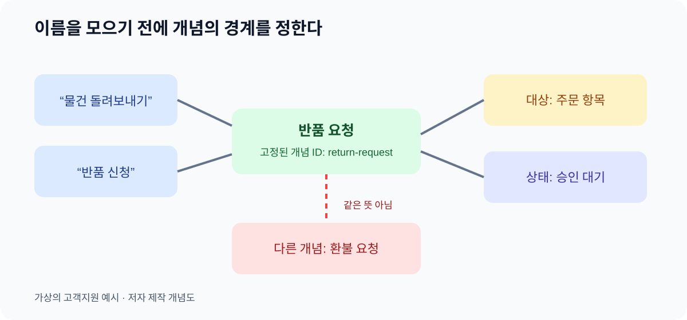

# 06. 분류·동의어·용어 관리

> **한 문장 요약:** 같은 업무 개념에 붙은 여러 표현을 정리할 때는 먼저 개념의 경계를 합의하고, 그다음 이름·분류·검색용 표현을 관리합니다.

다온상점의 고객이 “교환”을 요청했습니다. 상담사는 새 상품을 다시 보내는 절차로 이해했지만, 물류팀의 화면에서 “교환”은 기존 상품을 회수하는 단계까지 포함합니다. 기획 문서의 “교환 완료”는 새 상품 배송이 끝났다는 뜻입니다. 단어가 같아도 세 팀이 가리키는 상태가 다릅니다. 반대로 고객이 말하는 “물건 돌려보내기”, 상담사가 입력하는 “반품”, 물류팀의 “회수 접수”는 일부 상황에서 같은 일을 가리킬 수 있습니다. 검색창에 동의어만 많이 넣으면 이 혼란이 해결될까요? 그렇지 않습니다. 먼저 무엇이 같은 개념이고 무엇이 다른 단계인지 정해야 합니다.

*그림: 이 책의 가상 고객지원 사례를 위해 제작한 용어 관리 개념도입니다. 제품 화면이나 W3C 공식 그림이 아닙니다.*

## 이름보다 개념을 먼저 고정하기

용어집은 단어와 뜻을 모은 문서입니다. 분류표는 개념의 넓고 좁은 관계를 정리합니다. 온톨로지는 그 개념이 주문·배송·반품 같은 다른 대상과 어떤 관계를 맺는지까지 명시합니다. 이 셋을 같은 것으로 취급하면 “반품”이라는 한 칸에 상태, 절차, 요청 유형을 모두 넣게 됩니다.

| 구분 | 묻는 질문 | 고객지원 예 |
| --- | --- | --- |
| 용어 | 이 말을 어떤 뜻으로 쓰는가? | “회수”는 상품을 가져오는 물류 행위 |
| 분류 | 어느 개념이 더 넓은가? | “반품 요청”은 “고객 요청”의 한 유형 |
| 온톨로지 관계 | 무엇이 무엇과 연결되는가? | 반품 요청은 특정 주문 항목을 대상으로 함 |
| 상태 | 지금 어느 단계인가? | 반품 요청이 승인 대기 상태 |

표의 마지막 두 행은 특히 분리해야 합니다. “반품 요청”과 “승인 대기”는 같은 계층의 종류가 아닙니다. 전자는 업무 대상의 유형이고 후자는 그 대상의 현재 상태입니다. 상태를 유형 아래에 무리하게 끼워 넣으면 “승인 대기 중인 배송” 같은 이상한 분류가 만들어집니다.

## SKOS를 어디에 쓰는가

W3C의 SKOS(Simple Knowledge Organization System)는 개념 체계, 분류표, 시소러스처럼 이미 쓰던 지식 조직 체계를 공유하고 연결하기 위한 모델입니다. 한 개념에 식별자를 주고, 언어별 **선호 이름**(`skos:prefLabel`), **대체 이름**(`skos:altLabel`), 검색을 돕는 **숨은 이름**(`skos:hiddenLabel`)을 붙일 수 있습니다. 넓은 개념과 좁은 개념은 `skos:broader`와 `skos:narrower`로 연결할 수 있습니다. 2026년 11월 4일 확인한 [W3C SKOS 권고안](https://www.w3.org/TR/skos-reference/)의 내용입니다.

| 관리 항목 | 가상 예시 | 누가 확인할까? |
| --- | --- | --- |
| 개념 식별자 | `return-request` | 데이터 담당자와 업무 담당자 |
| 선호 이름 | 반품 요청 | 고객지원·물류 합의 |
| 대체 이름 | 반품 신청 | 상담 검색어 담당자 |
| 숨은 이름 | 반품요청, 흔한 오타 | 검색 품질 담당자 |
| 상위 개념 | 고객 요청 | 온톨로지 관리 담당자 |
| 정의 | 주문 항목의 반환을 요청한 기록 | 정책 담당자 |

식별자는 화면에 보이는 이름과 달리 안정적으로 유지합니다. “반품 신청”을 “반품 요청”으로 고치더라도 같은 개념의 식별자를 계속 쓸 수 있어야 과거 문서와 새 문서가 연결됩니다. 그러나 “반품”이라는 표현이 환불 절차까지 포함하는 팀과 단순 회수만 뜻하는 팀이라면 대체 이름으로 합치기 전에 범위를 합의해야 합니다.

SKOS의 상하 관계는 **개념 체계의 계층**입니다. OWL의 `subClassOf`처럼 모든 개별 대상에 대해 형식적으로 종류를 추론하는 관계와 자동으로 같아지지 않습니다. 또한 `skos:broader` 자체는 전이 관계가 아닙니다. A가 B보다 좁고 B가 C보다 좁다는 사실만으로 A `skos:broader` C가 직접 성립한다고 쓰지 않습니다. 더 넓은 경로를 다룰 때는 SKOS가 정의한 `broaderTransitive` 같은 별도 관계를 검토합니다. 이는 [W3C SKOS 관계 명세](https://www.w3.org/TR/skos-reference/#semantic-relations)에 따른 구분입니다.

한국어와 영어를 함께 사용하는 조직이라면 언어별 선호 이름도 따로 관리합니다. 예를 들어 한국어 선호 이름은 “반품 요청”, 영어 선호 이름은 “return request”가 될 수 있습니다. 같은 언어에 서로 다른 선호 이름 두 개를 붙이면 어떤 이름이 대표인지 다시 혼란이 생깁니다. SKOS는 한 자원에 같은 언어 태그의 `prefLabel`을 둘 이상 두지 않는 무결성 조건을 정합니다. 표기를 바꿀 때는 과거 검색어를 대체 이름으로 유지할지, 그 표현이 이미 다른 개념의 이름인지 확인합니다. 이름을 번역했다고 절차와 법적 의미까지 같아지는 것은 아닙니다.

## 고객이 쓴 말에서 표준 개념까지

가상의 고객이 “택배가 엉뚱한 집에 갔어요”라고 입력했다고 합시다. 상담 시스템은 “오배송”이라는 선호 이름을 가진 문제 유형을 후보로 제안할 수 있습니다. 하지만 “오배송”은 “배송 지연”과 다른 개념이고, 아직 실제 조사로 확정된 사실도 아닙니다. 따라서 고객 표현 → 후보 개념 → 상담사 확인 → 확정 기록의 단계를 남깁니다. 온톨로지에 들어갈 개념과 실제 사건의 판정은 다른 작업입니다.

이때 검색어 사전은 동의어를 늘리는 쪽으로만 최적화하기 쉽습니다. “배송 취소”와 “주문 취소”를 무조건 같은 말로 묶으면 출고 후의 배송 중단과 결제 직후의 주문 취소를 구분하지 못합니다. 검색에서는 두 개념을 함께 보여 주되, 처리 절차는 갈라야 합니다.

## 따라 해 보기: 열두 줄짜리 용어 카드

자기 조직의 문의 열 건을 골라 반복되는 단어 세 개를 뽑습니다. 개인 정보는 제거합니다. 다음 표를 복사해 한 단어씩 작성해 보세요. 첫 번째 초안에서 모든 팀의 합의를 얻으려 하지 않아도 됩니다. 불일치 자체가 중요한 발견입니다.

| 항목 | 기록할 내용 |
| --- | --- |
| 원문 표현 | 고객·상담·물류 화면에서 실제 쓰는 말 |
| 후보 개념 | 이름 대신 고정할 업무 의미 |
| 포함 기준 | 이 개념으로 분류해도 되는 상황 |
| 제외 기준 | 비슷하지만 다른 상황 |
| 선호 이름과 대체 이름 | 화면 이름과 검색 허용 표현 |
| 상위·관련 개념 | 넓은 종류 또는 함께 봐야 할 개념 |
| 담당자와 변경일 | 누가 정의를 승인했고 언제 바뀌었는가 |

예를 들어 “교환” 카드의 제외 기준에 “같은 상품을 다시 보내지 않고 금액만 돌려주는 경우”를 적으면 환불과의 경계가 보입니다. 이런 문장 하나가 그림 속 선 하나보다 더 큰 운영 효과를 냅니다.

## 자주 생기는 실패

첫째, **표현이 같으면 개념도 같다고 가정**합니다. 해결하려면 팀별 정의와 실제 처리 결과를 나란히 놓고 차이를 찾습니다. 둘째, **서로 다른 개념을 검색 편의 때문에 합칩니다.** 검색 확장 규칙은 유지하되 처리 규칙의 개념은 분리합니다. 셋째, **이름을 개념 ID로 사용**합니다. 이름이 바뀌면 모든 연결이 흔들리므로 안정적인 식별자를 둡니다. 넷째, **분류표만 만든 뒤 업무 관계까지 표현했다고 생각**합니다. “반품 요청이 어떤 주문 항목을 대상으로 하는가”는 별도 관계로 명시합니다.

## 점검표

- [ ] 서로 다른 팀이 같은 말을 같은 뜻으로 쓰는지 확인했나요?
- [ ] 선호 이름과 대체 이름을 구분했나요?
- [ ] 포함 기준과 제외 기준을 한 문장씩 적었나요?
- [ ] 상태와 종류를 분리했나요?
- [ ] 검색에서 가까운 개념을 보여 주되 업무 처리에서는 구분하나요?

## 장 요약

온톨로지 작업의 첫 성과는 복잡한 도식이 아니라 사람들이 같은 말에 같은 뜻을 붙이는 일입니다. SKOS는 용어·분류의 공유를 돕습니다. 업무 대상 사이의 정식 관계와 개별 데이터는 다음 장에서 별도로 다룹니다.

## 공식 출처

- [W3C SKOS Reference](https://www.w3.org/TR/skos-reference/) — 2009년 W3C 권고안, 2026-11-04 확인
- [W3C SKOS Primer](https://www.w3.org/TR/skos-primer/) — SKOS 입문 설명, 2026-11-04 확인
- [W3C OWL 2 Primer](https://www.w3.org/TR/owl-primer/) — 클래스 관계와의 구분 참고
