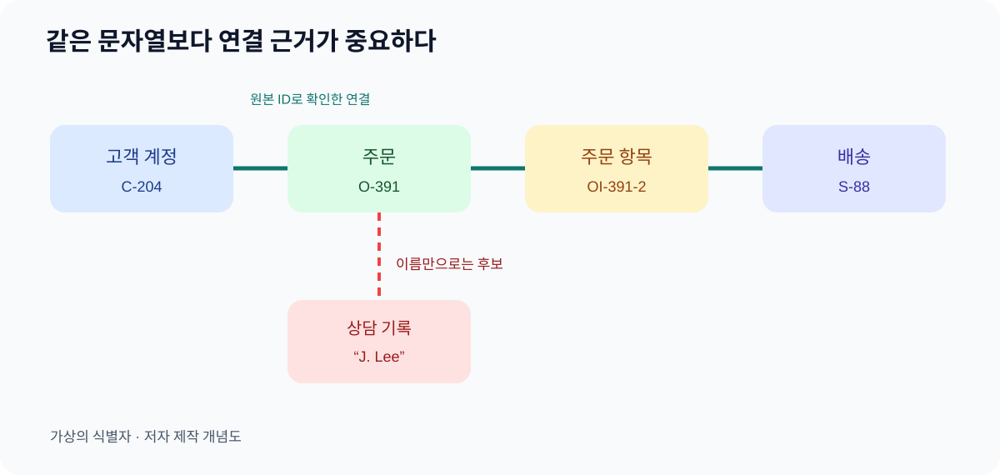

# 07. 같은 대상 알아보기

> **한 문장 요약:** 연결할 데이터가 많아질수록 이름이 아닌 안정적인 식별자와 검증 가능한 매칭 근거가 중요해집니다.

다온상점의 가상 고객 이지민 씨가 상담센터에 “배송을 못 받았다”고 말합니다. 상담 시스템에는 “이지민”, 주문 시스템에는 “J. Lee”, 택배사 파일에는 “수취인 02”가 보입니다. 이름만 보면 세 사람이 같은지 알 수 없습니다. 반대로 주문 시스템과 배송 시스템에 `12345`라는 번호가 둘 다 있어도, 하나는 주문번호이고 다른 하나는 운송장 번호일 수 있습니다. 다른 표의 같은 문자열을 곧바로 같은 대상으로 합치면 타인의 배송 정보가 잘못 노출될 수 있습니다.

*그림: 가상 고객지원 시스템의 식별자와 동일성 판단 경로를 표현한 자체 제작 개념도입니다.*

## 이름과 식별자의 역할

사람이 읽는 이름은 바뀌거나 중복될 수 있습니다. 식별자는 시스템 안에서 대상을 다시 찾기 위한 값입니다. RDF와 OWL 문서에서 자원을 가리키는 국제화된 식별자를 IRI라고 부릅니다. 예를 들어 `https://example.invalid/order/ORD-2026-0142`처럼 도메인과 대상 종류, 값을 함께 담은 형태를 생각할 수 있습니다. 이 주소는 설명용 가상 예시이며 실제 서비스 주소가 아닙니다.

| 항목 | 잘하는 일 | 주의할 점 |
| --- | --- | --- |
| 표시 이름 | 사람이 알아보기 쉬움 | 동명이인·개명·표기 차이 |
| 업무번호 | 같은 시스템에서 빠른 조회 | 다른 시스템의 같은 번호와 충돌 가능 |
| 통합 식별자 | 시스템 사이 연결 기준 | 누가 만들고 유지할지 책임 필요 |
| IRI | 그래프에서 대상·관계를 구분 | 주소처럼 보여도 열람 권한을 뜻하지 않음 |

표시 이름을 없애자는 뜻이 아닙니다. 이름은 상담 화면에, 안정적인 식별자는 연결에 씁니다. “주문 0142”라는 표현은 고객에게 충분하지만 데이터에서는 회사·시스템·번호 체계와 함께 해석해야 합니다. 서로 다른 시스템의 식별자가 같은 실제 대상을 가리키는지는 **증거를 모아 판단**합니다. 단순 문자열 일치는 증거 중 하나일 뿐입니다.

## 고객, 주문, 주문 항목을 섞지 않기

한 고객이 주문 두 건을 만들 수 있고, 한 주문에 상품 두 개가 들어갈 수 있습니다. 반품은 고객 자체보다 특정 주문 항목을 대상으로 하는 경우가 많습니다. 고객 이름을 키로 삼아 반품 요청을 붙이면 동일 고객의 다른 주문까지 영향이 퍼질 수 있습니다.

| 대상 | 예시 ID | 연결할 때 물을 질문 |
| --- | --- | --- |
| 고객 계정 | `C-204` | 로그인한 사람이 이 계정의 권한자입니까? |
| 주문 | `O-391` | 어느 계정이 만들었고 결제 상태는 무엇입니까? |
| 주문 항목 | `OI-391-2` | 어떤 상품 몇 개가 이 항목에 속합니까? |
| 배송 | `S-88` | 이 배송이 어느 주문 항목을 운반합니까? |
| 반품 요청 | `R-17` | 어느 주문 항목의 어떤 수량을 돌려보냅니까? |

이 표는 데이터베이스 설계의 완성안이 아닙니다. 실무자가 “우리가 같은 것이라고 보는 단위”를 점검하기 위한 질문 목록입니다. 주문 전체를 반품했다고 적었지만 실제로는 두 상품 중 하나만 반품한 경우라면 대상 단위를 주문 항목으로 낮춰야 합니다.

## 같은 이름, 같은 대상, 같은 개념

세 표현은 다릅니다. “반품 신청”과 “반품 요청”은 **같은 개념에 붙은 두 이름**일 수 있습니다. 상담 기록의 `R-17`과 물류 기록의 `RET-203`은 **같은 개별 반품 사건의 두 ID**일 수 있습니다. “반품 요청”과 “환불 요청”은 비슷하지만 **서로 다른 개념**일 수 있습니다. 6장의 용어 관리가 첫 번째 문제를 다루고, 이 장의 식별자 매칭은 두 번째 문제를 다룹니다.

OWL의 `owl:sameAs`는 두 이름이 같은 개별 대상을 가리킨다는 강한 주장입니다. [W3C OWL 2 입문서](https://www.w3.org/TR/owl-primer/)는 이 주장을 사용할 때 한쪽에 기록한 정보를 다른 쪽에도 적용할 수 있다고 설명합니다. 따라서 “두 기록이 비슷함”, “동일인일 확률이 높음”, “검토 중”을 `owl:sameAs`로 성급히 바꾸면 안 됩니다. 사람·주문·배송 정보가 잘못 섞일 위험이 있습니다.

## 매칭 근거를 별도로 남기기

고객지원 사례에서 상담 기록과 주문 기록을 연결할 때는 어떤 신호를 확인했는지 남깁니다. 전화번호만 같아도 가족 공유 번호일 수 있습니다. 배송 주소만 같아도 공동주택의 다른 세대일 수 있습니다. 반대로 이름이 달라도 계정 ID와 주문 확인 정보가 일치하면 같은 계정일 가능성이 높습니다. 다만 실제 고객 확인 절차는 조직의 개인정보·보안 정책을 따릅니다.

| 상태 | 기록 예 | 처리 |
| --- | --- | --- |
| 확인됨 | 내부 주문 ID와 권한 있는 계정 조회가 일치 | 업무 관계로 연결 |
| 후보 | 이름·주소 일부가 비슷함 | 사람 검토 전에는 합치지 않음 |
| 충돌 | 두 계정이 한 배송번호를 주장 | 원본 시스템 재조회·보류 |
| 철회 | 과거 매칭이 오판으로 밝혀짐 | 연결과 파생 결과 수정·감사 기록 |

이 표의 “확인됨”도 영구 불변이라는 뜻이 아닙니다. 계정 병합·분리, 주문 취소, 배송사 정정이 생기면 연결을 다시 검토해야 합니다. 매칭 근거, 결정한 담당자, 날짜를 함께 남겨야 나중에 왜 연결했는지 설명할 수 있습니다.

연결용 ID를 모든 직원과 AI 도구에 그대로 보여 줄 필요도 없습니다. 고객 계정의 내부 ID는 상담 화면에서는 일부만 보이게 할 수 있고, 그래프를 조회하는 역할에 따라 볼 수 있는 관계를 제한할 수 있습니다. 식별자가 안정적이라는 장점과, 여러 기록을 한 사람으로 모을 때 생기는 개인정보 위험을 함께 고려해야 합니다. 특히 고객 정보와 주문·배송 이력을 자동으로 합치는 작업은 현재 로그인 사용자의 권한을 원본 시스템에서 다시 확인해야 합니다.

## 따라 해 보기: 식별자 지도

주문·배송·반품 화면에서 동일 업무 한 건이 어떻게 표시되는지 빈 종이에 그려 보세요. 실제 고객 정보 대신 가상 값을 씁니다.

1. 화면마다 대상 종류와 필드 이름을 적습니다. “번호”처럼 모호한 이름은 `주문번호`, `배송번호`로 구체화합니다.
2. 각 번호의 발급 주체와 유효 범위를 적습니다. 한 시스템 안에서만 유일한지, 회사 전체에서 유일한지 구분합니다.
3. 두 기록을 연결하는 근거를 선 옆에 적습니다. 예: 배송 레코드의 원본 주문 ID.
4. 불확실한 선은 점선으로 그리고 자동 연결에 사용하지 않습니다.
5. 잘못 연결되었을 때 어떤 화면·검색 결과·AI 답변을 수정해야 할지 적습니다.

산출물은 “모든 데이터 통합”이 아닙니다. **확실히 이어지는 한 경로와 아직 불확실한 한 경로**를 구분한 작은 지도입니다.

## 자주 생기는 실패

**번호의 네임스페이스를 무시**하면 주문번호 `12345`와 운송장번호 `12345`를 합칩니다. 유형과 발급 시스템을 함께 보관합니다. **표시 이름을 키로 사용**하면 개명·오타·동명이인에서 연결이 무너집니다. 내부 식별자를 사용합니다. **후보 매칭을 동일성 선언으로 승격**하면 불확실한 정보가 넓게 퍼집니다. 근거가 확인되기 전까지 후보 상태를 유지합니다. **매칭만 기록하고 철회를 준비하지 않으면** 오판이 계속 전파됩니다. 수정 범위와 담당자를 미리 정합니다.

## 점검표

- [ ] 고객·주문·주문 항목·배송·반품의 ID가 구분되어 있나요?
- [ ] 같은 문자열이라도 발급 시스템과 대상 종류를 확인하나요?
- [ ] 동일성 판단 근거와 담당자를 남기나요?
- [ ] 후보 관계를 확정 관계로 오인하지 않나요?
- [ ] 잘못 합친 연결을 철회할 절차가 있나요?

## 장 요약

온톨로지의 선이 유용하려면 선 끝의 대상이 누구인지 분명해야 합니다. 이름은 보여 주기 위한 것이고 식별자는 연결을 위한 것입니다. 같은 개념의 이름을 맞추는 일과 같은 개별 대상을 확인하는 일은 다른 절차입니다.

## 공식 출처

- [W3C RDF 1.1 Concepts and Abstract Syntax](https://www.w3.org/TR/rdf11-concepts/) — IRI와 그래프의 대상 식별, W3C 권고안
- [W3C OWL 2 Primer](https://www.w3.org/TR/owl-primer/) — `owl:sameAs`의 의미, W3C 권고안

*출처 확인일: 2026년 11월 4일. 예시 ID와 판단 절차는 설명을 위한 가상 설계입니다.*
