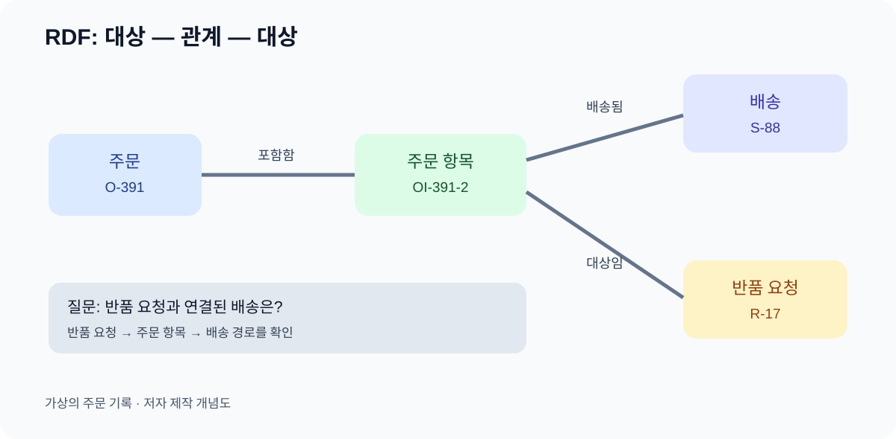

# 08. 사실을 연결하는 RDF

> **한 문장 요약:** RDF는 “어떤 대상이 어떤 관계로 무엇과 이어지는가”를 작은 문장들의 모임으로 표현하는 데이터 모델입니다.

다온상점 고객지원 팀은 주문 화면에서 주문번호를, 물류팀은 배송 화면에서 운송 상태를, 상담팀은 문의 내용을 봅니다. 세 화면의 열 이름을 한 표로 합치는 것만으로 “이 문의가 어느 배송에 관한 것인가”에 답할 수는 없습니다. 연결할 대상의 식별자와 관계의 뜻을 함께 적어야 합니다. RDF(Resource Description Framework)는 이런 연결을 **주어–술어–목적어**라는 세 칸의 문장, 즉 트리플(triple)로 표현합니다. 2026년 11월 4일 기준 기본 설명은 [W3C RDF 1.1 권고안](https://www.w3.org/TR/rdf11-concepts/)을 따릅니다.



*그림: 가상 주문 사례의 RDF 트리플을 설명하기 위해 자체 제작한 개념도입니다. 실제 서비스 데이터가 아닙니다.*

## 세 칸의 문장으로 읽기

가상의 주문 `O-391`이 고객 계정 `C-204`에 속한다고 합시다. “주문 O-391 — 주문자 — 고객 C-204”가 한 트리플입니다. 주문 항목 `OI-391-2`가 배송 `S-88`을 통해 운반된다면 “주문 항목 OI-391-2 — 배송됨 — 배송 S-88”이라는 다른 트리플을 적습니다. 여러 트리플이 이어지면 그래프가 됩니다.

| 위치 | 뜻 | 가상 예 |
| --- | --- | --- |
| 주어 | 설명할 대상 | 주문 `O-391` |
| 술어 | 관계 또는 속성 | `주문자` |
| 목적어 | 연결된 대상이나 값 | 고객 `C-204` |

술어는 단순한 연결선이 아닙니다. “주문자”와 “배송 받는 사람”은 같은 고객을 가리킬 수도 있지만 뜻이 다릅니다. 관계명을 모호하게 `관련됨`으로만 쓰면 검색도 검증도 어려워집니다. RDF의 목적어에는 다른 대상의 식별자 또는 날짜·문자열 같은 값이 올 수 있습니다. “주문 상태”처럼 문자열을 기록할 때는 그 값이 확정된 사실인지, 어느 시점의 값인지 별도 관리가 필요합니다.

## 표 한 줄과 그래프 한 문장

스프레드시트에는 `주문번호 | 고객번호 | 배송번호`가 한 줄에 놓입니다. RDF에서는 주문, 고객, 배송 각각이 별도 대상이며 관계 문장을 여러 개 만듭니다. 둘 중 하나가 항상 우월한 구조는 아닙니다. 일관된 목록과 집계에는 표가 충분할 수 있습니다. 여러 시스템을 넘나들며 관계 경로를 따라가야 할 때 그래프 표현이 유용해집니다.

| 표 방식에서 보이는 것 | RDF에서 명시할 것 | 확인 질문 |
| --- | --- | --- |
| 같은 행의 고객번호 | 주문이 어느 고객 계정과 관계있는지 | 주문자와 수취인이 같은 사람인가? |
| 배송번호 한 칸 | 배송이 어느 주문 항목을 운반하는지 | 분할 배송이면 여러 건인가? |
| 반품 상태 문자열 | 반품 요청의 현재 상태 또는 상태 이력 | 언제 누가 바꾸었는가? |
| 상담 메모 | 문의가 어느 주문·배송을 대상으로 하는지 | 근거가 확인된 연결인가? |

“같은 행에 있으니까 관계가 있다”에서 한 걸음 더 나아가 관계의 이름과 방향을 정해야 합니다. 주문이 배송을 가진다고 할지, 배송이 주문 항목을 운반한다고 할지는 실제 업무 질문에 맞게 결정합니다. 단순해 보이는 선택이 나중에 “한 주문을 여러 배송으로 나눈 경우”를 표현할 수 있는지 좌우합니다.

## 작은 그래프 읽어 보기

다음은 개념을 익히기 위한 가상 표현입니다. `example.invalid`는 실제 운영 주소가 아니며, 코드를 실행했다고 주장하는 예제가 아닙니다. Turtle은 RDF 그래프를 텍스트로 적는 여러 방법 중 하나입니다.

```turtle
@prefix ex: <https://example.invalid/ontology/> .
@prefix item: <https://example.invalid/item/> .

item:O-391 ex:hasItem item:OI-391-2 .
item:OI-391-2 ex:shippedBy item:S-88 .
item:R-17 ex:targetsItem item:OI-391-2 .
```

첫 줄의 `ex:`와 `item:`은 긴 식별자를 읽기 쉽게 줄여 쓴 접두어입니다. 실제 식별자는 각각의 전체 IRI입니다. 예를 들어 둘째 문장은 “주문 항목 `OI-391-2` — 배송됨 — 배송 `S-88`”로 읽습니다. 이 세 문장만으로 “반품 요청 `R-17`이 어떤 배송과 연결되는가”라는 질문에 경로를 따라 답할 수 있습니다. 다만 어느 시스템이 이 문장을 만들었는지, 이 배송이 최신 기록인지는 아직 모릅니다.

여기서 배송 `S-88`은 **다른 대상**이므로 IRI로 표현했습니다. 반면 “접수일은 2026년 11월 4일”이라는 문장의 날짜는 보통 값(리터럴)으로 표현합니다. 두 칸 모두 텍스트처럼 보이더라도 그래프에서의 역할은 다릅니다. 배송번호를 단순 문자열로만 저장하면 그 배송에 연결된 기사·상태·주문 항목으로 관계를 이어 가기 어렵습니다. 반대로 접수일을 별도 대상으로 만들 이유가 없다면 날짜 값만으로 충분할 수 있습니다. 어떤 것을 대상으로 삼을지는 답하려는 업무 질문에서 결정합니다.

## 그래프가 사실의 진위를 보장하지는 않습니다

“배송 S-88이 주문 항목 OI-391-2를 운반한다”는 문장을 RDF에 넣으면 **그 주장이 구조화**됩니다. 실제로 배송이 일어났다는 외부 검증은 별도입니다. 잘못 연결한 운송장을 그래프로 만들면 잘못된 답을 더 빠르게 찾을 수도 있습니다. 따라서 수집 단계에서 원본 필드와 매핑 규칙을 기록하고, 업무 담당자의 확인이 필요한 연결은 확정되기 전까지 후보로 둡니다.

또한 RDF 1.1은 기본 그래프와 이름 붙은 그래프를 모아 데이터셋을 구성할 수 있습니다. 그렇다고 이름 붙은 그래프만 사용하면 출처나 신뢰도가 자동으로 부여되는 것은 아닙니다. 출처의 의미와 처리 방식은 시스템이 따로 정해야 하며 11장에서 다룹니다.

오래된 배송 문장과 새 배송 문장이 함께 남아 있다면 어느 시점의 답이 필요한지도 정해야 합니다. “현재 배송 상태”와 “지난주에 상담사가 본 배송 상태”는 서로 다른 질문입니다.

## 따라 해 보기: 세 문장과 한 질문

코드 없이 종이 또는 표로 해도 됩니다. 주문 `O-391`, 항목 `OI-391-2`, 배송 `S-88`, 반품 `R-17`을 네 개의 상자로 적습니다. 다음 표를 채우세요.

| 주어 | 관계 | 목적어 | 근거가 있는 화면·문서 |
| --- | --- | --- | --- |
| 주문 O-391 | 포함함 | 주문 항목 OI-391-2 | 주문 상세 화면 |
| 주문 항목 OI-391-2 | 배송됨 | 배송 S-88 | 배송 원본 |
| 반품 요청 R-17 | 대상임 | 주문 항목 OI-391-2 | 반품 접수 기록 |

첫 두 줄은 표의 예시이고 세 번째도 가상입니다. 자기 업무에 적용할 때는 화면에 실제로 존재하는 필드를 확인해야 합니다. 이어서 “반품 요청과 배송은 어떤 경로로 이어지는가?”라고 질문해 보세요. 중간의 주문 항목이 없다면 이 질문에 안정적으로 답할 수 있는지 검토합니다. 이 활동의 산출물은 **근거가 있는 세 문장과 검증할 질문 하나**입니다.

## 자주 생기는 실패

**모든 관계를 `관련됨`으로 뭉치면** 질문별 경로를 구분할 수 없습니다. 동사와 방향을 적습니다. **화면의 한 행을 한 대상이라고 가정하면** 주문과 주문 항목, 배송의 다대다 관계가 사라질 수 있습니다. 대상을 분리합니다. **문자열 이름을 식별자처럼 쓰면** 동명이인과 이름 변경에 취약해집니다. 7장의 ID 지도를 참조합니다. **그래프에 들어갔다는 이유로 사실이 검증되었다고 생각하면** 원본 오류가 그대로 전파됩니다. 출처와 검증 절차를 분리합니다.

## 점검표

- [ ] 문장마다 주어·관계·목적어를 읽을 수 있나요?
- [ ] 관계의 방향과 뜻을 업무 담당자가 설명할 수 있나요?
- [ ] 주문 전체와 주문 항목을 구분했나요?
- [ ] 각 문장의 원본 근거를 추적할 수 있나요?
- [ ] 그래프에서 답할 질문을 하나 정했나요?

## 장 요약

RDF의 작은 문장은 시스템 사이의 연결을 명시합니다. 그래프는 이 문장들이 공유하는 대상을 통해 만들어집니다. 연결을 잘 적는 일과 연결이 현실에서 맞는지 확인하는 일은 계속 함께 가야 합니다.

## 공식 출처

- [W3C RDF 1.1 Concepts and Abstract Syntax](https://www.w3.org/TR/rdf11-concepts/) — 트리플·그래프·데이터셋, W3C 권고안
- [W3C RDF 1.1 Turtle](https://www.w3.org/TR/turtle/) — 예시 표기의 문법, W3C 권고안

*출처 확인일: 2026년 11월 4일. RDF 1.2 관련 문서는 별도 진행 중인 표준으로 이 장의 기본 규칙으로 사용하지 않았습니다.*
