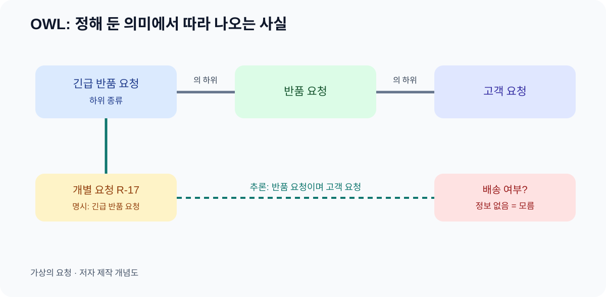

# 09. 규칙에서 따라 나오는 사실

> **한 문장 요약:** OWL은 개념과 관계의 형식적 뜻을 적고, 그 뜻과 이미 주어진 사실에서 따라 나오는 사실을 추론하게 합니다.

다온상점 고객지원 보고서에서 “긴급 반품 요청”은 반품 요청의 한 유형으로 정했습니다. 월말에 모든 반품 요청을 조회할 때 긴급 건도 포함되어야 합니다. 담당자가 매번 두 분류를 모두 검색해야 한다면 분류 규칙이 시스템에 충분히 전달되지 않은 셈입니다. OWL(Web Ontology Language)에서는 “긴급 반품 요청은 반품 요청의 하위 종류”라는 관계를 명시할 수 있습니다. 어떤 개별 요청 `R-17`이 긴급 반품 요청이라는 사실이 있으면, 적절한 OWL 추론기는 그 요청이 반품 요청이기도 하다는 결론을 낼 수 있습니다.

*그림: W3C OWL 2의 기본 추론 원리를 가상 반품 사례로 풀어 그린 자체 제작 개념도입니다. 특정 추론기의 실행 화면이 아닙니다.*

## 추론은 어디에서 나오는가

OWL은 클래스로 대상의 종류를, 속성으로 관계를, 개별 대상으로 실제 사건을 표현합니다. 여기서 “규칙”은 자연어 업무 지시와 다릅니다. 형식적 의미가 정해진 문장입니다. 따라서 추론 결과를 이해하려면 어떤 문장을 입력했고 어떤 규칙을 적용했는지 설명할 수 있어야 합니다.

| 주어진 문장 | 뜻 | 따라 나오는 결론 |
| --- | --- | --- |
| 긴급 반품 요청은 반품 요청의 하위 종류 | 모든 긴급 반품 요청은 반품 요청 | 긴급 건은 반품 요청 검색에 포함될 수 있음 |
| `R-17`은 긴급 반품 요청 | 개별 사건의 분류 | `R-17`은 반품 요청 |
| 반품 요청은 고객 요청의 하위 종류 | 더 넓은 분류 | `R-17`은 고객 요청 |

이 결론은 외부 세계를 새로 관찰한 결과가 아닙니다. 이미 입력한 분류와 개별 사실에서 논리적으로 따라옵니다. 만약 처음 분류가 틀렸다면 추론도 틀린 구조를 넓게 퍼뜨립니다. 그러므로 “추론이 되었다”와 “현실의 반품이 확인되었다”를 구분해야 합니다.

## 열린 세계: 빠진 사실은 거짓이 아닙니다

OWL을 처음 배우는 실무자가 특히 조심할 부분은 **열린 세계 가정**입니다. 배송 정보가 그래프에 없다고 해서 “배송되지 않았다”고 자동 결론 내리지 않습니다. 정보가 다른 시스템에 있을 수도, 아직 들어오지 않았을 수도 있습니다. [W3C OWL 2 입문서](https://www.w3.org/TR/owl-primer/)는 일반적인 데이터베이스에서 흔한 “없으면 거짓”의 사고와 OWL의 열린 세계를 구분합니다.

| 기록 상황 | OWL 관점의 안전한 해석 | 업무에서 할 일 |
| --- | --- | --- |
| 배송 문장이 없음 | 배송 여부를 모름 | 배송 원본 조회 |
| 배송 문장이 있음 | 그래프가 배송 관계를 주장함 | 출처·시각·원본 일치 확인 |
| “배송되지 않음”이 명시됨 | 별도의 부정 정보를 주장함 | 충돌하는 기록이 있는지 확인 |
| 두 기록이 서로 다름 | 모델에 따라 모순 또는 정정 후보 | 자동 답변을 보류하고 조사 |

두 번째 행도 현실의 진실을 보증하지 않습니다. RDF와 OWL은 주장의 구조와 의미를 다루며, 원본 시스템의 실제 사건을 스스로 확인하지 않습니다. “데이터가 없으면 미배송” 같은 운영 규칙이 필요하다면 필요한 범위와 시점을 정한 별도 질의·검증·업무 정책으로 처리합니다.

## 종류의 규칙과 업무 처리 규칙은 다릅니다

“긴급 반품 요청은 반품 요청이다”는 분류에 관한 명제입니다. “긴급 반품은 24시간 안에 환불해야 한다”는 서비스 운영 정책입니다. 두 번째 문장을 온톨로지 한 줄로 표현했다고 해서 시간 계산, 권한 확인, 결제 실행이 자동으로 이뤄지지 않습니다. 정책은 별도 업무 시스템에 구현하고 평가해야 합니다.

| 질문 | 온톨로지가 도울 수 있는 부분 | 별도로 필요한 부분 |
| --- | --- | --- |
| 이 요청은 어떤 종류인가? | 하위·상위 종류 추론 | 원본 분류의 정확성 확인 |
| 누가 승인할 수 있는가? | 역할 개념과 관계 표현 | 로그인·현재 권한 검증 |
| 환불을 실행할까? | 관련 주문·결제 정보 찾기 | 정책·사람 승인·결제 API |
| 24시간이 지났는가? | 접수 시각의 의미 명시 | 시계·시간대·기한 계산 |

이 표를 회의에서 그대로 활용할 수 있습니다. “온톨로지에 넣으면 AI가 알아서 한다”는 요구가 나오면, 어느 부분이 의미 모델이고 어느 부분이 행동과 책임인지 나누어 적습니다.

관계의 대상 범위도 자주 오해합니다. 예를 들어 “배송됨” 관계의 대상은 배송이라는 OWL 범위(range)를 선언했다고 합시다. 그래프에 `OI-391-2`가 `S-88`에 배송됨 관계로 이어지면, 추론기는 `S-88`을 배송의 한 사례로 분류할 수 있습니다. 이것은 `S-88`의 유형 표시가 빠졌다는 **검증 오류**를 자동으로 보고한다는 뜻이 아닙니다. 업무에서는 그런 누락을 실패로 처리해야 할 수 있으므로 10장의 SHACL 조건처럼 별도 검사가 필요합니다. 범위 선언을 입력 폼의 필수 입력 규칙처럼 읽지 않아야 합니다.

온톨로지 정의를 바꾸면 같은 데이터에서 따라 나오는 결론도 달라질 수 있습니다. 따라서 중요한 결정에 추론 결과를 사용했다면 당시의 정의 버전과 입력 데이터 버전을 함께 남겨야 나중에 결론을 재현할 수 있습니다.

## 서로 다른 대상을 구분하는 선언도 신중하게

OWL에서는 두 개별 대상이 같다는 `owl:sameAs`, 다르다는 `owl:differentFrom`, 두 종류가 겹치지 않는다는 분리 선언 등을 사용할 수 있습니다. 그러나 식별자 두 개가 다르다고 현실의 대상도 반드시 다르다고 단정할 수 없습니다. 7장에서 다룬 매칭 근거를 먼저 검토합니다. “반품 요청”과 “환불 요청”을 서로 겹치지 않는 종류로 선언할지도 업무 정의에 달렸습니다. 한 요청이 두 절차를 함께 포함할 수 있다면 무리한 분리는 모순을 만들 수 있습니다.

## 따라 해 보기: 추론 사다리

코드를 작성하지 않고 다음 네 줄을 적어 봅니다.

1. **종류**: “배송 지연 문의는 배송 문의의 하위 종류다.”
2. **더 넓은 종류**: “배송 문의는 고객 문의의 하위 종류다.”
3. **개별 사실**: “문의 `Q-018`은 배송 지연 문의다.”
4. **따라 나오는 사실**: “문의 `Q-018`은 배송 문의이며 고객 문의다.”

이제 “문의 `Q-018`은 환불 대상이다”라는 문장을 추가해도 되는지 묻습니다. 앞의 네 줄만으로는 알 수 없습니다. 환불 정책과 주문 사실이 더 필요합니다. 이 한 줄을 적지 않는 절제가 정확한 모델링의 일부입니다. 산출물은 **근거가 되는 문장과 추론 가능한 문장, 아직 모르는 문장의 구분표**입니다.

## 자주 생기는 실패

**빠진 값을 부정으로 읽으면** 배송 기록이 늦게 들어온 고객을 미배송으로 오판합니다. 원본을 조회하거나 “확인되지 않음” 상태를 사용합니다. **분류 추론을 실행 허가로 읽으면** 긴급 반품이라는 이유만으로 환불을 보낼 수 있습니다. 실행 정책과 권한을 따로 둡니다. **너무 넓은 상하 관계를 만들면** 한 번의 오분류가 큰 범위로 전파됩니다. 구체 사례를 사용해 반례를 찾아야 합니다. **모순을 단순 입력 오류로만 취급하면** 실제 업무 정의의 충돌을 놓칩니다. 담당자와 정의부터 재검토합니다.

## 점검표

- [ ] 각 추론 결과의 근거 문장을 설명할 수 있나요?
- [ ] 정보가 없는 경우를 거짓과 구분하나요?
- [ ] 추론과 원본 데이터 검증을 분리하나요?
- [ ] 분류 규칙을 결제·환불 실행 정책으로 오해하지 않나요?
- [ ] 하위·상위 종류의 반례를 점검했나요?

## 장 요약

OWL은 정의한 종류와 관계를 따라 새로운 분류를 이끌어 내는 데 유용합니다. 열린 세계에서는 기록되지 않은 사실을 거짓이라고 할 수 없습니다. 규칙의 품질과 원본 사실의 품질이 함께 좋아야 추론 결과도 업무에 쓸 수 있습니다.

## 공식 출처

- [W3C OWL 2 Primer](https://www.w3.org/TR/owl-primer/) — 클래스·개별 대상·추론·열린 세계 가정, W3C 권고안
- [W3C OWL 2 Overview](https://www.w3.org/TR/owl2-overview/) — OWL 2 문서군과 의미 체계, W3C 권고안

*출처 확인일: 2026년 11월 4일. 본문의 고객지원 규칙과 번호는 가상입니다.*
