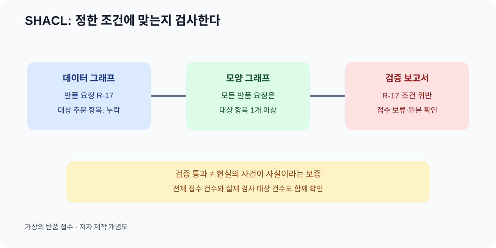

# 10. 데이터가 약속을 지켰는지 검사하기

> **한 문장 요약:** SHACL은 정해 둔 데이터 조건에 비추어 그래프를 검사하고, 어느 대상이 어느 조건을 어겼는지 보고합니다.

다온상점의 반품 접수 파일에 반품 요청 `R-17`이 들어왔습니다. 그러나 어느 주문 항목을 반품하는지 비어 있습니다. OWL의 열린 세계 관점에서는 “대상 주문 항목이 아직 알려지지 않았다”고 볼 수 있습니다. 업무 시스템은 그렇게 기다릴 수만 없습니다. 반품 창고가 물건을 받아도 어떤 주문에서 차감할지 모르면 처리가 멈춥니다. “반품 요청에는 대상 주문 항목이 적어도 하나 있어야 접수를 진행한다”는 **검사 조건**이 필요합니다. W3C의 SHACL(Shapes Constraint Language)은 RDF 데이터 그래프를 이런 조건에 비추어 검증하는 언어입니다.



*그림: 가상 반품 접수의 검사 흐름을 설명하기 위해 자체 제작한 도식입니다. W3C 공식 도식이나 검증 도구 화면이 아닙니다.*

## 모양과 데이터의 두 묶음

SHACL에서는 검사할 데이터 그래프와 조건을 적은 모양 그래프(shapes graph)를 구분합니다. 이 장에서 “모양”은 화면 디자인이 아니라 **어떤 대상이 어떤 값을 갖추어야 하는지** 적은 약속입니다. 검증을 실행하면 적합 여부와 위반 항목을 담은 보고서가 나옵니다. [W3C SHACL 권고안](https://www.w3.org/TR/shacl/)은 2017년에 확정된 규격입니다. 2026년 11월 4일 현재 보이는 SHACL 1.2 Core는 별도의 작업 초안이므로 여기서 사용하는 기본 규칙과 같은 확정 상태로 쓰지 않습니다.

| 구분 | 다온상점 예시 | 읽는 법 |
| --- | --- | --- |
| 데이터 그래프 | `R-17`의 유형·대상 항목·접수일 | 지금 들어온 기록 |
| 모양 그래프 | 모든 반품 요청에 대상 항목 1개 이상 | 접수 전에 지켜야 할 조건 |
| 검증 보고서 | `R-17`에서 대상 항목 누락 | 무엇을 고쳐야 하는지 |

검사는 “형식과 약속에 맞는가?”를 답합니다. “고객이 정말 물건을 보냈는가?”나 “입력한 주문 항목이 실제 물건과 일치하는가?”는 추가 원본 확인이 필요합니다. 검증에 통과한 거짓 정보도 있을 수 있습니다. 따라서 SHACL 검증과 현장 사실 확인을 함께 설계합니다.

## 어떤 조건을 둘 수 있나

반품 요청의 대상 주문 항목에는 최소 한 개가 있어야 합니다. 접수일은 날짜 형식이어야 합니다. 상태는 조직이 허용한 값 중 하나여야 할 수 있습니다. W3C SHACL에는 최소 개수를 검사하는 `sh:minCount`, 값의 유형을 보는 `sh:datatype`, 노드 종류를 확인하는 `sh:nodeKind` 같은 구성 요소가 있습니다. 실무자는 우선 조건을 자연어와 표로 정한 뒤, 데이터 담당자와 기술 표현을 확인하면 됩니다.

| 조건 카드 | 가상 규칙 | 누락·오류가 나면 |
| --- | --- | --- |
| 필수 관계 | 반품 요청은 대상 주문 항목 1개 이상 | 접수 보류, 담당자 확인 |
| 값 형식 | 접수일은 날짜 | 원본 입력 수정 |
| 허용 값 | 상태는 접수·승인 대기·승인·거절 중 하나 | 새 상태 도입인지 오타인지 확인 |
| 참조 종류 | 대상은 주문 항목 식별자 | 주문 전체 번호를 잘못 넣었는지 확인 |

마지막 행은 숫자가 들어 있다는 사실만 확인해서는 해결되지 않습니다. `O-391`은 주문이고, `OI-391-2`는 그 주문의 개별 항목이라고 정했다면 둘을 구분해야 합니다. 검사 규칙을 만들 때는 현재 데이터가 **어떤 유형으로 표시되어 있는지**와 그것을 추론해도 되는지 명시합니다.

## 아주 작은 기술 예시

다음 Turtle은 조건의 모양을 보여 주는 설명용 초안이며 실행 결과를 주장하지 않습니다. `example.invalid`는 가상 주소입니다. 기술 담당자가 실제 도메인과 대상 클래스의 식별자를 맞춘 뒤 검증 도구에서 시험해야 합니다.

```turtle
@prefix ex: <https://example.invalid/ontology/> .
@prefix sh: <http://www.w3.org/ns/shacl#> .

ex:ReturnRequestShape
    a sh:NodeShape ;
    sh:targetClass ex:ReturnRequest ;
    sh:property [
        sh:path ex:targetsItem ;
        sh:minCount 1 ;
        sh:nodeKind sh:IRI
    ] .
```

이 조건은 `ReturnRequest` 유형으로 선택된 대상마다 `targetsItem` 값이 한 개 이상 있는지, 그 값이 IRI인지 검사합니다. 값이 실제 다온상점 주문 항목인지까지 이 코드만으로 증명하지 않습니다. 또한 실제 데이터에서 반품 요청의 유형 표시가 누락되면 `sh:targetClass`의 검사 대상에 들어오지 않을 수 있습니다. 그러므로 “검증 통과” 보고서를 볼 때는 **몇 건을 검사했는지**도 함께 확인합니다.

## 실패 사례: 검사 성공률 100%의 함정

100건 중 20건이 반품 요청 유형을 잘못 표시해서 검사 대상에서 빠졌다고 합시다. 나머지 80건이 모두 통과하면 도구의 결과가 “적합”으로 나올 수 있습니다. 그러나 업무 관점에서는 20건의 분류 누락이 남아 있습니다. 해결하려면 원본 접수 건수와 검사 대상 건수를 대조하고, 유형 누락 자체를 찾는 별도 검사 또는 수집 단계 검사를 마련합니다.

또 다른 함정은 규칙을 과하게 고정하는 것입니다. 주문 항목을 무조건 정확히 한 개로 제한하면, 한 번의 반품 요청으로 같은 주문의 두 상품을 보내는 실제 업무를 막을 수 있습니다. 이 경우는 “한 개 이상”이 맞는지, “반품 요청 항목”이라는 별도 대상이 필요한지 업무 담당자와 검토해야 합니다. 좋은 검증 규칙은 업무를 아는 사람이 예외와 반례를 함께 확인한 결과입니다.

## 따라 해 보기: 검사 카드 다섯 장

다온상점 예시처럼 자기 업무의 한 대상만 고릅니다. 실제 개인정보를 적지 말고 가상 행을 만듭니다.

1. **대상**을 적습니다. 예: 반품 요청.
2. 업무를 멈추게 하는 필수 관계 두 개와 필수 값 한 개를 적습니다.
3. 각 조건에 대해 정상 행, 누락 행, 잘못된 형식의 행을 만듭니다.
4. 실패했을 때 자동 보류할지, 담당자에게 보낼지, 원본을 재조회할지 정합니다.
5. 검사를 받아야 할 전체 건수와 실제 검사한 건수를 기록합니다.

산출물은 검사 카드와 세 개의 가상 행입니다. 이렇게 시작하면 “어떤 조건을 SHACL로 옮겨야 할지”를 개발 담당자에게 전달할 수 있습니다. 모든 규칙을 한 번에 형식화할 필요는 없습니다.

## OWL과 SHACL을 나란히 놓기

| 질문 | OWL에서 주로 다루는 것 | SHACL에서 주로 다루는 것 |
| --- | --- | --- |
| 이 종류가 더 넓은 종류에 속하나? | 정의에서 따라 나오는 분류 | 필요하면 검사 대상으로 활용 |
| 관계가 기록되지 않았나? | 없다고 해서 거짓이라고 단정하지 않음 | 최소 개수 조건에 걸릴 수 있음 |
| 데이터가 조건에 맞나? | 의미와 일관성의 논리 | 명시한 조건의 검증 보고서 |
| 현실에서 사실인가? | 별도 원본 확인 필요 | 별도 원본 확인 필요 |

두 도구의 질문이 다르므로 어느 하나로 다른 하나를 대체한다고 생각하지 않습니다. OWL이 뜻을 설명하고 SHACL이 접수 조건을 검사하도록 함께 쓸 수 있습니다. 다만 실제 검증 결과는 대상 선택, 추론 적용 여부, 구현 설정에 따라 달라질 수 있어 운영 절차를 명시해야 합니다.

## 점검표

- [ ] 조건이 업무상 왜 필요한지 설명할 수 있나요?
- [ ] 검사 대상의 전체 건수와 실제 선택된 건수를 비교하나요?
- [ ] 최소 개수·형식·참조 종류를 분리했나요?
- [ ] 예외 사례로 규칙을 시험했나요?
- [ ] 검증 통과를 현실 사실의 보증으로 오해하지 않나요?

## 장 요약

SHACL은 데이터가 조직이 정한 모양을 지켰는지 알려 줍니다. 검사 결과에는 대상의 누락과 잘못된 값을 찾는 실질적 효용이 있습니다. 동시에 조건 자체가 현실 업무에 맞는지, 검사 대상이 빠지지 않았는지, 원본 사실이 맞는지는 사람이 계속 확인해야 합니다.

## 공식 출처

- [W3C Shapes Constraint Language (SHACL)](https://www.w3.org/TR/shacl/) — 2017년 W3C 권고안, 조건·대상·보고서
- [W3C OWL 2 Primer](https://www.w3.org/TR/owl-primer/) — 열린 세계 가정과 의미 모델의 구분
- [W3C SHACL 1.2 Core](https://www.w3.org/TR/shacl-core/) — 2026-11-02 작업 초안. 확정 권고안으로 취급하지 않음

*출처 확인일: 2026년 11월 4일. 사례 수치와 검증 코드는 설명용 가상 예시입니다.*
