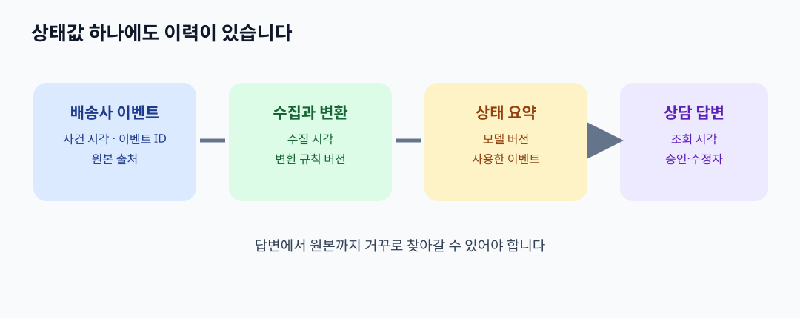

# 11. 출처·시간·버전: 같은 사실이 왜 달라 보일까

> **이 장의 한 문장:** 온톨로지의 개념과 관계를 정한 뒤에는 개별 사실이 **어디서 왔고, 언제 유효하며, 어떤 버전으로 해석되었는지** 함께 남겨야 합니다.

가상의 쇼핑몰 ‘다온상점’에서 상담원이 주문 `O-391`을 열었습니다. 고객 화면에는 ‘배송 중’인데 물류 화면에는 ‘배송 완료’라고 나옵니다. 온톨로지에 `주문 — 배송건`, `배송건 — 배송상태`라는 관계를 정확히 정의했어도 두 값의 차이는 사라지지 않습니다. 한 화면은 어제 밤 11시에 복사한 값을 보여 주고, 다른 화면은 오늘 아침 배송사의 새 이벤트를 받아들였기 때문입니다. 상담원이 먼저 물어야 할 말은 “어느 값이 맞지?”뿐 아니라 “각 값은 언제, 누가, 어떤 기록을 근거로 만들었지?”입니다.

*그림: 이 책을 위해 직접 제작한 출처·시간·버전 개념도입니다. 특정 제품 화면이나 W3C 공식 그림이 아닙니다.*

## 11.1 사실을 기록할 때 필요한 세 종류의 시간

`배송 완료` 같은 문장은 사실처럼 보이지만, 시간과 출처가 빠지면 의미가 모호합니다. 배송사가 11월 3일 10시에 배달을 완료했고, 우리 시스템이 11월 3일 10시 5분에 그 이벤트를 받았으며, 상담 화면이 11월 4일 9시에 갱신되었다고 해 봅시다. 세 시각은 서로 다른 질문에 답합니다.

| 기록 | 답하는 질문 | 예시 |
| --- | --- | --- |
| 사건 시각 | 현실의 일이 언제 일어났나? | 배송사가 배달 완료를 기록한 11월 3일 10:00 |
| 수집 시각 | 우리 시스템이 언제 알게 되었나? | 배송 이벤트를 받은 11월 3일 10:05 |
| 조회 기준 시각 | 화면이나 답변을 어느 시점의 자료로 만들었나? | 상담원이 조회한 11월 4일 09:00 |

이 세 칸은 업무 설계를 위한 제안입니다. 특정 표준이 모든 조직에 이 세 칸을 의무화한다는 뜻은 아닙니다. 다만 기록된 때와 실제로 유효한 때를 구분하지 않으면 늦게 도착한 이벤트를 잘못 읽기 쉽습니다. 예를 들어 11월 4일에 들어온 ‘11월 3일 8시 배송 지연’ 이벤트는 새로 수집되었지만, 뒤이어 발생한 10시 배송 완료를 뒤집는 최신 상태가 아닙니다.

## 11.2 출처를 따라갈 수 있게 하기

출처 기록을 ‘문서 링크 하나’로 끝내지 않습니다. 누가 원자료를 만들었는지, 어떤 작업이 값을 변환했는지, 최종 답변이 어떤 버전을 사용했는지를 구분합니다. W3C의 **PROV-O**는 이 과정을 표현하는 공통 어휘를 제공합니다. 여기서 `Entity`는 문서·상태 기록 같은 대상, `Activity`는 수집·정제·답변 생성 같은 활동, `Agent`는 활동에 책임이 있는 사람·조직·시스템입니다. `wasGeneratedBy`, `wasDerivedFrom`, `wasAttributedTo`는 각각 생성 활동, 파생 원본, 귀속 대상을 연결합니다.

| 우리 사례의 대상 | 출처 관점 | 기록할 질문 |
| --- | --- | --- |
| 배송사 원본 이벤트 | 원자료 Entity | 이벤트 ID와 원본 주소는 무엇인가? |
| 이벤트 수집 작업 | Activity | 어떤 시각과 규칙으로 가져왔는가? |
| 배송 상태 요약 | 파생 Entity | 어떤 이벤트를 묶어 만들었는가? |
| 배송사 또는 운영 팀 | Agent | 누가 원자료와 규칙에 책임지는가? |
| AI의 고객 안내 초안 | 또 다른 파생 Entity | 어떤 요약과 정책 문서를 인용했는가? |

예를 들어 “배송 완료”라는 답변을 상담원에게 보여 줄 때는 원본 배송 이벤트 ID와 조회 시각을 함께 제공할 수 있습니다. 나중에 배송사가 이벤트를 정정했다면, 어느 답변이 정정 전 자료를 사용했는지 찾아낼 수 있습니다. PROV-O를 쓰지 않는 작은 팀이라도 같은 질문을 기록표로 남길 수 있습니다. 중요한 것은 특정 파일 형식보다 **근거를 역으로 찾을 수 있는 연결**입니다.

## 11.3 개념의 버전과 사실의 버전은 다릅니다

`배송 완료`의 의미 자체가 달라질 수도 있습니다. 예전에는 배송사 앱에서 ‘도착’ 버튼을 누르면 완료로 분류했지만, 새 정책에서는 수령 확인이 필요할 수 있습니다. 그러면 11월 3일의 값은 어떤 정책 버전으로 해석한 결과인지 기록해야 합니다. 개념 모델의 버전과 주문 데이터의 버전을 하나로 뭉치면 과거 사례를 다시 설명하기 어렵습니다.

| 바뀌는 것 | 변경 예 | 남길 기록 |
| --- | --- | --- |
| 온톨로지 | `배송완료`의 정의 또는 관계 변경 | 모델 버전·효력 시작일·변경 이유 |
| 원본 데이터 | 배송사 상태 이벤트 정정 | 이벤트 ID·정정 전후 값·수집 시각 |
| 변환 규칙 | 배송사 코드를 회사 상태로 매핑하는 규칙 변경 | 규칙 버전·검토자·적용 범위 |
| AI 답변 | 상담 초안 수정 | 사용한 자료 버전·작성 시각·승인자 |

OWL 2 명세는 온톨로지 IRI와 별도의 버전 IRI를 사용할 수 있게 합니다. 이는 **모델을 식별하는 방법**이며, 고객 주문의 변경 이력까지 자동으로 보관하는 기능은 아닙니다. 원본 데이터와 규칙의 이력은 별도 저장·운영 절차가 필요합니다. 고객에게 노출된 답변을 재현하려면 ‘그때의 모델 + 그때의 데이터 + 그때의 규칙’을 함께 확인해야 합니다.

## 11.4 따라 해 보기: 배송 사실 카드 만들기

종이나 스프레드시트에 아래 다섯 줄을 적어 보세요. 예시 값은 모두 가상입니다.

1. **주장:** 주문 `O-391`의 배송 상태는 배송 완료입니다.
2. **원본:** 배송사 이벤트 `EV-8821`, 원본 화면 주소 또는 보관 위치.
3. **시간:** 사건 11월 3일 10:00, 수집 10:05, 조회 11월 4일 09:00.
4. **해석:** 상태 변환 규칙 `ship-map-v3`, 온톨로지 `support-v2`.
5. **담당:** 배송 데이터 담당 팀, 이의 제기와 정정 요청 경로.

이 카드가 있으면 상담원은 “배송 완료로 보입니다”라고만 말하지 않고 “배송사가 11월 3일 10시에 완료로 기록했고, 현재 화면은 그 기록을 반영합니다”라고 설명할 수 있습니다. 원본에 개인정보가 들어 있다면 링크를 모두에게 공개하지 말고 권한이 있는 사람에게만 보여 줍니다.

## 11.5 흔한 실패와 수정

| 실패 | 왜 문제인가 | 수정 방법 |
| --- | --- | --- |
| 최종 상태 하나만 덮어쓰기 | 정정 경위와 이전 답변의 근거가 사라짐 | 원본 이벤트와 상태 변경 이력을 남김 |
| `updated_at` 하나에 모든 시간을 담기 | 사건과 수집 시각을 혼동함 | 사건·수집·조회 시각을 구분 |
| 출처를 ‘AI가 분석함’으로만 기록 | 원자료까지 역추적할 수 없음 | 원본 ID·변환 규칙·모델 버전 연결 |
| 오래된 자료가 현재 정책으로 자동 해석됨 | 당시 안내가 왜 달랐는지 재현할 수 없음 | 정책 효력 기간과 적용 버전 기록 |

출처를 남겨도 원본이 틀릴 수 있습니다. 이 장의 설계는 진실을 자동 판정하는 장치가 아니라, 틀린 값이 어디서 들어왔고 어디로 퍼졌는지 찾는 장치입니다.

### 점검표

- [ ] 가장 중요한 상태값 세 개의 원본과 담당자를 적었습니다.
- [ ] 사건 시각과 수집 시각을 구분했습니다.
- [ ] 고객에게 보낸 답변이 어떤 자료·규칙 버전을 썼는지 찾을 수 있습니다.
- [ ] 정정된 원본을 과거 답변과 연결할 수 있습니다.
- [ ] 출처 링크의 접근 권한을 확인했습니다.

## 장 요약

온톨로지는 말의 뜻을 맞추고, 출처·시간·버전은 그 말로 표현한 개별 사실의 생애를 설명합니다. PROV-O의 Entity·Activity·Agent는 출처를 연결하는 유용한 공통 틀입니다. 과거의 답변을 다시 설명하려면 원본 데이터, 변환 규칙, 온톨로지의 버전을 함께 남겨야 합니다.

## 공식 출처

- [W3C PROV-O: The PROV Ontology](https://www.w3.org/TR/prov-o/) — 출처의 대상·활동·담당과 파생 관계.
- [W3C OWL 2 구조 명세](https://www.w3.org/TR/owl-syntax/) — 온톨로지 IRI와 버전 IRI.
- [W3C Data on the Web Best Practices](https://www.w3.org/TR/dwbp/) — 데이터 버전과 출처 기록의 운영 원칙.
