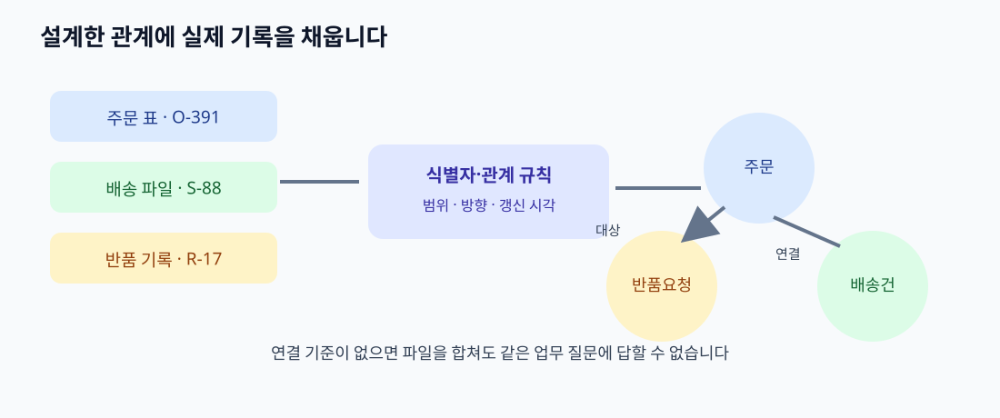

# 12. 지식 그래프와 데이터 연결: 설계도를 실제 기록에 적용하기

> **이 장의 한 문장:** 온톨로지가 업무 대상과 관계의 뜻을 정한 설계도라면, 지식 그래프는 그 뜻에 맞춰 **개별 사실을 연결해 사용하는 데이터**로 이해할 수 있습니다.

가상의 다온상점은 주문 표, 배송사 파일, 고객 문의 기록을 따로 관리합니다. 상담원이 “이 고객의 주문 중 반품 요청을 했지만 배송사는 아직 배달 중이라고 표시하는 건”을 찾으려면 세 곳을 오가야 합니다. 각 파일에는 고객 번호, 주문 번호, 송장 번호가 있지만 표기 방식과 갱신 시각이 다릅니다. 파일을 한곳에 복사하는 것만으로 문제는 해결되지 않습니다. `문의가 어느 주문에 관한 것인지`, `배송 이벤트가 어느 배송건에 속하는지` 연결 기준을 정해야 합니다.

*그림: 이 책을 위해 직접 제작한 데이터 연결 개념도입니다. 특정 제품 구조나 W3C 공식 그림이 아닙니다.*

## 12.1 설계도와 실제 기록을 구분하기

이 책에서 **온톨로지**는 ‘주문은 배송건과 연결될 수 있다’, ‘반품 요청은 주문 항목을 대상으로 한다’처럼 개념과 관계의 의미를 명시한 모델입니다. 어떤 관계를 업무상 허용할지는 검증 규칙과 정책에서 별도로 정합니다. **지식 그래프**는 주문 `O-391`, 배송건 `S-88`, 반품 요청 `R-17` 같은 구체적 대상을 실제로 연결한 데이터입니다. 지식 그래프라는 말은 업계에서 넓게 쓰입니다. RDF·OWL을 전혀 사용하지 않는 그래프 데이터도 지식 그래프라고 부릅니다. 따라서 모든 지식 그래프가 형식 온톨로지를 가진다고 단정하지 않습니다.

| 층 | 우리 사례에서 적는 것 | 무엇이 바뀔 때 수정하나? |
| --- | --- | --- |
| 업무 질문 | ‘어느 반품 요청이 아직 배송 중인가?’ | 상담 업무의 목표가 바뀔 때 |
| 온톨로지 | `반품요청 → 대상주문 → 배송건`이라는 관계와 뜻 | 개념·관계의 정의가 바뀔 때 |
| 연결 규칙 | 주문 표의 `order_no`와 배송 파일의 `merchant_order_no`를 대응 | 원본 필드·식별 규칙이 바뀔 때 |
| 그래프 사실 | `R-17 → OI-391-2 → O-391` | 실제 주문·배송 기록이 바뀔 때 |
| 조회 결과 | 오늘 기준 조건에 맞는 요청 목록 | 조회 시각·데이터·질문이 바뀔 때 |

표에서 연결 규칙을 따로 둔 이유가 있습니다. 온톨로지가 `주문`과 `배송건`의 관계를 설명해도, 어느 파일의 어떤 열이 그 관계를 채우는지 자동으로 알 수는 없습니다. 사람은 원본 시스템의 담당자와 함께 열의 뜻, 누락값, 중복값을 확인해야 합니다.

## 12.2 세 표를 연결하는 작은 예

다음 표는 설명을 위한 가상 데이터입니다. 고객 이름이나 실제 연락처는 쓰지 않았습니다.

| 원본 | 원본의 행 | 연결에 쓰는 값 | 사실로 만들 내용 |
| --- | --- | --- | --- |
| 주문 시스템 | 주문 `O-391` | 주문 번호 `O-391` | 주문 `O-391`은 고객 `C-204`의 주문 |
| 배송 시스템 | 배송 `S-88` | 판매자 주문 번호 `O-391` | 주문 `O-391`에 배송 `S-88`이 연결 |
| 반품 시스템 | 요청 `R-17` | 대상 주문 항목 `OI-391-2` | 반품 `R-17`은 `O-391`의 항목 `OI-391-2`를 대상으로 함 |
| 상담 시스템 | 문의 `TKT-9` | 주문 번호 `O-391` | 문의 `TKT-9`는 주문 `O-391`에 관한 것 |

연결한 뒤에는 “반품 요청 → 주문 항목 → 주문” 경로로 필요한 기록을 찾을 수 있습니다. 이 항목이 어느 배송건에 담겼는지 답하려면 주문 항목과 배송건의 연결 기록도 필요합니다. RDF를 쓴다면 사실을 **주어–관계–목적어**의 문장으로 표현할 수 있습니다. 예컨대 `반품 R-17 — 대상항목 — 주문 항목 OI-391-2`가 한 문장입니다. 여러 문장을 연결한 것이 그래프입니다. W3C RDF는 그래프의 데이터 모델을 정의하고, SPARQL은 이런 관계 패턴을 질의할 수 있게 합니다. 책의 실습에서는 코드를 쓰지 않아도 관계의 뜻을 먼저 그려 볼 수 있습니다.

## 12.3 연결의 핵심은 식별자와 기준일

같은 번호처럼 보이는 값이 항상 같은 대상을 뜻하지는 않습니다. 다른 판매자도 `O-391`을 쓸 수 있고, 한 주문에 여러 배송건이 붙을 수 있습니다. 번호가 중복될 가능성이 있다면 `판매자 + 주문번호`, `배송사 + 송장번호`처럼 범위를 정하거나 안정적인 내부 식별자를 발급해야 합니다. 7장에서 정한 식별 원칙이 여기서 실제 데이터 결합의 품질을 결정합니다.

| 질문 | 잘못 연결했을 때의 위험 | 결정할 기준 |
| --- | --- | --- |
| 주문번호는 어느 범위에서 유일한가? | 다른 고객의 주문과 연결 | 판매자·시스템 범위를 포함 |
| 한 주문에 배송건이 여러 개일 수 있는가? | 첫 배송건만 보여 주고 나머지 누락 | 1대다 관계로 설계 |
| 상태는 어느 시점 기준인가? | 과거 완료와 현재 재배송을 혼동 | 사건·수집·조회 시각 표시 |
| 원본에서 주문이 삭제·정정되면? | 그래프에 오래된 사실 잔존 | 변경·삭제 전파 규칙 정의 |

“그래프로 만들었다”는 말은 데이터를 한 번 적재했다는 뜻일 뿐입니다. 원본이 바뀔 때 언제 갱신할지, 실패한 동기화를 누가 발견할지까지 정해야 상담원이 현재의 답을 얻습니다. 11장의 출처·시간 기록을 각 연결에 붙이는 이유도 여기에 있습니다.

## 12.4 따라 해 보기: 네 장짜리 연결 카드

자신의 업무에서 자주 함께 조회하는 표나 문서 네 종류를 고릅니다. 각 장에 **원본 이름, 주체 ID, 연결할 다른 ID, 담당자, 갱신 주기**를 적습니다. 다온상점이라면 주문, 배송, 반품, 문의입니다. 다음으로 카드 사이에 관계 이름을 써서 화살표를 긋습니다. 관계 이름은 ‘관련됨’ 같은 넓은 말보다 `문의가대상으로하는주문`, `주문에속한배송건`처럼 방향이 분명한 표현을 택합니다.

이제 상담원이 실제로 묻는 질문 세 개를 카드 위에서 따라가 보세요. 한 질문이 카드 두 장으로 끝나는지, 원본 상태까지 가야 하는지 확인합니다. 경로 중간에 ‘어느 주문인지 모른다’는 공백이 생기면 온톨로지를 더 복잡하게 만들기 전에 원본의 식별자부터 바로잡아야 합니다. 최종 산출물은 **자료 목록 한 장 + 관계 화살표 한 장 + 모호한 연결 목록**입니다.

## 12.5 흔한 실패와 수정

| 실패 | 드러나는 증상 | 수정 방법 |
| --- | --- | --- |
| 같은 열 이름을 같은 뜻으로 간주 | 주문번호가 다른 범위에서 충돌 | 발급 주체·유일성 범위 기록 |
| ‘최신 상태’만 저장 | 과거 문의의 근거를 재현 못 함 | 이벤트 이력과 조회 기준 시각 보관 |
| 임의 문자열로 대상을 합침 | 고객 이름이 같다는 이유로 다른 사람 병합 | 안정적 식별자와 수동 검토 절차 |
| 표를 전부 그래프로 옮김 | 비용·유지 보수만 커지고 질문은 그대로 | 업무 질문에 필요한 관계부터 연결 |
| 연결이 보이니 권한도 있다고 생각 | 상담원이 다른 고객의 기록을 조회 | 원본 권한을 조회 시 다시 검사 |

작은 연결부터 시험하면 그래프의 가치와 관리 비용을 함께 볼 수 있습니다. 그래프를 쓴다는 사실 자체가 검색 정확도나 업무 속도를 보장하지 않습니다. 먼저 같은 질문에 대해 기존 방식과 그래프 방식의 결과를 비교합니다.

### 점검표

- [ ] 세 가지 대표 질문에 필요한 데이터와 관계를 그렸습니다.
- [ ] 각 ID의 발급 주체와 유일성 범위를 확인했습니다.
- [ ] 누락·중복·정정된 기록의 처리 방법을 정했습니다.
- [ ] 각 연결의 출처와 갱신 기준을 남겼습니다.
- [ ] 그래프 조회에도 기존 접근 권한이 적용됩니다.

## 장 요약

온톨로지는 관계의 뜻을 정하고, 지식 그래프는 실제 대상을 연결해 질문에 답하게 합니다. 원본의 열을 그래프 관계로 바꾸는 규칙과 안정적인 식별자가 필요합니다. 한 번 만든 연결을 계속 믿으려면 출처, 시각, 변경 전파, 접근 권한을 함께 운영해야 합니다.

## 공식 출처

- [W3C RDF 1.1 개념과 추상 데이터 모델](https://www.w3.org/TR/rdf11-concepts/) — 그래프와 주어·술어·목적어.
- [W3C SPARQL 1.1 질의 언어](https://www.w3.org/TR/sparql11-query/) — RDF 그래프에서 관계 패턴 찾기.
- [W3C DCAT 3](https://www.w3.org/TR/vocab-dcat-3/) — 데이터셋과 데이터 서비스의 목록·메타데이터 관점.
