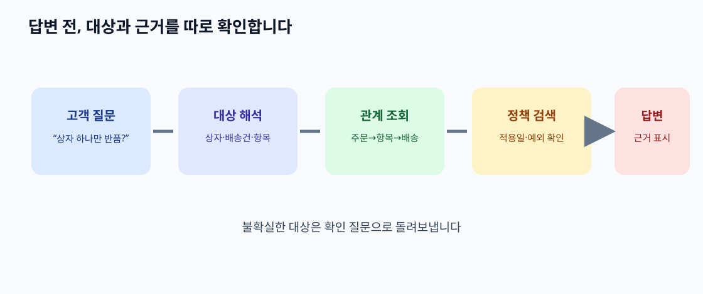

# 13. 검색과 RAG에 연결하기: 관련 문서를 찾았는데 답이 틀린 이유

> **이 장의 한 문장:** 온톨로지는 검색어와 자료의 **뜻과 연결 경로**를 정리하는 데 도움을 줄 수 있지만, 검색 결과와 AI 답변의 정확성은 자료·갱신·평가에 달려 있습니다.

가상의 다온상점 고객이 “한 주문을 두 상자로 받았는데 한 상자만 반품할 수 있나요?”라고 묻습니다. 이 예시에서 주문 `O-391`에는 배송건 `S-88`과 `S-89`가 연결되어 있습니다. 일반 문서 검색은 ‘반품’이 많이 적힌 정책 페이지를 찾을 수 있습니다. 그러나 해당 주문이 두 배송건으로 나뉘었다는 사실, 반품 요청이 주문 전체가 아니라 특정 상품 줄을 대상으로 한다는 사실은 별도 시스템에 있습니다. 상담용 AI가 정책 문단 하나만 보고 “주문 전체를 반품하세요”라고 답하면 문장 자체는 자연스러워도 실제 업무와 맞지 않습니다.

*그림: 이 책을 위해 직접 제작한 검색·근거 확인 개념도입니다. 특정 RAG 제품이나 연구 논문의 그림이 아닙니다.*

## 13.1 검색의 세 부분을 나누기

**RAG**는 답변을 만들 때 외부 자료를 검색해 함께 제공하는 방식입니다. 검색으로 자료를 가져오는 일, 가져온 자료를 읽어 답변하는 일, 답변이 원본과 업무 규칙에 맞는지 검증하는 일은 서로 다릅니다. 온톨로지는 첫 단계의 표현과 관계를 정리하고, 두 번째 단계의 맥락을 분명하게 만드는 데 쓰일 수 있습니다. 세 번째 단계까지 자동 보장하지는 않습니다.

| 단계 | 고객의 질문에서 하는 일 | 잘못되면 생기는 문제 |
| --- | --- | --- |
| 용어 해석 | ‘한 상자’를 배송건 또는 배송 포장 단위로 매핑 | 주문 전체와 한 배송건을 혼동 |
| 관계 조회 | 주문→주문 항목→배송건→반품 가능 항목을 찾음 | 다른 상품이나 고객의 정보를 끌어옴 |
| 정책 검색 | 부분 반품 조건과 예외 문서를 찾음 | 오래된 정책 또는 일반 정책을 선택 |
| 답변 생성 | 조회 사실과 정책 근거를 함께 설명 | 근거 없는 단정과 누락 |
| 결과 검증 | 실제 반품 가능 여부를 원본 시스템에서 확인 | 문장은 맞아도 실행은 실패 |

표의 첫 두 단계가 없으면 검색기가 좋은 문서를 찾아도 질문의 대상이 잘못 정해질 수 있습니다. 반대로 관계가 정확해도 정책 문서가 오래되었다면 답변은 틀립니다. 온톨로지와 자료 운영은 함께 필요합니다.

## 13.2 온톨로지가 검색에 줄 수 있는 도움

고객은 ‘상자’, 물류 팀은 ‘배송건’, 반품 팀은 ‘반품 대상 항목’이라고 말합니다. 이 단어들을 무조건 같은 뜻으로 묶으면 문제가 생깁니다. 한 배송건에 상자가 둘일 수도 있고, 한 상자에 주문 항목이 여러 개일 수도 있습니다. 먼저 각 말이 **같은 대상의 다른 이름인지**, **서로 다른 대상이 연결된 것인지** 정해야 합니다. 6장의 용어 관리와 7장의 식별 원칙을 검색에 적용하는 단계입니다.

| 고객 표현 | 모델에서 확인할 개념 | 더 물어야 하는 질문 |
| --- | --- | --- |
| ‘상자 하나’ | 포장 단위 또는 배송건 | 송장번호가 하나인가, 상자가 하나인가? |
| ‘상품 하나’ | 주문 항목 | 같은 상품을 여러 개 샀는가? |
| ‘반품 가능’ | 정책 조건 + 실제 원본 상태 | 배송 완료 여부·기간·제외 품목은? |
| ‘내 주문’ | 현재 사용자가 조회할 수 있는 주문 | 인증된 고객과 주문의 관계가 확인됐는가? |

온톨로지로 질문을 해석한다는 것은 추측에 멋진 이름을 붙이는 일이 아닙니다. 애매한 표현을 발견하고 필요한 질문을 줄 세우는 일입니다. 고객이 상자와 송장번호를 구분하지 못한다면 AI는 단정하기보다 확인 질문을 해야 합니다.

## 13.3 GraphRAG는 하나의 연구 접근입니다

Microsoft Research의 2024년 GraphRAG 연구는 문서에서 엔터티 관계 그래프와 공동체 요약을 만들고, 큰 문서 집합의 전반적 주제를 묻는 질문에 활용했습니다. 연구가 비교한 질문과 데이터, 지표가 특정되어 있습니다. 따라서 “그래프를 넣으면 모든 고객지원 답변이 좋아진다”는 결론으로 읽으면 안 됩니다. 더구나 그 연구의 **문서에서 자동 추출한 그래프**와 이 책의 **사람이 승인한 업무 온톨로지**는 만드는 목적과 신뢰 수준이 다릅니다. 자동 추출한 관계에는 오인식이 있을 수 있고, 업무 온톨로지를 쓴다고 해서 검색 알고리즘이나 요약 품질이 자동으로 개선되는 것도 아닙니다.

| 접근 | 잘 맞는 질문의 예 | 별도 확인할 것 |
| --- | --- | --- |
| 문서 검색 | ‘부분 반품 규정의 문구는?’ | 정책 버전과 적용일 |
| 관계 조회 | ‘이 주문의 어느 항목이 어느 배송건에 있나?’ | 원본 ID·권한·갱신 시각 |
| 두 방식 결합 | ‘이 주문 항목에 현재 반품 규정이 적용되나?’ | 규정의 조건과 실제 상태가 함께 맞는가 |
| 문서 기반 GraphRAG | ‘지난달 문의에서 반복된 큰 주제는?’ | 자동 추출·요약 오류와 비용 |

하나의 질문에 모든 기술을 쓰지 않습니다. “반품 정책 문서가 어디 있나?”에는 문서 검색만으로 충분할 수 있습니다. 주문별 조건 판단에는 원본 상태와 관계 조회가 필요합니다. 정책 적용은 단순한 문장 유사도만으로 결정하지 않습니다.

## 13.4 따라 해 보기: 근거가 보이는 답변 설계

같은 고객 질문에 대해 **기존 검색 방식**과 **관계 확인을 더한 방식**의 답변 카드를 만들어 보세요. 실제 고객 자료를 쓰지 않고 가상 주문 `O-391`을 사용합니다.

1. 질문 원문을 그대로 적습니다: “두 상자 중 하나만 반품할 수 있나요?”
2. 결정에 필요한 대상 목록을 적습니다: 주문, 주문 항목, 배송건, 반품 요청.
3. 각 대상의 ID와 원본 시스템을 정합니다. ID가 없으면 ‘확인 필요’라고 남깁니다.
4. 적용할 정책 문서의 이름, 버전, 효력 시작일을 적습니다.
5. 답변 초안에서 **확인된 사실**, **정책 설명**, **아직 확인되지 않은 조건**을 다른 칸으로 분리합니다.
6. 상담원에게 보여 줄 답변은 확인되지 않은 조건을 질문으로 돌려주거나 사람 검토를 요청하게 합니다.

예를 들어 “부분 반품이 가능합니다”라는 단정 대신 “정책은 주문 항목별 반품을 허용하지만, 이 주문의 어떤 항목이 어느 배송건에 속하는지 먼저 확인해야 합니다”라고 쓸 수 있습니다. 고객에게 실행 버튼을 제공한다면 버튼을 누르기 직전에 원본 시스템에서 현재 가능 여부를 다시 검사해야 합니다.

## 13.5 평가: 더 풍부한 답이 더 좋은 답은 아닙니다

도입 전에는 대표 질문과 까다로운 예외 질문을 모아 두 방식의 결과를 비교합니다. 모든 질문을 인상 평가로 끝내지 말고, 판단 기준을 먼저 씁니다.

| 평가 질문 | 확인 기준 | 실패 신호 |
| --- | --- | --- |
| 맞는 대상을 찾았나? | 주문·항목·배송건 ID가 일치 | 다른 주문의 상태 인용 |
| 근거가 현재 유효한가? | 문서 버전과 효력일 표시 | 폐기된 정책 사용 |
| 모르는 것을 드러냈나? | 미확인 조건을 명시 | 추측을 사실처럼 단정 |
| 답변이 실행으로 이어져도 안전한가? | 권한과 원본 상태 재확인 | 검색 결과만으로 반품 실행 |
| 추가 관리 비용이 감당 가능한가? | 갱신·정정·검수 비용 기록 | 그래프가 원본보다 오래됨 |

GraphRAG를 포함한 어떤 검색 방식도 성능을 보장하지 않습니다. 이 평가표의 목적은 특정 방식을 미리 이기게 하는 것이 아니라, 실제 질문에서 오류가 줄었는지 확인하는 것입니다.

### 점검표

- [ ] 검색 대상 문서와 조회할 업무 사실을 구분했습니다.
- [ ] 사용자 표현의 동의어와 모호한 대상을 구분했습니다.
- [ ] 답변에 원본·정책 버전·조회 시각을 표시할 수 있습니다.
- [ ] 대표 질문과 예외 질문으로 기존 방식과 비교합니다.
- [ ] 검색 결과만으로 상태 변경을 승인하지 않습니다.

## 장 요약

온톨로지는 질문의 대상을 정리하고 필요한 관계 경로를 드러낼 수 있습니다. RAG는 관련 자료를 가져와 답변에 쓰지만, 자료의 정확성·신선도·권한은 별도 문제입니다. GraphRAG는 유망한 연구와 구현 방식의 이름이며, 우리 업무에서의 효과는 질문별 평가로 확인해야 합니다.

## 출처

- [W3C SKOS 참조 문서](https://www.w3.org/TR/skos-reference/) — 선호·대체 명칭 등 개념 체계.
- [W3C RDF 1.1 개념](https://www.w3.org/TR/rdf11-concepts/) — 관계 데이터의 기본 구조.
- [Microsoft Research, *From Local to Global: A Graph RAG Approach to Query-Focused Summarization*](https://www.microsoft.com/en-us/research/publication/from-local-to-global-a-graph-rag-approach-to-query-focused-summarization/) — GraphRAG의 특정 연구 접근과 평가 범위.
