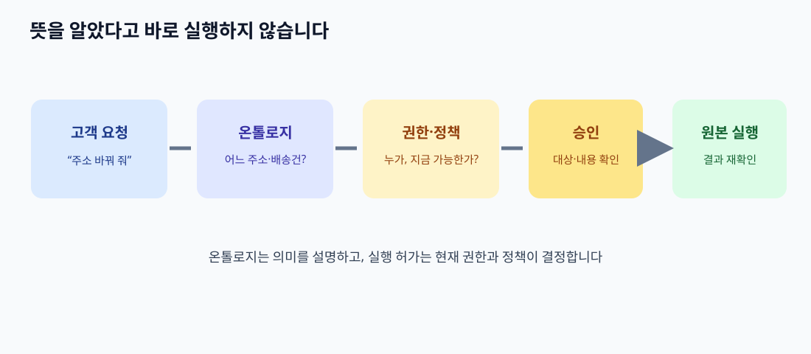

# 14. AI 에이전트와 업무 도구에 연결하기: 뜻을 알아도 실행해도 되는 것은 아닙니다

> **이 장의 한 문장:** 온톨로지는 AI 에이전트가 업무 대상과 관계를 이해하도록 돕지만, 실제 조회·수정의 허가는 **현재 사용자 권한과 업무 정책을 실행 시점에 다시 검사**해야 합니다.

가상의 다온상점 고객이 “주문 `O-391`의 배송이 늦으니 주소를 바꿔 줘”라고 말합니다. AI가 온톨로지를 읽고 `주문`, `배송건`, `배송 주소`를 정확히 구분했다고 해 봅시다. 그 사실만으로 주소 변경이 허용되지는 않습니다. 배송건 `S-88`이 이미 배송 시작 상태일 수 있고, 요청자가 주문 고객 `C-204`인지 확인되지 않았을 수 있으며, 회사 정책상 사람이 승인해야 할 수도 있습니다. **뜻을 아는 단계와 행동할 권한을 얻는 단계** 사이에 분명한 경계가 필요합니다.

*그림: 이 책을 위해 직접 제작한 에이전트 실행 경계 개념도입니다. 특정 제품 화면이나 프로토콜 공식 그림이 아닙니다.*

## 14.1 온톨로지는 에이전트의 ‘업무 지도’가 됩니다

에이전트가 업무를 맡을 때는 사용자의 말에서 **어떤 대상을 가리키는지** 알아야 합니다. “그 주문의 주소”라는 말에는 청구 주소, 배송 주소, 반품 수거 주소가 모두 후보입니다. 온톨로지가 이 세 개를 별도 속성으로 정의하고 `배송건 → 배송 주소` 관계를 명시했다면, 에이전트는 어느 값을 조회하거나 변경해야 하는지 질문할 수 있습니다. 혼동의 가능성을 줄이는 역할입니다. 그러나 온톨로지가 빈 원본 값이나 잘못 입력된 주소를 스스로 바로잡지는 않습니다.

| 고객의 말 | 온톨로지로 확인할 뜻 | 행동 전에 추가 확인 |
| --- | --- | --- |
| “내 주문” | 요청자와 주문의 관계 | 로그인 주체가 실제 주문 접근 권한을 갖는가 |
| “주소” | 배송·청구·수거 주소 중 무엇인가 | 어떤 배송건과 시점의 주소인가 |
| “늦는다” | 배송 예정일과 현재 배송 이벤트의 관계 | 배송사의 현재 상태가 무엇인가 |
| “바꿔 줘” | 조회가 아니라 상태 변경 요청 | 현재 단계에서 수정 가능하며 승인이 필요한가 |

표의 오른쪽 칸이 없으면 `주소`를 정확히 알아도 잘못된 사람의 주소를 바꿀 수 있습니다. 온톨로지는 **명사와 관계의 뜻**을 정합니다. 접근 권한, 고객 동의, 변경 가능 시간, 실행 결과 확인은 별도 업무 절차입니다.

## 14.2 읽기와 쓰기 도구를 나누기

에이전트에게 ‘주문 도구 하나’를 주는 것보다 행동을 좁혀 나누는 편이 검토하기 쉽습니다. 예를 들어 `주문 상태 조회`, `배송 주소 변경 가능 여부 조회`, `배송 주소 변경 요청 생성`은 위험이 다릅니다. MCP 같은 도구 연결 방식은 에이전트가 외부 시스템의 기능을 사용할 수 있게 하지만, 도구가 존재한다는 사실은 호출 권한을 뜻하지 않습니다. 실제 권한과 입력 검증은 도구를 제공하는 시스템에서 수행해야 합니다.

| 도구의 종류 | 예 | 기본 위험 | 확인할 통제 |
| --- | --- | --- | --- |
| 읽기 | 배송 `S-88`의 상태 조회 | 개인정보 노출 | 고객·상담원 권한, 최소 정보 반환 |
| 판단 보조 | 주소 변경 가능 여부 조회 | 오래된 판단 사용 | 현재 배송 상태·정책 버전 |
| 초안 생성 | 변경 요청 초안 만들기 | 잘못된 대상 기록 | 고객에게 대상과 새 주소 재확인 |
| 상태 변경 | 실제 배송 주소 수정 | 배송 실패·오배송 | 명시적 승인, 원본 재검사, 변경 이력 |

조회 도구도 무해하다고 가정하지 않습니다. 다른 고객의 주문번호를 알았다는 이유로 배송 주소를 볼 수 있으면 개인정보가 새어 나갑니다. 반면 상태 변경은 이미 실행한 뒤 되돌리기 어려울 수 있으므로 승인과 결과 확인을 더 엄격하게 합니다. 이 표는 예시 위험 분류이며, 실제 조직의 정책은 데이터 민감도와 피해 가능성에 맞춰 정해야 합니다.

## 14.3 여섯 단계로 실행 흐름 만들기

다온상점의 주소 변경 요청을 처음부터 끝까지 따라가 봅니다. 예시 ID와 상황은 모두 가상입니다.

1. **대상 해석:** 고객의 ‘그 주문’을 `O-391`로 연결합니다. 여러 주문이 후보면 다시 묻습니다.
2. **신원 확인:** 현재 인증된 사용자가 `C-204`인지, 그 주문을 조회할 수 있는지 원본 시스템에서 확인합니다.
3. **현재 상태 조회:** 주문 `O-391`에 속한 배송건 `S-88`의 최신 배송 이벤트와 조회 시각을 받습니다.
4. **정책 평가:** 현재 상태에서 주소 변경이 가능한지, 추가 승인이나 배송사 확인이 필요한지 평가합니다.
5. **행동 승인과 실행:** 바꿀 주소와 대상 배송건을 고객에게 보여 주고 승인받은 뒤, 실행 도구가 다시 권한·상태·입력을 검사합니다.
6. **결과 확인과 기록:** 요청 접수와 실제 변경 완료를 구분해 보여 줍니다. 원본 시스템의 결과 ID와 시각을 남깁니다.

여기서 온톨로지는 1·3·4단계의 대상과 관계를 명료하게 합니다. 2·5·6단계는 인증·권한·승인·거래 결과를 확인하는 절차입니다. 4단계에서도 정책을 ‘온톨로지에 적었으니 자동 실행 가능’으로 축약하면 위험합니다. 정책의 조건과 예외가 원본 상태에 맞는지 검사해야 합니다.

## 14.4 실습: 에이전트 행동 카드

독자가 자신의 업무에 적용하려면 하나의 행동을 골라 아래 카드를 채웁니다. 가능하면 처음에는 **읽기 행동**으로 시작하고, 실제 상태 변경은 별도 검토 대상에 둡니다.

| 카드 항목 | `O-391` 배송 주소 변경 예시 |
| --- | --- |
| 사용자의 표현 | “배송 주소 바꿔 줘” |
| 가리키는 대상 | 고객 `C-204`, 주문 `O-391`, 배송 `S-88` |
| 애매한 말 | 주소가 배송 주소인지, 반품 수거 주소인지 |
| 읽을 사실 | 최신 배송 상태, 기존 주소, 변경 가능 조건 |
| 필요한 권한 | 해당 고객·주문 접근권, 배송 변경권 |
| 승인 단계 | 변경 대상과 새 주소를 고객이 확인 |
| 실행 결과 | 접수 ID와 실제 배송사 반영 상태를 별도 표시 |
| 실패 시 | 이유·미완료 범위를 알리고 사람에게 이관 |

카드를 채우면서 **온톨로지에서 정할 뜻**과 **운영 정책에서 정할 허가**를 다른 색으로 표시해 보세요. ‘고객과 주문의 관계’는 데이터 모델입니다. ‘본인만 주소를 바꿀 수 있다’는 권한 정책입니다. ‘배송 출발 후에는 상담원이 승인한다’는 업무 정책입니다. 각 정책의 소유자와 변경 절차도 적어 두면 모델을 고친 뒤 누가 실행 규칙을 검토해야 하는지 알 수 있습니다.

## 14.5 흔한 실패와 수정

| 실패 | 일어날 일 | 수정 방법 |
| --- | --- | --- |
| 고객 ID 관계만 보고 권한 허용 | 다른 세션에서 유출된 ID로 조회 | 현재 인증 주체와 원본 권한 재검사 |
| 온톨로지의 ‘변경 가능’ 분류만 신뢰 | 배송 상태가 이미 바뀌었는데 실행 | 실행 직전 원본 상태 재조회 |
| 도구 호출 성공을 업무 완료로 표시 | 요청은 접수됐지만 배송사는 거절 | 완료 이벤트 또는 원본 조회로 확인 |
| 애매한 ‘주소’를 임의 선택 | 청구 주소 또는 반품 수거 주소를 변경 | 대상 속성을 확인 질문으로 명시 |
| 실패 뒤 무작정 재시도 | 주소 변경 요청이 중복 생성 | 결과 ID 확인과 중복 방지 기준 마련 |

고객에게 보이는 메시지에도 실행 단계가 드러나야 합니다. “주소를 바꿨습니다”는 실제 변경을 원본에서 확인한 뒤에만 씁니다. 요청만 전달했다면 “변경 요청을 접수했습니다”라고 씁니다. 뜻과 행동을 연결할수록 이 차이는 중요해집니다.

### 점검표

- [ ] 요청이 가리키는 고객·주문·배송건을 구분했습니다.
- [ ] 애매한 속성에는 확인 질문이 있습니다.
- [ ] 읽기와 상태 변경 도구를 분리했습니다.
- [ ] 권한·정책·현재 상태를 실행 시점에 검사합니다.
- [ ] 도구 응답과 실제 업무 완료를 구분해 기록합니다.

## 장 요약

온톨로지는 AI 에이전트의 업무 지도가 될 수 있습니다. 지도는 대상을 잘 찾게 하지만 문을 열 권한까지 주지는 않습니다. 에이전트가 외부 도구를 쓸 때는 대상 해석, 인증, 현재 상태, 정책, 승인, 결과 확인을 별도 단계로 운영해야 합니다.

## 공식 출처

- [W3C OWL 2 입문서](https://www.w3.org/TR/owl-primer/) — 클래스·관계의 의미를 정의하는 기본 개념.
- [W3C SHACL](https://www.w3.org/TR/shacl/) — 정한 데이터 조건의 검증.
- [MCP 공식 사양](https://modelcontextprotocol.io/specification/2026-07-28) — 외부 도구·자료 연결과 사용자 통제의 원칙. 온톨로지나 업무 권한 표준이라는 뜻은 아닙니다.
