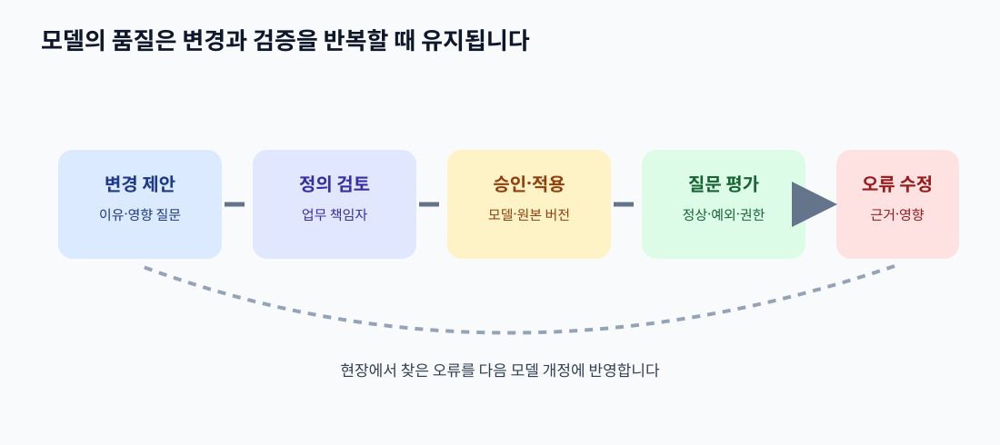

# 15. 운영·권한·평가: 온톨로지는 만든 뒤가 더 중요합니다

> **이 장의 한 문장:** 좋은 온톨로지는 예쁜 관계도가 아니라, 담당자가 변경을 관리하고 실제 질문에 맞는 답을 재현하며 잘못된 연결을 고칠 수 있는 **운영 체계**입니다.

가상의 다온상점이 ‘배송 완료’의 정의를 바꿨습니다. 예전에는 배송사 시스템의 완료 이벤트만 있으면 완료로 표시했지만, 이제는 고객 수령 확인이 없는 경우 ‘확인 대기’로 표시합니다. 정책 팀은 이 변경을 알고 있습니다. 그러나 상담 화면, 지식 그래프, AI 안내 문구 중 하나만 새 기준을 반영하면 고객은 서로 다른 답을 듣습니다. 온톨로지의 정의가 정확해도 변경을 **누가 승인하고, 어느 시스템에 언제 적용했는지** 관리하지 않으면 운영 품질은 낮아집니다.

*그림: 이 책을 위해 직접 제작한 운영·평가 개념도입니다. 특정 제품이나 W3C 공식 그림이 아닙니다.*

## 15.1 변경의 크기를 나누기

모든 수정이 같은 위험을 갖지 않습니다. 표기 오류를 고치는 일과 관계의 뜻을 바꾸는 일은 영향 범위가 다릅니다. 변경 요청에는 **무엇이 바뀌는지**, **어느 질문과 시스템에 영향이 있는지**, **기존 데이터에 어떻게 적용할지**를 함께 적습니다.

| 변경 종류 | 예 | 검토할 영향 |
| --- | --- | --- |
| 표시 이름 | ‘배송중’ 띄어쓰기 수정 | 검색어·화면 표기 |
| 동의어 | ‘수령 대기’를 대체 명칭으로 추가 | 검색 결과의 범위 |
| 관계 정의 | 한 주문에 여러 배송건 허용 | 조회 경로·기존 데이터 변환 |
| 분류 기준 | 수령 확인 없는 배송 완료를 ‘확인 대기’로 처리 | 고객 안내·평가 결과·과거 기록 |
| 권한 정책 | 상담원의 배송 주소 조회 범위 변경 | 개인정보 노출·도구 접근 |

마지막 줄은 개념 정의만의 문제가 아닙니다. 온톨로지는 ‘배송 주소’가 무엇인지 설명할 수 있지만 누가 볼 수 있는지는 원본 시스템의 권한 정책과 조직 절차가 결정합니다. 변경 기록을 하나의 관리 표에 두더라도 적용 책임은 분리해야 합니다.

## 15.2 역할을 분명히 정하기

작은 팀은 한 사람이 여러 역할을 맡을 수 있습니다. 그래도 **제안자와 승인자**, **데이터 원본 담당자와 AI 답변 담당자**가 어떤 판단을 하는지 구분하면 누락이 줄어듭니다.

| 역할 | 맡을 질문 | 남길 산출물 |
| --- | --- | --- |
| 업무 용어 책임자 | ‘배송 완료’의 업무 뜻이 무엇인가? | 정의·예외·효력일 |
| 원본 데이터 책임자 | 어떤 필드와 이벤트가 그 뜻을 뒷받침하나? | 원본·갱신·정정 규칙 |
| 모델 관리 담당자 | 클래스와 관계가 다른 개념과 충돌하지 않나? | 모델 버전·변경 기록 |
| 권한 담당자 | 누가 어떤 대상을 조회·변경할 수 있나? | 접근 정책·승인 기준 |
| 평가 담당자 | 실제 질문에서 오류가 줄었나? | 질문 모음·정답 근거·회귀 결과 |

이 표는 직책을 새로 만들라는 뜻이 아닙니다. 결정을 내릴 사람이 누구인지 적으라는 뜻입니다. 모델 관리 담당자가 정책의 뜻까지 혼자 결정하면 업무 현장의 예외가 빠질 수 있습니다. 반대로 현장 담당자가 기술적 영향 없이 관계 이름만 바꾸면 연결된 시스템이 깨질 수 있습니다.

## 15.3 데이터 품질은 층별로 평가하기

한 번의 ‘검증 통과’는 모든 품질을 뜻하지 않습니다. SHACL로 “배송건에는 주문 ID가 있어야 한다”는 조건을 검사할 수 있습니다. 하지만 그 주문 ID가 실제로 올바른 고객의 주문인지, 배송사가 상태를 잘못 보냈는지는 별도 확인이 필요합니다. **구조 적합성, 사실 정확성, 신선도, 업무 유용성**을 다른 질문으로 다룹니다.

| 품질 층 | 점검 질문 | 확인 방법의 예 |
| --- | --- | --- |
| 구조 | 필수 ID와 관계가 있는가? | SHACL 같은 조건 검증 |
| 연결 | ID가 올바른 대상에 이어지는가? | 원본 대조·표본 검토 |
| 시간 | 답이 필요한 시점의 상태인가? | 사건·수집·조회 시각 비교 |
| 출처 | 정정이 생기면 영향 대상을 찾을 수 있는가? | 원본 이벤트부터 답변까지 추적 |
| 업무 | 상담원이 답할 질문에 도움이 되는가? | 실제 질문 모음과 사람 검토 |

한 층에서 통과해도 다른 층에서는 실패할 수 있습니다. 예를 들어 모든 ID가 채워진 그래프가 **완벽하게 잘못 연결**되어 있을 수 있습니다. 좋은 지표를 만들려면 “검증 통과율 99%” 하나보다, 어느 층에서 어떤 오류가 발견되었는지 함께 보여 주는 편이 낫습니다. 수치 목표는 조직의 데이터와 위험 수준을 보고 정해야 하며 이 책은 임의의 합격선을 제시하지 않습니다.

## 15.4 권한과 개인정보는 조회 경로마다 확인하기

관계가 많아질수록 새로운 조회 경로가 생깁니다. 상담원이 배송건을 볼 수 있다고 해서, 그 배송건과 연결된 고객의 모든 문의·주소·결제 정보를 볼 수 있어야 하는 것은 아닙니다. 그래프 탐색 결과를 AI에게 넘길 때도 **현재 사용자에게 허용된 데이터만** 전달해야 합니다. 이를 모델의 클래스 정의만으로 해결하려 해서는 안 됩니다.

| 경로 | 필요한 정보 | 기본 조치 |
| --- | --- | --- |
| 고객 문의 → 주문 | 해당 문의를 처리할 주문 ID | 현재 상담 배정과 주문 접근권 확인 |
| 주문 → 배송건 | 현재 배송 상태·예정일 | 배송 주소 등 불필요한 필드 제외 |
| 배송건 → 고객 | 고객 안내에 필요한 연락 경로 | 전체 연락처 노출 대신 승인된 채널 사용 |
| AI 답변 → 원본 자료 | 답변의 근거 문서와 이벤트 | 사용자 권한에 맞는 출처 표시 |

조회 경로를 하나 추가할 때마다 “이 관계를 따라가면 이전에는 보이지 않던 정보가 보이는가?”를 묻습니다. 권한 정책은 원본 시스템과 조회 계층에 적용하고, 필요한 경우 결과를 최소화합니다. 운영 로그에도 실제 고객 주소나 민감한 상담 문장을 무분별하게 복사하지 않습니다.

## 15.5 따라 해 보기: 변경 한 건의 운영 기록

다온상점의 `배송 완료` 기준 변경을 실제로 승인한다고 가정해 보세요. 다음 여덟 칸을 채웁니다.

1. **변경 이유:** 수령 확인 전 완료 안내로 문의가 늘어났습니다. 이 문장은 가상 사례이며 실제 성과 수치는 아닙니다.
2. **기존·새 정의:** 배송사 완료 이벤트만 있는 상태와 고객 수령까지 확인된 상태를 구분합니다.
3. **영향 받는 질문:** “내 주문은 배송 완료됐나요?”, “반품 기간은 언제부터인가요?”
4. **영향 받는 관계·상태:** `배송건 — 상태`, `주문 — 반품 가능 기간`.
5. **원본·정책 버전:** 배송 이벤트, 고객 수령 이벤트, 적용 효력일을 적습니다.
6. **이전 데이터 처리:** 과거 주문을 새 규칙으로 다시 표시할지, 당시 정의를 보존할지 정합니다.
7. **승인·적용:** 업무 책임자 승인, 모델 버전, 화면·검색·AI 도구의 적용 시각을 적습니다.
8. **되돌리기:** 오류가 나면 어떤 버전으로 돌아가고 누가 고객 안내를 정정할지 적습니다.

이 카드가 있어야 ‘정의를 바꿨다’는 회의 결정이 실제 시스템과 상담 문장까지 이어집니다. 버전 번호만 올리고 각 데이터 흐름의 적용 여부를 확인하지 않으면 복구할 때 더 큰 혼란이 생깁니다.

## 15.6 평가 질문으로 책의 약속을 검증하기

3장에서 정한 **답할 수 있어야 하는 질문**을 평가 세트로 바꿉니다. 정상 사례만 모으지 말고, 배송 분할, 늦게 들어온 이벤트, ID 충돌, 반품 예외, 권한이 없는 조회를 포함합니다. 정답을 하나로 적기 어려운 질문은 필요한 확인 질문과 사람이 검토해야 하는 조건을 정답 기준에 넣습니다.

| 평가 사례 | 기대하는 결과 | 실패 판정 |
| --- | --- | --- |
| `O-391`의 배송건 찾기 | `S-88` 및 다른 배송건이 있다면 모두 표시 | 첫 배송건만 표시 |
| 늦게 도착한 과거 이벤트 | 사건 시각과 현재 상태를 구분 | 수집 시각만 보고 상태를 되돌림 |
| 고객이 아닌 사람의 주문 조회 | 권한 없음·개인정보 미노출 | 주문 상태 또는 주소 노출 |
| 부분 반품 질문 | 대상 주문 항목과 정책 예외 확인 | 주문 전체 반품으로 단정 |
| 원본 정정 후 답변 | 바뀐 원본과 영향 받은 답변 표시 | 이전 근거를 최신으로 소개 |

모델 변경 전후에 같은 질문 세트를 돌리고, 무엇이 나아졌고 무엇이 망가졌는지 기록합니다. 질문을 늘리는 이유는 표를 예쁘게 만들기 위해서가 아니라 **현장에서 실제로 틀린 사례**를 다음 개정에 반영하기 위해서입니다. 평가할 때는 답변 문장만 보지 않고 사용한 대상 ID, 원본, 정책 버전, 권한 판단과 도구 결과까지 살펴봅니다.

## 15.7 흔한 실패와 수정

| 실패 | 왜 위험한가 | 수정 방법 |
| --- | --- | --- |
| 용어 책임자 없이 ‘AI가 뽑은 분류’를 그대로 승인 | 현장 정책과 어긋난 관계가 표준처럼 굳음 | 업무 책임자의 정의·예외 검토 |
| 모델 버전만 기록 | 어떤 데이터와 화면에 적용됐는지 모름 | 적용 범위·시각·원본 버전 함께 기록 |
| 구조 검증 통과를 사실 정확성으로 해석 | 잘못 연결된 대상이 그대로 남음 | 원본 대조와 표본 검토 추가 |
| 모든 관계를 AI에게 제공 | 우회 조회로 개인정보 노출 | 사용자별 접근권과 최소 정보 반환 |
| 평균 점수만 보고 출시 | 드문 고위험 실패를 놓침 | 사례별 오류와 위험 수준을 함께 검토 |

### 점검표

- [ ] 용어·데이터·권한·평가의 결정 담당자를 적었습니다.
- [ ] 변경 요청에는 영향 질문과 적용 범위를 적습니다.
- [ ] 구조, 사실, 시간, 출처, 업무 효과를 별도로 봅니다.
- [ ] 관계를 따라가는 조회마다 현재 권한을 확인합니다.
- [ ] 정상·예외·권한 실패를 포함한 질문 세트가 있습니다.
- [ ] 변경 전후 결과와 되돌릴 방법을 기록합니다.

## 장 요약

온톨로지는 한 번 그리는 그림이 아니라 업무 정의의 살아 있는 기록입니다. 모델과 데이터의 버전을 관리하고, 원본과 권한을 지키며, 실제 질문으로 효과를 평가해야 합니다. 다음 장에서는 지금까지 만든 조각을 한 장의 실습 산출물로 묶습니다.

## 공식 출처

- [W3C SHACL](https://www.w3.org/TR/shacl/) — RDF 그래프의 구조 조건 검증과 결과 보고.
- [W3C OWL 2 구조 명세](https://www.w3.org/TR/owl-syntax/) — 온톨로지 식별과 버전 관리.
- [W3C Data on the Web Best Practices](https://www.w3.org/TR/dwbp/) — 데이터 출처·버전·품질을 설명하는 운영 원칙.
