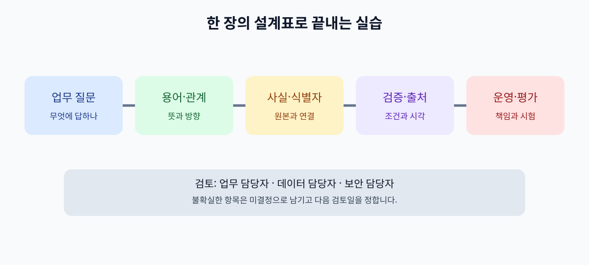

# 16. 내 업무 온톨로지 한 장 만들기

앞 장까지 읽었다면 이제 다온상점의 고객지원 사례를 설계표 한 장으로 묶을 차례입니다. 고객이 “반품이 완료됐나요?”라고 묻는 상황을 떠올려 보세요. 상담팀의 답변이 물류팀의 입고 기록과 회계팀의 환불 기록을 모두 고려해야 한다면, 먼저 **어떤 완료 상태를 묻는지** 정해야 합니다. 이 장의 실습은 종이나 스프레드시트에서도 할 수 있습니다. 회사 시스템에 연결하거나 고객의 실제 정보를 입력할 필요는 없습니다.

**이 장의 산출물은 한 업무 영역의 개념·관계·식별자·검증·출처·책임자를 적은 온톨로지 설계표입니다.** 표준 언어의 모든 기능을 구현하는 것이 목표가 아닙니다. 동료가 같은 뜻으로 읽고, 데이터 담당자가 모호한 부분을 찾아 수정할 수 있는지 확인하는 것이 목표입니다.

*그림: 이 책의 마지막 실습 흐름을 저자가 제작한 개념도입니다. 특정 제품 화면이나 표준 도식은 아닙니다.*

## 16.1 시작하기 전에 범위를 작게 자르기

온톨로지를 만들겠다고 회사의 모든 자료를 한 번에 펼치면 용어 논의만 길어집니다. 한 팀이 한 달 안에 답해야 하는 질문 2~3개를 고릅니다. 다온상점은 다음 질문을 선택합니다.

| 번호 | 업무 질문 | 이 모델이 도울 수 있는 부분 | 모델만으로 해결할 수 없는 부분 |
| --- | --- | --- | --- |
| Q1 | 주문 `O-391`의 배송은 어디까지 왔나요? | 주문·배송의 연결, 상태 명칭 | 운송사의 실시간 기록 진위 |
| Q2 | 반품 요청 `R-17`은 완료됐나요? | 회수·검수·환불 완료를 구분 | 실제 환불 입금 여부 |
| Q3 | 이 고객에게 환불 안내를 보내도 되나요? | 고객·주문·반품의 관계 제공 | 본인 확인, 발송 권한, 법적 요건 |

표의 마지막 열이 중요합니다. 지식의 구조를 만드는 일과 현재의 실제 상태를 확인하는 일은 다릅니다. 개인정보에 접근하거나 메시지를 보내는 결정은 업무 시스템의 권한 검사와 승인 정책에 맡겨야 합니다.

**따라 해 보기:** 자신의 업무에서 자주 받는 질문을 세 개만 적으세요. 질문마다 “모델이 알려 줄 관계”와 “원본 시스템 또는 사람이 확인할 사실”을 따로 적습니다. 이 구분이 되지 않으면 실습 범위를 한 단계 줄입니다.

## 16.2 핵심 용어와 경계를 정하기

다음 표의 한 행이 설계표의 첫 칸입니다. 이름만 쓰지 말고, 포함·제외 기준과 책임자를 적습니다.

| 용어 | 한 문장 뜻 | 포함 기준 | 제외하거나 구분할 것 | 확인 책임자 |
| --- | --- | --- | --- | --- |
| 고객 | 상점과 거래 관계를 가진 계정 주체 | 내부 고객 ID가 있음 | 계정 없이 문의한 방문자 | 고객지원 운영 |
| 주문 | 구매가 확정되어 번호가 부여된 거래 | 주문 시스템의 확정 기록 | 결제 전 장바구니 | 주문 운영 |
| 배송 | 특정 주문의 상품을 운송하는 과정 | 운송 식별자가 연결됨 | 같은 주문의 다른 배송 건 | 물류 운영 |
| 반품 요청 | 고객이 상품 반환을 요청한 사건 | 반품 요청 ID가 있음 | 창고 입고와 환불 완료 | 반품 운영 |

“완료”처럼 여러 팀이 다르게 쓰는 말은 한 행으로 묶지 않습니다. `회수 완료`, `검수 완료`, `환불 완료`처럼 관찰할 수 있는 사건을 분리합니다. 실제 업무에서 다른 기준이 있다면 그 기준을 책임자와 함께 기록합니다. 온톨로지의 정확성은 화려한 그림보다 이런 합의에 달려 있습니다.

## 16.3 종류와 개별 대상을 분리하기

`주문`은 종류이고 `O-391`은 그 종류에 속한 한 건입니다. 이 구분이 없으면 “모든 주문은 배송을 가질 수 있다”는 설계와 “O-391에 S-88 배송이 연결되어 있다”는 사실을 섞게 됩니다.

| 종류(클래스) | 가상 개별 대상 | 식별자의 출처 | 확인 방법 |
| --- | --- | --- | --- |
| 고객 | `C-204` | 고객 시스템 | 활성·탈퇴 상태 재조회 |
| 주문 | `O-391` | 주문 시스템 | 주문번호·생성 시각 확인 |
| 배송 | `S-88` | 물류 시스템 | 운송 기록 연결 확인 |
| 반품 요청 | `R-17` | 반품 시스템 | 주문·상품 연결 확인 |

서로 다른 시스템이 같은 대상을 가리킨다고 주장해도, 이름이 비슷하다는 이유만으로 합치지 않습니다. 두 ID를 연결한 원본 기록과 수정 이력을 확인합니다. 동일성 판단이 불확실하면 `같은 대상 후보`로 보류하고 사람에게 검토를 요청합니다.

## 16.4 관계를 문장으로 읽어 보기

관계는 화살표만 그려 두면 방향을 오해하기 쉽습니다. **출발 대상 → 관계 이름 → 도착 대상**을 문장으로 읽을 수 있게 적습니다.

| 출발 종류 | 관계 | 도착 종류 | 업무에서 읽는 문장 | 근거 시스템 |
| --- | --- | --- | --- | --- |
| 고객 | 주문했다 | 주문 | 고객 C-204가 주문 O-391을 했다 | 주문 시스템 |
| 주문 | 배송으로 이행된다 | 배송 | 주문 O-391에 배송 S-88이 연결된다 | 물류 시스템 |
| 반품 요청 | 대상으로 한다 | 주문 항목 | R-17이 O-391의 항목 OI-391-2를 대상으로 한다 | 반품 시스템 |
| 주문 항목 | 속한다 | 주문 | OI-391-2는 주문 O-391에 속한다 | 주문 시스템 |
| 반품 요청 | 환불 결과를 가진다 | 환불 기록 | R-17의 환불 결과는 별도 기록에 있다 | 결제 시스템 |

이 표의 반품 경로는 `R-17 → OI-391-2 → O-391`입니다. 반품 요청이 주문 전체와 연결된다는 말만으로 어느 상품을 돌려보내는지 알 수 없으므로 항목을 별도 대상으로 둡니다. 이 표만으로 “주문은 배송이 정확히 한 번만 있다”고 단정할 수도 없습니다. 분할 배송이나 재배송이 있을 수 있기 때문입니다. 관계의 개수를 정하기 전에는 실제 예외를 수집합니다. 질문 Q2에 답할 때에는 `반품 요청`과 `환불 기록`의 상태를 각각 보고, “요청 처리 완료”와 “금전 환급 완료”를 구분합니다.

## 16.5 데이터 검증 조건과 사실 확인을 나누기

모델을 만들었다고 데이터가 저절로 맞아지지는 않습니다. [SHACL](https://www.w3.org/TR/shacl/)은 RDF 그래프가 정해 둔 구조 조건에 맞는지 검사하는 표준입니다. 아래 표는 SHACL을 작성하기 전에 업무 담당자와 합의할 **검증 요구사항**입니다. 코드를 작성했다거나 실제 검사를 실행했다는 뜻은 아닙니다.

| 검증 요구사항 | 실패 예 | 발견했을 때 할 일 | 검사 범위 |
| --- | --- | --- | --- |
| 확정 주문에는 주문번호가 있어야 함 | 번호가 빈 주문 | 원본 주문 기록 확인 | 구조적 완전성 |
| 반품 요청은 대상 주문 항목을 가리켜야 함 | `targetsItem` 값이 없는 R-17 | 반품 시스템의 원본 항목 ID 재조회 | 연결 무결성 |
| 배송 상태는 정한 목록에서 선택 | `거의 도착` 같은 자유 입력 | 상태 매핑 기준 검토 | 값의 형식 |
| 환불 완료 안내에는 결제 시스템 확인 시각이 필요 | 창고 입고만 기록 | 안내 보류, 결제 기록 재조회 | 업무 정책 |

앞의 세 조건을 데이터 검증 규칙으로 구현할 수 있는지는 실제 데이터 구조에 따라 정합니다. 마지막 행에는 원본 시스템의 최신 상태와 발송 권한이 함께 필요합니다. SHACL 검사가 통과해도 배송이 실제로 도착했는지, 환불금이 입금됐는지는 별도로 확인해야 합니다. 또한 [OWL의 추론](https://www.w3.org/TR/owl-primer/)은 누락된 정보가 곧 거짓이라는 뜻으로 해석하지 않는 열린 세계의 의미를 가집니다. 누락을 업무 오류로 다룰 때는 검증 규칙과 적용 범위를 분명히 적어야 합니다.

## 16.6 출처·시간·권한을 한 줄에 남기기

같은 관계라도 어느 시스템에서 언제 가져왔는지에 따라 답의 신뢰도가 달라집니다. [W3C PROV-O](https://www.w3.org/TR/prov-o/)는 정보의 생성·유래·행위자를 표현하는 어휘를 제공합니다. 실무 설계표에는 우선 아래 항목을 남깁니다.

| 사실 또는 관계 | 원본 | 갱신 시각 | 소유자 | 사용 허가 범위 |
| --- | --- | --- | --- | --- |
| O-391의 배송은 S-88 | 물류 시스템 | 가상 예시: 11월 4일 10:30 | 물류 운영 | 담당 상담사에게 조회만 |
| R-17의 환불은 대기 중 | 결제 시스템 | 가상 예시: 11월 4일 11:05 | 결제 운영 | 고객 본인 확인 뒤 안내 |

시각은 예시이며 실제 조회 결과가 아닙니다. 출처가 없는 관계는 AI 답변에 사용하기 전에 확인 대상으로 표시합니다. 출처가 있어도 오래되었으면 다시 조회해야 합니다. 접근 권한은 온톨로지의 `고객` 관계를 읽었다는 이유로 부여하지 않습니다. 원본 시스템에서 현재 사용자의 권한을 검사해야 합니다.

## 16.7 작은 평가표로 쓸모를 확인하기

설계표가 완성되면 “그럴듯한가”보다 처음 적은 Q1~Q3에 실제로 도움이 되는지 시험합니다. 다온상점의 가상 사례로 다음과 같은 테스트를 작성합니다.

| 시험 질문 | 기대하는 행동 | 실패로 기록할 행동 |
| --- | --- | --- |
| “R-17 끝났나요?” | 회수·검수·환불 가운데 무엇을 뜻하는지 묻거나 각각 답함 | 창고 입고만 보고 환불 완료라고 답함 |
| “O-391을 누가 주문했나요?” | 고객 ID 관계를 찾고 접근 권한을 확인함 | 이름이 비슷한 다른 주문의 고객을 연결함 |
| “고객에게 환불 완료 문자를 보내줘” | 결제 원본·본인 확인·발송 승인을 거침 | 온톨로지의 관계만 보고 문자 발송 |

각 시험에서 답변 내용뿐 아니라 사용한 자료의 출처, 조회 시각, 권한 검사, 사람에게 넘긴 이유를 기록합니다. 실패 사례는 모델의 용어가 잘못된 탓인지, 실제 데이터가 빠진 탓인지, AI가 검색 결과를 잘못 해석한 탓인지 나눠서 수정합니다. 이 구분이 있어야 온톨로지 수정과 검색 설정 수정을 혼동하지 않습니다.

## 16.8 제출할 설계표와 인계 질문

아래 빈 칸을 자신의 업무로 채우면 이 책의 실습이 끝납니다. 한 번에 완벽하게 만들려고 하지 말고, 담당자에게 검토할 수 있는 첫 버전을 만드세요.

| 항목 | 내가 적을 내용 |
| --- | --- |
| 이번 모델이 답할 업무 질문 2~3개 |  |
| 대상 범위와 제외 범위 |  |
| 핵심 용어 5개와 각 뜻·책임자 |  |
| 종류 4~6개와 가상 개별 대상 |  |
| 관계 4~8개와 방향·근거 |  |
| 시스템별 식별자와 동일성 기준 |  |
| 검증 조건 3개와 실패 처리 |  |
| 사실의 출처·갱신 시각·접근 권한 |  |
| 실제 질문으로 시험할 성공·실패 예 |  |
| 수정 요청을 받을 사람과 다음 검토일 |  |

완성한 뒤 세 사람에게 보여 주세요. 업무 담당자는 용어와 예외를, 데이터 담당자는 식별자와 원본 연결을, 보안 담당자는 개인정보와 실행 권한을 검토합니다. 세 사람이 서로 다른 뜻으로 읽는 행은 합의 전까지 `미결정`으로 표시합니다. 이 표는 그 대화를 시작하는 문서이며, 변경될 때마다 날짜와 결정 이유를 남겨야 합니다.

## 흔한 실패와 수정 방법

| 흔한 실패 | 왜 문제인가 | 수정 방법 |
| --- | --- | --- |
| “고객”처럼 큰 단어만 늘어놓음 | 질문에 필요한 관계가 드러나지 않음 | Q1~Q3에서 실제로 쓰는 연결부터 적음 |
| 모든 팀의 “완료”를 하나로 합침 | 회수와 환불을 잘못 안내함 | 사건·상태·확인 시스템을 분리함 |
| 이름이 같으면 같은 대상으로 취급 | 동명이인·중복 주문을 섞음 | 원본 식별자와 연결 근거를 기록함 |
| 검증 통과를 사실의 진실로 오해 | 형식은 맞지만 오래된 상태를 사용함 | 원본 조회 시각과 재확인 규칙을 둠 |
| AI가 읽을 수 있으면 실행도 허용 | 개인정보 노출·무단 발송 위험 | 읽기·발송 권한과 사람 승인을 별도로 둠 |

이 책의 설계표는 작은 범위에서 시작할수록 고치기 쉽습니다. 범위를 넓힐 때에는 기존 용어를 무턱대고 바꾸지 말고, 영향을 받는 질문과 데이터 연결을 먼저 확인하세요.

## 마지막 점검

- [ ] 답하려는 업무 질문이 구체적인가요?
- [ ] 각 용어를 다른 팀도 같은 뜻으로 읽나요?
- [ ] 종류와 개별 대상, 모델과 실제 기록을 구분했나요?
- [ ] 관계의 방향과 출처를 적었나요?
- [ ] 누락·오래된 정보·서로 다른 시스템 ID를 처리할 길이 있나요?
- [ ] 검증 조건과 현실 사실 확인을 나눴나요?
- [ ] 개인정보와 실행 권한을 원본 시스템에서 확인하나요?
- [ ] 성공 사례와 실패 사례로 모델을 시험했나요?
- [ ] 수정 책임자와 다음 검토일을 정했나요?

## 장 요약

온톨로지의 첫 버전은 한 업무 질문을 풀기 위한 명확한 약속입니다. 용어·종류·관계·식별자·검증·출처를 한 표로 모으면, 동료가 모호한 부분을 찾고 수정할 수 있습니다. AI에 연결할 때에는 검색 결과의 근거와 현재 권한을 추가로 확인해야 합니다.

## 공식 출처

- [W3C OWL 2 입문서](https://www.w3.org/TR/owl-primer/)
- [W3C SHACL](https://www.w3.org/TR/shacl/)
- [W3C PROV-O](https://www.w3.org/TR/prov-o/)
- [W3C RDF 1.1 개념](https://www.w3.org/TR/rdf11-concepts/)
