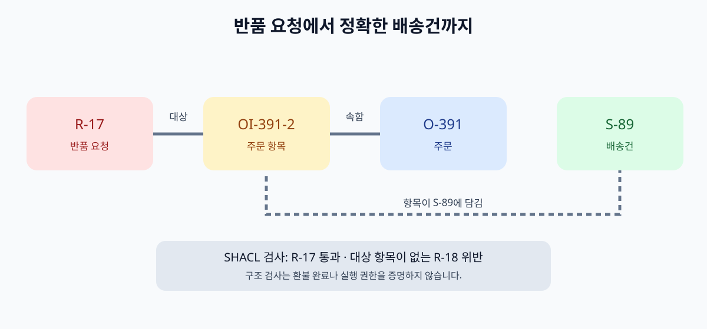

# 17. 처음부터 끝까지: 다온상점 사례로 온톨로지 완성하기

앞 장의 빈 설계표를 실제로 채워 보겠습니다. 가상의 다온상점에는 고객 `C-204`, 주문 `O-391`, 주문 항목 두 개, 배송건 두 개, 반품 요청 `R-17`이 있습니다. 독자는 “R-17은 어느 상품의 반품이며, 그 상품은 어느 배송건에 있었나요?”라는 질문에 답할 수 있어야 합니다. 마지막에는 “환불이 끝났나요?”라는 질문을 **아직 확인되지 않은 사실**로 남길 수 있어야 합니다.

이 장의 모든 기록과 시각은 가상입니다. [CSV 원본 묶음](../examples/daon/README.md)을 내려받아 스프레드시트에서 열 수 있습니다. 기술 담당자를 위한 [RDF 모델](../examples/daon/ontology.ttl), [사실 데이터](../examples/daon/data.ttl), [SHACL 조건](../examples/daon/shapes.ttl), [SPARQL 질의](../examples/daon/return-path.rq)도 같은 사례를 표현합니다. 코드를 실행하지 않아도 아래 표를 따라 실습할 수 있습니다.

*그림: 다온상점의 가상 기록을 이용해 이 책에서 제작한 관계·검증 개념도입니다. 실제 서비스 화면이나 W3C 공식 도식은 아닙니다.*

## 17.1 질문 하나가 필요한 데이터의 범위를 정합니다

고객의 말은 “두 상자 중 하나를 반품하고 싶어요”입니다. 여기서 `상자`, `배송건`, `주문 항목`이 같은 대상을 뜻한다고 가정하면 바로 오류가 납니다. 한 배송건에 상자가 여러 개일 수도 있고, 한 상자에 여러 주문 항목이 들어갈 수도 있습니다. 이 예제에서는 단순화를 위해 **주문 항목 하나가 배송건 하나에 연결**되었다고 가정합니다. 실제 업무에서는 이 가정을 먼저 확인해야 합니다.

| 구체적 질문 | 이 사례에서 찾을 것 | 아직 확인해야 할 것 |
| --- | --- | --- |
| R-17은 무엇을 반품하나요? | 대상 주문 항목 `OI-391-2` | 고객이 실제로 보낸 물건 |
| 그 항목은 어느 주문에 있나요? | 주문 `O-391` | 주문 취소·변경 이력 |
| 어느 배송건으로 보냈나요? | 배송건 `S-89` | 운송사 원본의 최신 상태 |
| 환불이 끝났나요? | 현재 기록은 `환불대기` | 결제 원본의 실제 지급 완료 |

처음 세 행은 이 예제의 관계 경로로 답할 수 있습니다. 마지막 행은 반품 요청의 기록만으로 완료라고 답하면 안 됩니다. 환불 기록의 출처와 시각을 다시 확인해야 합니다.

## 17.2 표 다섯 장을 하나의 그림으로 읽습니다

예제 폴더에는 고객, 주문, 주문 항목, 배송, 반품 요청을 담은 CSV가 있습니다. 각 표의 ID는 서로 다른 시스템에서 나온 것이라고 가정합니다.

| 출발 기록 | 연결 열 | 도착 기록 | 읽는 문장 |
| --- | --- | --- | --- |
| 고객 `C-204` | 주문의 `customer_id` | 주문 `O-391` | C-204가 O-391을 주문했습니다. |
| 주문 `O-391` | 항목의 `order_id` | `OI-391-1`, `OI-391-2` | 한 주문에 두 상품 줄이 있습니다. |
| 항목 `OI-391-2` | 배송의 `item_id` | 배송건 `S-89` | 두 번째 항목이 S-89에 담겼습니다. |
| 반품 `R-17` | 반품의 `item_id` | 항목 `OI-391-2` | R-17은 두 번째 항목을 대상으로 합니다. |

이 표는 여러 화면의 ID를 옮겨 적은 **관계 설명**입니다. 실제 업무에서는 같은 문자열의 ID가 다른 판매자나 시스템에 존재할 수 있습니다. 따라서 `O-391`이라는 글자만 보고 동일한 주문이라고 합치지 않습니다. ID를 발급한 시스템, 판매자 범위, 변경 이력을 함께 확인합니다. 7장에서 다룬 동일성 판단이 이 단계에 적용됩니다.

연결 경로는 `R-17 → OI-391-2 → O-391`과 `OI-391-2 → S-89`입니다. `O-391`에는 다른 배송건 `S-88`도 있으므로 주문번호만 가지고 반품 대상의 배송건을 고르면 틀릴 수 있습니다. 주문 항목을 중간에 두는 이유가 바로 여기에 있습니다.

## 17.3 온톨로지는 표의 뜻을 고정합니다

[예제 온톨로지 파일](../examples/daon/ontology.ttl)은 `고객`, `주문`, `주문 항목`, `배송건`, `반품 요청`을 대상의 종류로 정합니다. `반품 요청이 주문 항목을 대상으로 한다`는 관계의 방향과 뜻도 적습니다. 이 파일은 특정 반품 요청 `R-17`의 현재 상태를 담는 곳이 아닙니다. 구체적인 기록은 [예제 사실 파일](../examples/daon/data.ttl)에 있습니다.

| 파일에서 찾을 것 | 실제 문장으로 읽기 | 혼동하기 쉬운 점 |
| --- | --- | --- |
| `ReturnRequest` | 반품 요청이라는 대상 종류 | R-17 한 건과 다릅니다. |
| `targetsItem` | 반품 요청에서 주문 항목으로 가는 관계 | 반품 승인 명령이 아닙니다. |
| `R-17 targetsItem OI-391-2` | R-17이 두 번째 주문 항목을 가리킨다는 사실 | 원본 시스템 확인이 더 필요합니다. |
| `sourceSystem`, `observedAt` | 어느 기록에서 언제 확인했는지 | 현재도 참이라는 보장은 아닙니다. |

W3C [RDF](https://www.w3.org/TR/rdf11-concepts/)는 주어–술어–목적어의 문장들을 그래프로 다루는 데이터 모델입니다. [OWL](https://www.w3.org/TR/owl-primer/)은 클래스와 관계의 형식적 뜻을 표현하는 데 쓰입니다. 여기서 클래스의 `domain`과 `range`는 맞지 않는 입력을 자동 거절하는 양식 검사가 아닙니다. 실제 필수 입력과 형식 검사는 다음 단계에서 별도로 정의합니다.

## 17.4 잘못된 반품 기록을 일부러 넣어 봅니다

`R-18`은 대상 주문 항목 없이 접수된 가상 오류 사례입니다. [오류 데이터 파일](../examples/daon/data-missing-target.ttl)을 추가하면 [SHACL 조건 파일](../examples/daon/shapes.ttl)의 `targetsItem` 최소 한 개 조건에 걸립니다.

| 검사 대상 | 예상 결과 | 실무에서 할 행동 |
| --- | --- | --- |
| R-17 | 구조 조건 통과 | 원본 상태·고객 권한을 계속 확인 |
| R-18 | 대상 항목 누락 보고 | 접수 보류, 원본 반품 기록 재조회 |

조건을 통과한 R-17도 환불 완료가 아닙니다. 구조가 알맞다는 것과 실제 물건이 회수됐다는 것, 환불금이 지급됐다는 것은 서로 다른 질문입니다. SHACL은 정한 데이터 조건에 대해 보고서를 만들며, 현실의 모든 사실을 인증하지 않습니다. 반대로 OWL의 열린 세계 의미에서는 항목 관계가 빠졌다는 것만으로 “반품 대상이 존재하지 않는다”고 단정할 수 없습니다. 업무 접수 단계에서 그 누락을 오류로 다룰지 정하는 일은 조직의 검증 정책입니다.

## 17.5 조회 결과를 행동과 구분합니다

[SPARQL 질의 예제](../examples/daon/return-path.rq)는 R-17에서 항목, 주문, 배송건을 찾아 `R-17 → OI-391-2 → O-391 → S-89` 한 줄을 예상합니다. 이는 **그래프에 적힌 경로**입니다. 고객 본인 확인, 실제 반품 가능 기간, 현재 배송 상태, 환불 권한은 질의만으로 결정되지 않습니다.

| 업무 단계 | 자동으로 보여 줄 수 있는 내용 | 원본·사람 확인이 필요한 내용 |
| --- | --- | --- |
| 상담 준비 | 연관 주문·항목·배송건 후보 | 현재 고객의 조회 권한 |
| 반품 접수 | 대상 항목과 필요한 추가 정보 | 정책상 반품 가능 여부 |
| 환불 안내 | 환불 상태를 확인할 원본 위치 | 실제 지급 결과와 안내 승인 |

AI가 “R-17은 S-89에 해당합니다”라고 설명하더라도, 그다음에 “환불이 완료됐습니다”라고 덧붙이려면 별도 근거가 있어야 합니다. 도구 호출이 성공했다는 사실도 실제 결제 완료를 뜻하지 않습니다. 14장의 에이전트 실행 경계를 이 사례에 다시 적용해 보세요.

## 17.6 내 업무로 옮기기: 네 번의 검토

먼저 [빈 설계표](../templates/ontology-design-sheet.md)를 복사해 자신의 질문 하나를 적습니다. 다음 네 번의 검토를 거쳐 첫 버전을 만듭니다.

1. **업무 담당자:** `완료`, `접수`, `승인`의 뜻과 예외를 확인합니다.
2. **데이터 담당자:** 시스템별 ID, 누락 값, 두 기록의 동일성 근거를 확인합니다.
3. **보안 담당자:** 누가 어떤 관계를 조회하고 어떤 행동을 할 수 있는지 확인합니다.
4. **운영 담당자:** 실제 질문 5개와 실패 사례 3개로 답변을 시험하고 수정 책임자를 정합니다.

시험 질문에는 “두 배송건 중 하나만 반품할 때 주문번호만으로 대상 배송건을 찾지 않는가?”, “대상 항목이 빠진 R-18을 보류하는가?”, “환불대기를 완료로 안내하지 않는가?”를 넣을 수 있습니다. 평가 결과가 나쁘다면 그래프를 더 크게 만들기보다 **어느 단계에서 잘못됐는지** 찾습니다. 용어 매핑, ID 결합, 원본 데이터, 조회, 답변 생성, 실행 권한은 각각 다른 수정 지점입니다.

## 흔한 실패와 바로잡기

| 실패 | 왜 생기는가 | 수정 |
| --- | --- | --- |
| 주문번호만으로 배송건을 고름 | 한 주문에 여러 배송건이 있음 | 주문 항목과 배송건의 연결을 확인 |
| `R-18` 누락을 “반품 없음”으로 답함 | 누락과 부정을 혼동 | 누락 오류로 표시하고 원본 재조회 |
| 구조 검증 통과를 환불 완료로 읽음 | 데이터 형식과 현실 상태를 혼동 | 결제 시스템의 최신 지급 기록 확인 |
| 예제 ID를 운영 환경에 그대로 사용 | 가상 범위와 실제 식별 체계가 다름 | 원본 시스템의 ID 범위·권한 검토 |

## 장 요약

온톨로지는 다섯 표에서 같은 대상을 같은 뜻으로 연결하기 위한 약속입니다. 지식 그래프에는 실제 한 건의 관계와 출처가 들어갑니다. SHACL은 정한 구조 조건을 검사하고, SPARQL은 그래프의 경로를 찾습니다. 고객에게 답하거나 환불을 실행할 때에는 현재 원본과 권한을 다시 확인합니다.

## 출처

- [W3C RDF 1.1 개념](https://www.w3.org/TR/rdf11-concepts/)
- [W3C OWL 2 입문서](https://www.w3.org/TR/owl-primer/)
- [W3C SHACL](https://www.w3.org/TR/shacl/)
- [W3C SPARQL 1.1 질의](https://www.w3.org/TR/sparql11-query/)

*기술 예제의 검증일: 2026년 11월 9일. 예시 데이터는 가상입니다.*
